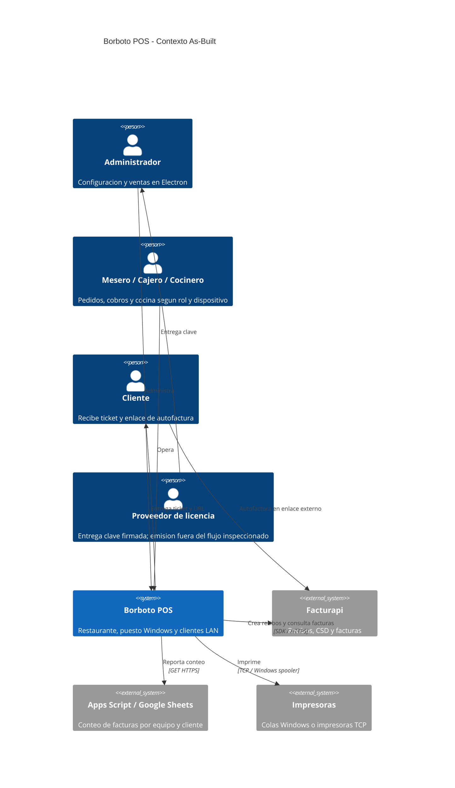
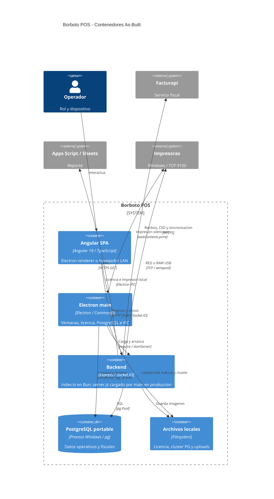

# 01. Arquitectura general (As-Built)

Fecha de inspeccion: 2026-11-09. Alcance: fuentes presentes en el repositorio, no una certificacion de la instalacion ni de sus datos. Las versiones siguientes son declaraciones de los manifiestos, no versiones resueltas de dependencias. Los diagramas describen lo implementado; la propuesta SDD se limita al documento 05.

## Proposito y resumen ejecutivo

Extension offline SDD-024: Electron main posee [electron-dictation.cjs](../../electron-dictation.cjs), que ejecuta exclusivamente [windows-dictation.ps1](../../speech/windows-dictation.ps1) mediante Windows PowerShell sin shell. System.Speech usa el reconocedor espanol instalado en el equipo, sin servicios de red ni persistencia de audio; es un prerrequisito de despliegue, no un motor incluido por Windows en todas sus ediciones. El preload expone solo tres comandos acotados y un evento; el renderer no ejecuta procesos. Cancelacion/recarga/cierre termina el proceso propio. Navegadores conservan Web Speech. No se modifica la persistencia ni el arranque PostgreSQL; instrucciones de provisionamiento en README.

Revision [SDD-024](SDD-024-inventario-almacen-cocina-y-guardia.md), Implementado: inventario independiente del catalogo de venta, API en [inventario.ts](../../backend-borboto/src/modules/inventario.ts) registrada desde index.ts despues de JSON/CORS y antes del middleware general. Todas sus rutas aplican requireAuth y requireRoles propios, incluyendo lecturas; no es una excepcion sin autenticacion. Pool y emisor inyectados permiten pruebas sin cargar initDB ni escuchar puertos. Migracion aditiva [007](../../Database/migrations/007_inventario_almacen.sql), descubierta por el cargador existente y empaquetada con Database; no aplicada en esta entrega. Angular agrega ruta lazy /inventario y pestaña administrativa en Ajustes; no cambia recetas, ventas, IPC o arranque Electron. Invalidacion Socket.IO actualizar_inventario tras commit. Evidencia: 74 pruebas en memoria, tres typechecks y builds Angular/servidor correctos, sin infraestructura activa.

Revision [SDD-099](SDD-099-cierre-integral-arquitectura-y-modulos.md), cierre Implementado: sesiones HMAC y autorizacion HTTP por rol, PIN scrypt mediante [005_pin_hash.sql](../../Database/migrations/005_pin_hash.sql), renderer aislado con [preload.js](../../preload.js), puerto efectivo y uploads en userData con lectura legacy. Migraciones usan client retenido y protegen init destructivo; cluster propio y shutdown compartido con limite 30 s. Cobro/cortes autoritativos, combos atomicos y fiscalidad por identidad. Cierre durable: USB requiere ack de itemIds y fiscal usa [006_intentos_autofactura.sql](../../Database/migrations/006_intentos_autofactura.sql), external_id por pago y reconciliacion sin reemision ambigua. Validado con mocks/tsc, sin servicios o hardware reales; migracion 006 no aplicada aqui.

Borboto POS es un punto de venta para restaurantes: administra mesas, pedidos de mostrador y domicilio, comandas, preparacion en cocina, cobro, clientes y promociones. Incluye configuracion del negocio, colaboradores por PIN, cortes de caja, consulta de ventas, impresoras y recibos de autofacturacion con Facturapi. Electron actua como puesto principal Windows y administra PostgreSQL portable. Los clientes de navegador pueden operar como mesero o cocinero mediante la red local.

Es un monolito de negocio con interfaz Angular y despliegue de escritorio. En produccion Electron carga el backend CommonJS en su propio proceso principal mediante `require`, no mediante un proceso servidor separado. PostgreSQL si es un proceso externo. En desarrollo Angular CLI, Bun y Electron se ejecutan concurrentemente. El backend expone HTTP y Socket.IO; el IPC no transporta las comandas o el SQL, sino funciones locales de Electron.

Fuentes principales: [package.json](../../package.json), [angular.json](../../angular.json), [main.js](../../main.js), [server.js](../../server.js), [backend-borboto/index.ts](../../backend-borboto/index.ts), [db.ts](../../backend-borboto/src/db.ts), [app.config.ts](../../src/app/app.config.ts), [app.routes.ts](../../src/app/app.routes.ts).

## Tech Stack

Reporte Sheets requiere GOOGLE_SHEET_TOKEN configurado en entorno; no hay token secreto embebido como fallback. Sin configuracion falla cerrado, sin enviar conteos falsos.

| Capa | Declarado / utilizado | Funcion actual |
| --- | --- | --- |
| Frontend | Angular core/common/compiler/forms/router/platform-browser/animations 19; CDK y Material 19 | Componentes standalone, formularios reactivos y de plantilla, dialogs, iconos, snackbar |
| Estado y transporte UI | Signals, computed, effect; RxJS; socket.io-client ^4.8.1 | Estado en servicios singleton, HTTP Observable, invalidacion por eventos |
| Lenguaje UI | TypeScript 5.8.3; ES2022; SCSS | Configuracion strict y strictTemplates |
| Arranque UI | zone.js importado en src/main.ts; provideZoneChangeDetection | Coalescencia de eventos; hash routing y precarga PreloadAllModules |
| Escritorio | Electron ^44.5.1; API Node fs/path/crypto/http/net/child_process | Ventanas, licencia, IPC, ciclo de PostgreSQL e impresion silenciosa |
| Backend | Bun 1.3.14 como packageManager raiz; Express ^5.2.1; cors ^2.8.6; dotenv ^17.4.2 | API sin ORM, SQL parametrizado, configuracion de entorno |
| Tiempo real | socket.io ^4.8.3 | Broadcast global de cambios sobre servidor HTTP compartido |
| Persistencia | pg ^8.23.0; PostgreSQL portable Windows | Pools, esquema inicial, migraciones SQL y ampliaciones al arrancar |
| Facturacion | facturapi ^4.20.0; fetch y AbortController | Recibos, certificados CSD, sincronizacion de facturas, reporte a Apps Script/Sheets |
| Archivos | multer ^2.0.2, jimp ^1.6.1, xlsx ^0.18.5 | Imagenes multipart en memoria y conversion PNG; importacion Excel/CSV en UI |
| Impresion | net TCP, Electron webContents.print, PowerShell/C# winspool; pdf-to-printer ^5.8.1 | RED, USB y SIMULACION; tickets de texto 58/80 mm |
| Build | @angular/build y CLI 19; esbuild ^0.28.2; electron-builder ^26.15.3; concurrently ^10.0.5; cross-env ^10.1.0 | Bundle Angular y backend, instalador NSIS x64 |
| Dependencia declarada adicional | sharp ^0.35.4 | Declarada en ambos manifiestos; el procesamiento de imagenes inspeccionado usa Jimp |

[backend-borboto/package.json](../../backend-borboto/package.json) declara ESM, tipos Bun/Node/Express/pg/cors/sharp y TypeScript ^7.0.2 como peer, distinto del 5.8.3 raiz. Jimp y Multer se declaran en la raiz, no en ese manifiesto. `zone.js` y RxJS se importan en las fuentes sin declaracion directa en el manifiesto raiz inspeccionado. No se infiere la version de PostgreSQL de sus carpetas binarias.

## Capas y comunicaciones

- Angular obtiene la API de RuntimeConfigService: override `window.__BORBOTO_RUNTIME_CONFIG__`, o `http://127.0.0.1:3000/api` en Electron, o `${window.location.origin}/api` en navegador. Socket usa reglas equivalentes sin `/api`.
- El backend escucha `PORT` (3000 por defecto) en `0.0.0.0`, permite CORS general y sirve `/uploads`. Si encuentra un build con index, sirve Angular estatico y fallback SPA fuera de `/api` y `/uploads`.
- Electron carga Angular desde archivos en produccion y desde `http://127.0.0.1:4200` en desarrollo. Las rutas Angular usan `#`; las features se cargan con `loadComponent`.
- HTTP realiza lecturas y mutaciones; Socket.IO emite avisos para recargar. No hay rooms por usuario ni comandos de negocio recibidos por socket.
- IPC directo con `window.require('electron')`: licencia, listado de impresoras, impresion y avisos. No existe preload que aisle estas funciones: las ventanas principal y licencia tienen `nodeIntegration: true`, `contextIsolation: false`.
- El backend consulta PostgreSQL por `pg.Pool`. DB_HOST por defecto es 127.0.0.1, DB_PORT 58432 y DB_NAME borboto_pos. Electron espera conexion TCP al puerto, luego el backend ejecuta initDB antes de escuchar.
- Facturapi y Sheets son dependencias externas para tareas fiscales/reportes, no para toda venta local. Fallos de impresion o recibo fiscal no deshacen un cobro ya confirmado.

## C4: Contexto



## C4: Contenedores

Los contenedores representan responsabilidades logicas: backend y main comparten proceso en produccion.



## Estructura comentada

```text
Borboto/
  package.json               Scripts raiz y empaquetado Electron/NSIS
  angular.json               Build, serve, assets, budgets y unit-test
  main.js                    Orquestador Electron, PG, licencia e IPC
  server.js                  Bundle esbuild de index.ts y dependencias
  license.html               Ventana de activacion con ipcRenderer
  licencia_publica.pem       Clave de verificacion, sin documentar su contenido
  tsconfig*.json             Strict TypeScript/Angular y separacion app/spec
  src/
    main.ts                  bootstrapApplication y zone.js
    index.html               Documento host de Angular
    styles.scss              Estilos globales
    app/
      app.*                  Shell, navbar, router y puente de errores
      core/models/           Interfaces de mesa, producto, pago, cocina y zona
      core/services/         HTTP, signals, auth, permisos, tema y runtime
      core/guards/           Guards funcionales auth, role y admin
      core/pipes/            Formato de numero de mesa
      features/              Login, mesas, comanda, cocina, caja, ventas, ajustes
      shared/components/     Navbar y dialogs reutilizables
  public/                    Assets copiados por Angular
  backend-borboto/
    index.ts                 Registro de endpoints, SQL y startServer
    package.json             Desarrollo Bun y dependencias backend
    tsconfig.json            ESM/bundler, strict y noEmit
    src/db.ts                Pools, inicializacion, migraciones y combos
    src/sincronizarFacturas.ts Consulta fiscal y upsert local
    src/services/            Reporte a Google Sheets
    src/modules/printer/     Router, servicio, config declarativa y templates
    postgres-bin/            Binarios PostgreSQL distribuidos
    uploads/productos/       Carpeta presente; la ruta activa depende de cwd
  Database/
    000_init.sql             Esquema completo destructivo si se aplica
    migrations/001..003      Origen, mesa nullable y estado operativo
  dist-electron/             Salidas generadas de empaquetado, no fuente primaria
  docs/especificaciones/     Estos cinco documentos
```

La ruta activa de uploads es `process.cwd()/uploads/productos`, no necesariamente backend-borboto/uploads. El cluster PG es backend-borboto/data-pg en desarrollo y userData/data-pg en produccion. La licencia vive en userData/borboto_license.lic.

## Build y limites de despliegue

`start` ejecuta Bun/Angular serve en 127.0.0.1; `server` ejecuta index.ts; `electron:dev` combina ambos y Electron. `build:server` genera server.js con esbuild target node18 y pg-native externo. `dist` compila Angular, genera el bundle backend y ejecuta electron-builder en produccion. No se modifico ni regenero server.js durante esta inspeccion; sus bloques propios contienen los endpoints y startServer correspondientes a las fuentes revisadas.

Angular produce dist/borboto, con hashing en produccion y budgets de 1/2 MB para initial, 15/30 KB para estilos de componente. NSIS permite elegir carpeta, conserva appData al desinstalar y genera accesos directos. Se empaquetan Database y clave publica como extraFiles y postgres-bin como extraResources; se excluyen backend-borboto y archivos .env del conjunto principal. Las rutas de busqueda de Database y clave deben funcionar en la instalacion concreta; no se verifico un instalador.

No hay evidencia en estos caminos de ORM, microservicios, JWT, control de acceso HTTP, cola durable de impresion, actualizacion automatica activada o validacion continua de licencia por timer. La LAN y los renderers Node habilitados constituyen fronteras de confianza actuales, no garantias de seguridad.