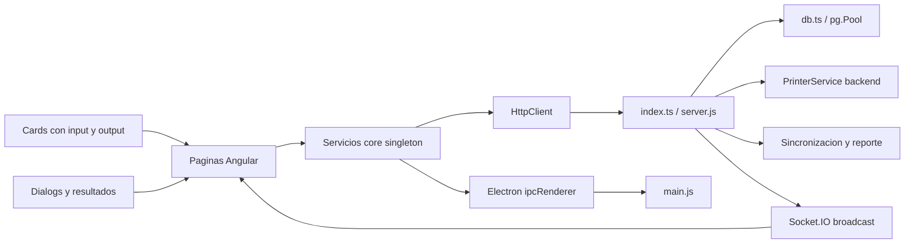

# 02. Especificacion de componentes (As-Built)

Fecha: 2026-11-09. Catalogo de responsabilidades implementadas. E/S significa entradas y salidas observables, incluyendo servicios inyectados, parametros de ruta y resultados de dialogs; no implica que exista un input/output Angular formal. Las rutas de cada fila identifican la fuente. Las dependencias listadas son las funcionales principales; CommonModule, FormsModule y modulos Material actuan como dependencias de presentacion donde se importan.

Revision [SDD-002](SDD-002-integridad-mesa-cobro-y-sockets.md): index.ts bloquea mesas al abrir/mover, convierte 23505 en 409 en esos handlers y adiciones, calcula subtotal/pago/cambio en servidor y valida descuentos/puntos. SocketService retira listeners al desuscribirse. Declaracion local [multer.d.ts](../../backend-borboto/src/multer.d.ts) permite typecheck backend limpio sin cambiar dependencias. Validacion con mocks en memoria, sin PostgreSQL activo.

Revision [SDD-010](SDD-010-kds-entrega-tiempos-y-finalizados.md): KdsCard emite itemToggle numerico con boton nativo y aria-pressed; CocinaService sincroniza agregado y revierte fallo optimista por item, evitando duplicados locales pendientes. GET cocina excluye despachados/servidos y normaliza PENDIENTE/PREPARANDO/LISTO. MesaService.marcarServido y Mesas conectan SERVIR/ENTREGAR por comanda, incluidos externos. GET mesas calcula minutos desde apertura e incluye externas cerradas de hoy; ACTIVOS excluye finalizadas y sus tarjetas no ofrecen mutaciones. Sin migracion ni nueva autorizacion.

Revision [SDD-014](SDD-014-catalogos-mesas-admin-y-seleccion-comanda.md): AjustesService.getAdminMesas usa GET admin/mesas (solo fisicas con zona_id); Ajustes filtra identidades externas y conserva zona al editar. Comanda escucha actualizar_productos y queryParamMap, limpia IDs invalidos y desmonta ruta/socket. ComandaService comparte carga y mapeo tipado con Subscription/token de vigencia; reset/destroy invalidan pendientes y recargas de menu no pisan consumos. CRUD productos publica evento uniforme, PUT/DELETE ausente 404 y desactivacion solo ante FK 23503.

Revision [SDD-009](SDD-009-transferencias-folios-y-direccion-envio.md): trasladarComanda unifica mover por origen, mover legacy y asignar-mesa, con comanda bloqueada antes de mesas ascendentes, validacion destino, rollback y eventos mesas/cocina post-COMMIT. generarFolioOrigen recibe PoolClient y usa advisory lock por tipo mas MAX sufijo diario. CrearEnvioDialog habilita direccion/telefono/notas para cliente existente, persiste cambios antes de close y bloquea confirmaciones durante guardado; fallo notifica sin cerrar.

## Shell y paginas Angular

Revision [SDD-004](SDD-004-proteccion-secretos-y-contratos-admin.md): index.ts devuelve usuarios sin PIN real y keys fiscales enmascaradas/flags; resuelve secretos guardados en POST/test/CSD. Ajustes limpia PIN al editar y permite preservarlo; alta lo exige. ProductoAdmin incluye clave_sat y categorias admiten CAJA, con controles de alta/edicion. Billing usa flags para preservar keys vacias y recarga mascara tras guardar. Pruebas en memoria y typechecks limpios, sin PostgreSQL.

Revision [SDD-003](SDD-003-precuenta-servido-y-ticket-modal.md): generarTemplatePrecuenta e imprimirPrecuenta consultan comanda ABIERTA/items y envian a CAJA sin mutaciones. MesaService ofrece imprimirPrecuenta(Mesa), Mesas procesa USB o TicketModal; servir sincroniza mesa y comandas abiertas con lock/transaccion y dos eventos. Pruebas en memoria, typechecks limpios, bundle regenerado.

| Componente y archivo | Responsabilidad y E/S | Dependencias y estado |
| --- | --- | --- |
| App: [src/app/app.ts](../../src/app/app.ts) | Shell con RouterOutlet/navbar; recibe app-notification, errores globales y consola; emite snackbars | AuthService, NotificationService; title signal y bandera de instalacion del puente; no declara OnPush |
| LoginComponent: [login.ts](../../src/app/features/login/login.ts) | Detecta primer uso, registra ADMIN o autentica PIN, teclado numerico, redireccion segun rol/dispositivo | AuthService, RoleAccessService, Router, NotificationService; signals hasUsers/registerMode y formularios |
| MesasComponent: [mesas.ts](../../src/app/features/mesas/mesas.ts) | Tablero fisico/mostrador/domicilio; recibe acciones de card y actualizar_mesas; abre dialogs, crea pedidos y navega con mesaId/comandaId | MesaService, SocketService, AuthService, Router, MatDialog, NotificationService; vistaEspecial signal y Subscription |
| Comanda: [comanda.ts](../../src/app/features/comanda/comanda.ts) | Lee queryParams, carga consumos y menu, envia solo nuevas adiciones, procesa trabajos USB y muestra ticket fallback | ComandaService, MesaService, AuthService, ActivatedRoute/Router, PrinterService, MatDialog, NotificationService; estado principal en ComandaService |
| Cocina: [cocina.ts](../../src/app/features/cocina/cocina.ts) | Pantalla KDS; carga tickets, escucha actualizar_cocina, permite toggle y despacho | CocinaService y SocketService; Subscription, tickets/filtros en servicio |
| Caja: [caja.ts](../../src/app/features/caja/caja.ts) | Seleccion por comandaId o mesaId, flags fiscales, valida pagoSuficiente, cobra y abre corte/ticket | CajaService, MesaService, AuthService, ruta/router, dialogs, PrinterService y notificaciones; estado compartido en CajaService |
| DashboardComponent: [dashboard.ts](../../src/app/features/dashboard/dashboard.ts) | Estadisticas por fechas, filtros folio/cliente, consulta tickets y reimpresion por pago | HttpClient, RuntimeConfigService, PrinterService, MatDialog, NotificationService; signals data/tickets/cargando/reimprimiendo y campos de filtros |
| AjustesComponent: [ajustes.ts](../../src/app/features/ajustes/ajustes.ts) | CRUD categorias, productos, zonas, mesas, clientes, promociones, empleados, impresoras; datos negocio/transferencia, historial cortes, importacion XLSX/CSV, carga imagen y renovacion de licencia | AjustesService, CajaService, AuthService, HttpClient, PrinterService, RuntimeConfigService, NgZone, NotificationService, XLSX; listas/edicion en signals y objetos mutables de formulario; flags de licencia |
| BillingComponent: [billing-component.ts](../../src/app/features/billing-component/billing-component.ts) | Configura datos fiscales, keys enmascaradas y CSD; prueba con modo/valor o key guardada server-side; guarda FormData y recarga mascara | FormBuilder, Validators, AjustesService, NotificationService; FormGroup, File cer/key, signals probandoConexion/guardando/tieneApiKeyTest/tieneApiKeyLive |
| NotFoundComponent: [not-found.ts](../../src/app/features/not-found/not-found.ts) | Ruta **; devuelve al inicio segun sesion | Router y AuthService; sin almacen de dominio |
| TicketModal: [ticket-modal.ts](../../src/app/features/ticket-modal/ticket-modal.ts) | Visualiza texto de ticket; MAT_DIALOG_DATA DatosDialogTicket; envia a printerName o default del sistema, fallback window.print | MatDialogRef, PrinterService, NotificationService; datos inyectados, no signal propio; no bloquea por ausencia de printerName |

Las paginas no exponen inputs formales. Se encuentran componentes con standalone:true y OnPush, pero no es uniforme: App y TicketModal son ejemplos sin OnPush. No se deduce conformidad AXE/WCAG de estas declaraciones.

## Componentes de mesas y pedidos

| Archivo / componente | Responsabilidad y E/S | Dependencias y estado |
| --- | --- | --- |
| [mesa-card.ts](../../src/app/features/mesas/components/mesa-card/mesa-card.ts), MesaCardComponent | input.required Mesa; output accion {tipo, mesa}; ABRIR, AGREGAR_COMANDA, VER_DETALLE, IMPRIMIR_PRECUENTA, MOVER_MESA, COBRAR, SERVIR; SERVIR visible LISTO PARA SERVIR | Material; deriva badge/origen de la entrada, sin persistencia |
| [mesa-filtros.ts](../../src/app/features/mesas/components/mesa-filtros/mesa-filtros.ts), MesaFiltrosComponent | Cambios de zona/estado actualizan filtros del servicio; no input/output formal | MesaService; zonas computed a partir del estado compartido |
| [abrir-mesa-dialog.ts](../../src/app/features/mesas/components/abrir-mesa-dialog/abrir-mesa-dialog.ts), AbrirMesaDialogComponent | MAT_DIALOG_DATA DialogDataAbrirMesa; seleccion manual/stepper de comensales; devuelve resultado de apertura con comensales | MatDialogRef, Material; comensales y modoManual signals; no ejecuta SQL |
| [mover-mesa-dialog.ts](../../src/app/features/mesas/components/mover-mesa-dialog/mover-mesa-dialog.ts), MoverMesaDialogComponent | Datos {mesaOrigen, mesasLibres}; devuelve {confirmado:true, destinoId} o cierre sin resultado | MatDialogRef, MAT_DIALOG_DATA, FormsModule; mesaDestinoId mutable |
| [desglose-mesa-dialog.ts](../../src/app/features/mesas/components/desglose-mesa-dialog/desglose-mesa-dialog.ts), DesgloseMesaDialogComponent | Datos {mesa}; carga items/total por comanda o mesa; solicita motivo, cancela y cierra | ComandaService, MesaService, AuthService, MatDialog, NotificationService; signals items/total/comandaId/cargando |
| [crear-mostrador-dialog.ts](../../src/app/features/mesas/components/crear-mostrador-dialog/crear-mostrador-dialog.ts), CrearMostradorDialogComponent | Selecciona cliente o crea uno; devuelve confirmado, clienteId y nombre; Mesas crea la comanda despues | AjustesService, MatDialogRef, NotificationService; clientes/busquedaCliente signals, clientesFiltrados computed y campos de cliente |
| [crear-envio-dialog.ts](../../src/app/features/mesas/components/crear-envio-dialog/crear-envio-dialog.ts), CrearEnvioDialogComponent | Seleccion/alta de cliente; contacto existente editable y PUT previo si cambia; devuelve confirmado/clienteId solo tras persistir, fallo sin close | AjustesService, MatDialogRef, NotificationService; clientes/busqueda/guardando signals; confirma sin duplicados locales, conserva otros datos del cliente |

IMPRIMIR_PRECUENTA invoca MesaService.imprimirPrecuenta, por comandaId si existe o por mesa fisica. Mesas envia trabajos USB con PrinterService y abre TicketModal para texto fallback/simulacion o trabajo USB fallido. No cierra comanda ni marca flags de cocina.

## Componentes de comanda, cocina y caja

| Archivo / componente | Responsabilidad y E/S | Dependencias y estado |
| --- | --- | --- |
| [menu-productos.ts](../../src/app/features/comanda/components/menu-productos/menu-productos.ts), MenuProductosComponent | Seleccion de categoria, URL de imagen y agregar producto; E/S mediante servicio | ComandaService y Material; productos/filtros en servicio |
| [orden-resumen.ts](../../src/app/features/comanda/components/orden-resumen/orden-resumen.ts), OrdenResumenComponent | Muestra guardados/nuevos, cambia notas por indice y emite confirmarComanda:void | ComandaService; no almacen separado |
| [kds-card.ts](../../src/app/features/cocina/components/kds-card/kds-card.ts), KdsCardComponent | input.required TicketCocina, input itemsPendientes, outputs ticketListo:void e itemToggle:number; botones por item clic/Enter/Espacio y aria-pressed; despacho habilitado aunque todos listos, bloqueado durante toggle pendiente | Material; deriva de ticket, no consulta HTTP |
| [desglose-cuenta.ts](../../src/app/features/caja/components/desglose-cuenta/desglose-cuenta.ts), DesgloseCuentaComponent | Muestra cuenta; seleccion/alta rapida de cliente, cupon y canje de puntos; actualiza estado de caja y vincula cliente | CajaService, AjustesService, MatDialog, NotificationService; codigoPromo/clientes/busqueda/puntosAUsarInput signals y computed de filtrado/encabezado |
| [calculadora-pago.ts](../../src/app/features/caja/components/calculadora-pago/calculadora-pago.ts), CalculadoraPagoComponent | Selecciona metodo, monto, billetes rapidos y numero de partes; abre datos de transferencia | CajaService, MatDialog; importes/cambio en servicio, billetesRapidos constantes |
| [corte-caja-dialog.ts](../../src/app/features/caja/components/corte-caja-dialog/corte-caja-dialog.ts), CorteCajaDialog | Consulta corte del usuario, cuenta efectivo/fondo/notas, guarda y cierra true/false | CajaService, AuthService, NotificationService, Router, MatDialogRef; signals cargando/guardando/importes/notas y computed efectivoEsperado/diferencia |
| [datos-transferencia-dialog.ts](../../src/app/features/caja/components/datos-transferencia-dialog/datos-transferencia-dialog.ts), DatosTransferenciaDialogComponent | Consulta y muestra datos bancarios; cierra sin payload | AjustesService y MatDialogRef; signals datos/cargando |
| [ticket-cobro-dialog.ts](../../src/app/features/caja/components/ticket-cobro-dialog/ticket-cobro-dialog.ts), TicketCobroDialog | Datos {transaccion:TransaccionPago}; carga negocio, window.print y cierre true | AjustesService, MAT_DIALOG_DATA/MatDialogRef; negocio signal. Existe en fuentes; Caja actual abre TicketModal, no este dialog |

## Shared

| Archivo / componente | Responsabilidad y E/S | Dependencias y estado |
| --- | --- | --- |
| [navbar-component.ts](../../src/app/shared/components/navbar-component/navbar-component.ts), NavbarComponent | Navegacion permitida por rol/dispositivo, tema, cambio de turno y cierre de sesion | AuthService, RoleAccessService, ThemeService, MatDialog, Router; estado derivado de servicios |
| [cambiar-turno-dialog.ts](../../src/app/shared/components/cambiar-turno-dialog/cambiar-turno-dialog.ts), CambiarTurnoDialogComponent | Teclado PIN; login reemplaza sesion activa; close true/false | AuthService, NotificationService, MatDialogRef; pinText signal |
| [cancel-comanda-dialog.ts](../../src/app/shared/components/cancel-comanda-dialog/cancel-comanda-dialog.ts), CancelComandaDialogComponent | Recoge motivo; devuelve string o undefined; fallback Sin motivo especificado | MatDialogRef y FormsModule; motivo mutable |
| [quick-client-dialog.ts](../../src/app/shared/components/quick-client-dialog/quick-client-dialog.ts), QuickClientDialogComponent | Datos opcionales para prefijar nombre; devuelve QuickClientDialogResult con nombre/telefono/direccion/email | MAT_DIALOG_DATA opcional, MatDialogRef; campos locales, caller persiste el cliente |

## Servicios, guards y pipe Angular

Prefijo de archivos: src/app/core/services. Todos los servicios siguientes declaran providedIn:root.

| Fuente | Responsabilidad, E/S y dependencias | Estado |
| --- | --- | --- |
| [runtime-config.service.ts](../../src/app/core/services/runtime-config.service.ts) | Decide isElectron/isBrowserClient y URLs desde Window/location/override | Getters, sin cache ni signal |
| [auth.service.ts](../../src/app/core/services/auth.service.ts) | Usuarios, registro/login/CRUD; HttpClient y Router; Observable Usuario | usuarioActivo signal, estaAutenticado computed, localStorage borboto_pos_usuario |
| [role-access.service.ts](../../src/app/core/services/role-access.service.ts) | Matriz por rol/dispositivo, menus y ruta inicial; AuthService y RuntimeConfigService | navItems constantes; visibleNavItems computed |
| [mesa.ts](../../src/app/core/services/mesa.ts) | Carga/normaliza tablero, zonas, abrir/mover/asignar, mostrador/envio, cancelar y marcarServido(Mesa) por comanda o mesa legacy; HTTP + runtime | mesas/zonas/mesaActiva y filtros signals; ACTIVOS excluye DISPONIBLE, DISPONIBLE muestra finalizadas, TODOS incluye ambas |
| [comanda.ts](../../src/app/core/services/comanda.ts) | Menu cancelable, carga compartida por mesa/comanda y mapeo tipado NUMERIC, borrador, notas y envio; HTTP + runtime | Signals de productos/consumos/origen; Subscription y tokens independientes de seleccion/menu; limpiarComanda y cancelarCargas invalidan respuestas antiguas |
| [cocina.ts](../../src/app/core/services/cocina.ts) | GET KDS, despacho y toggle HTTP; runtime | tickets/filtroEstado/itemsPendientes signals; agregado PENDIENTE/PREPARANDO/LISTO; rollback por item ante fallo, sin borrar cambios de otros items |
| [caja-service.ts](../../src/app/core/services/caja-service.ts) | Cuentas, cobro, cliente, cupon, puntos y cortes; HTTP + runtime | Signals de origen/cuenta/cliente/metodo/partes/fiscal; cambio, pagoSuficiente, totalPorPersona computed; limpiarSeleccion resetea |
| [ajustes.service.ts](../../src/app/core/services/ajustes.service.ts) | Fachada CRUD administrativo y configuracion fiscal/FormData; getAdminMesas usa DTO fisico con zona_id en /admin/mesas; HTTP + runtime; Observable DTO | Sin cache de dominio |
| [printer.service.ts](../../src/app/core/services/printer.service.ts) | CRUD/prueba HTTP, get-system-printers IPC, trabajos USB; RAW HTTP con fallback IPC para termica con corte | Sin cola durable; Promises/Observables por solicitud |
| [socket.service.ts](../../src/app/core/services/socket.service.ts) | Crea socket.io-client desde runtime; onEvent devuelve Observable | Socket singleton; callback retenido por suscripcion; teardown invoca off(eventName,handler) al unsubscribe |
| [notification.service.ts](../../src/app/core/services/notification.service.ts) | Snackbars success/info/warning/error y confirmAction callback | Map de deduplicacion 2.5 s; normaliza texto a 220 caracteres |
| [theme.service.ts](../../src/app/core/services/theme.service.ts) | Tema claro/oscuro, inicial desde storage/SO; effect sobre DOM/storage | temaActual signal y esOscuro computed |

[auth.guard.ts](../../src/app/core/guards/auth.guard.ts) protege sesion Angular; [role.guard.ts](../../src/app/core/guards/role.guard.ts) consulta permisos por ruta; [admin.guard.ts](../../src/app/core/guards/admin.guard.ts) existe pero app.routes usa auth/role. [formato-numero-mesa.pipe.ts](../../src/app/core/pipes/formato-numero-mesa.pipe.ts) presenta el numero/origen de mesa sin persistencia. Ninguno implementa autorizacion del servidor HTTP.

## Backend

| Modulo / fuente | Responsabilidad y E/S | Dependencias y estado |
| --- | --- | --- |
| [backend-borboto/index.ts](../../backend-borboto/index.ts) | app Express, HTTP server y io; endpoints del documento 03; emitirCambioGlobal; resolver origen/folio/cuenta; startServer y senales de apagado | express/cors/dotenv/multer/Jimp/fs/path/Facturapi, db, printer, sync y reporte; app/server/io en memoria, datos en SQL, uploads en cwd |
| [db.ts](../../backend-borboto/src/db.ts) | Exporta pool, initDB y sincronizarCombosComoProductos; crea BD/esquema, registra versiones y materializa combos como productos | pg, dotenv, fs/path; pool global y pools temporales; schema_migrations y SQL como estado persistente |
| [sincronizarFacturas.ts](../../backend-borboto/src/sincronizarFacturas.ts) | obtenerVencimientoLicencia y realizarSincronizacionFacturas; devuelve {ok,total,error?}; paginas de 50 y upsert por uuid_sat | Facturapi, pool, fs/path/os; estado local por ejecucion, facturas/tickets persistentes |
| [reporteFacturas.service.ts](../../backend-borboto/src/services/reporteFacturas.service.ts) | Hardware ID, nombre, conteo y GET Sheets; {success,url,status,data,error?} | pool, fs/path/os/crypto, execSync, fetch/AbortController; env/licencia como entrada, sin cola/reintento persistente |
| [printer.routes.ts](../../backend-borboto/src/modules/printer/printer.routes.ts) | Router /api/impresoras: CRUD, test, RAW USB; system responde 410 | Router, pool y PrinterService; persistencia impresoras |
| [printer.service.ts](../../backend-borboto/src/modules/printer/printer.service.ts) | Clase estatica: consulta destinos, templates, TCP, deteccion Windows y RAW winspool; devuelve texto fallback/trabajos Electron | pool, net/fs/path, exec PowerShell, pdf-to-printer, templates; flags impreso/impreso_en y temporales .bin; sin spool propio durable |
| [printer.config.ts](../../backend-borboto/src/modules/printer/printer.config.ts) | ConfigImpresora y CONFIG_IMPRESORAS por env para COCINA/BARRA/CAJA | Objeto constante; no importado por la ruta activa del servicio, que consulta BD |
| [ticket-templates.ts](../../backend-borboto/src/modules/printer/templates/ticket-templates.ts) | Funciones generarTemplateProduccion/generarTemplateCobro; DTO de empresa/comanda/cobro/items; salida string | Transformaciones de texto por AnchoPapel y formato; no estado compartido |

## Procesos Electron y bundle

| Fuente / funcion | Entrada y salida | Estado / dependencias |
| --- | --- | --- |
| [main.js](../../main.js): setupAndStartPostgres, waitForPostgres, stopPostgres | Env, bin/data paths; initdb/pg_ctl y sondeo TCP con timeout 15 s | fs, execSync, net; cluster y logfile; taskkill global postgres.exe al iniciar |
| main.js: validarLicencia, getHardwareId, getPublicKeyPath | Clave payloadBase64.firmaBase64, PEM y hardware; {valida,motivo,payload?,vencida?} | crypto SHA256, WMIC o hash MD5 fallback; licencia guardada en userData |
| main.js: solicitarLicencia, createMainWindow, iniciarSistemaCompleto | Estado licencia y entorno; ventanas licencia/Angular, inicio condicionado, cierre ante fallo | mainWindow/licenseWindow/expressServer globales; BrowserWindow, HTTP, app |
| main.js: startBackendServer | En produccion require server.js y await startServer; devuelve listener retenido | Backend dentro de main; desarrollo no lo inicia desde esta funcion |
| main.js: getSystemPrintersFromElectron, printTicketSilently, buildTicketHtml | Nombre, contenido, titulo y ancho; lista de colas o {ok:true}; HTML escapado | Ventana de impresion oculta temporal; webContents.getPrintersAsync/print; cierre finally |
| main.js: puentes de consola/errores | Warn/error, rechazo de Promise y fallos de renderer/subproceso; app-notification | Deduplicacion Map; solo ventana principal disponible recibe avisos |
| [server.js](../../server.js) | Bundle generado con exports startServer/emitirCambioGlobal; ejecucion directa usa require.main | Mismos modulos propios de backend y dependencias empaquetadas; no fuente para edicion manual |
| [license.html](../../license.html) | init-license-view; textarea; submit-license-key y respuesta | DOM local y ipcRenderer; muestra hardware/error, valida clave no vacia |

## Relacion funcional

Los archivos spec.ts vecinos son pruebas, no componentes productivos adicionales. El catalogo enumera tambien componentes presentes sin conexion a la ruta principal; presencia en fuente no equivale a uso activo.