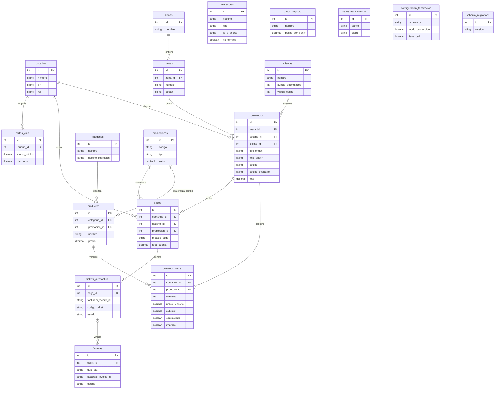
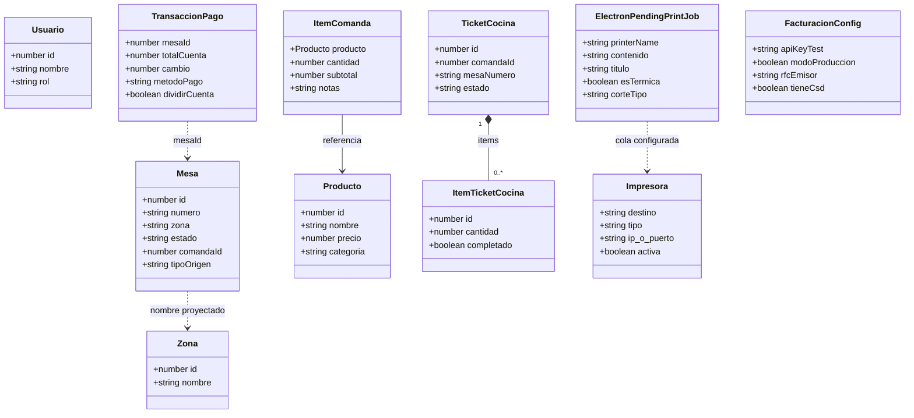

# 03. Contratos y datos (As-Built)

Fecha: 2026-11-09. Fuentes de verdad: [000_init.sql](../../Database/000_init.sql), [migraciones](../../Database/migrations/001_add_comanda_origen.sql), [db.ts](../../backend-borboto/src/db.ts), [index.ts](../../backend-borboto/index.ts), [printer.routes.ts](../../backend-borboto/src/modules/printer/printer.routes.ts) y [main.js](../../main.js). No existe OpenAPI ni esquema de validacion runtime central en estos caminos. Los contratos siguientes transcriben handlers, no una API propuesta.

Revision SDD-001 implementada el 2026-11-09: rollback seguro de cancelacion, bloqueo/verificacion de estado del cobro y subtotal real de items. [Especificacion y evidencia](SDD-001-estabilizacion-comandas-cobro.md). Bundle server.js regenerado con build:server; no hay migracion SQL ni cambios Angular.

Revision [SDD-002](SDD-002-integridad-mesa-cobro-y-sockets.md): indice unico parcial en esquema inicial y [004](../../Database/migrations/004_unique_open_comanda_per_mesa.sql); lock de mesas, calculo financiero en servidor y teardown Socket. SQL 004 no ejecutado: garantia de BD requiere su aplicacion en despliegue. Typechecks backend/Angular limpios y bundle regenerado; pruebas con mocks, sin PostgreSQL.

## Esquema SQL

Revision [SDD-004](SDD-004-proteccion-secretos-y-contratos-admin.md): sin migracion; respuestas de usuarios omiten PIN real y configuracion fiscal solo devuelve mascaras/flags. Campos destino_impresion y clave_sat ahora completos en CRUD administrativo y formularios. Secrets siguen almacenados en BD; no se implementa hashing/cifrado ni autorizacion.

Revision [SDD-003](SDD-003-precuenta-servido-y-ticket-modal.md): sin cambios de esquema; precuenta solo lee y servir sincroniza estado_operativo de comandas abiertas. Template DatosPrecuenta extiende DatosComandaProduccion con datosEmpresa y total calculado desde items; PrecuentaError expone status 400/404. Bundle actualizado y pruebas en memoria sin PostgreSQL.

El SQL inicial establece timezone America/Mexico_City, elimina tablas/tipos anteriores con CASCADE y crea 18 tablas contando schema_migrations. No contiene usuarios o configuracion de negocio sembrados. PK id es SERIAL salvo datos_negocio/datos_transferencia (INT); FK y nulabilidad indicadas abajo. `?` significa columna nullable; los DEFAULT no implican NOT NULL. Importes son NUMERIC(10,2), fechas TIMESTAMP sin zona y creado_en suele tener CURRENT_TIMESTAMP.

| Tabla | Columnas y restricciones principales |
| --- | --- |
| schema_migrations | id PK; version VARCHAR(150) NOT NULL UNIQUE; ejecutado_en? TIMESTAMP DEFAULT CURRENT_TIMESTAMP |
| usuarios | id PK; nombre VARCHAR(100) NOT NULL; pin VARCHAR(6) NOT NULL UNIQUE; rol enum NOT NULL DEFAULT MESERO; activo? BOOLEAN DEFAULT true; creado_en? |
| datos_negocio | id INT PK; nombre VARCHAR(100) NOT NULL; rfc? VARCHAR(20), telefono? VARCHAR(20), direccion? TEXT, email? VARCHAR(100), mensaje_recibo? TEXT; visitas_requeridas_frecuente? INT DEFAULT 5; puntos_por_cada_diez_pesos? INT DEFAULT 1; pesos_por_punto? NUMERIC DEFAULT 1 |
| datos_transferencia | id INT PK; banco/titular VARCHAR(100) NOT NULL; clabe VARCHAR(20) NOT NULL; email? VARCHAR(100) |
| clientes | id PK; nombre VARCHAR(100) NOT NULL; telefono?, direccion?, email?, notas?; puntos_acumulados? INT DEFAULT 0; es_frecuente? BOOLEAN DEFAULT false; visitas_count? INT DEFAULT 0; creado_en? |
| zonas | id PK; nombre VARCHAR(50) NOT NULL UNIQUE |
| mesas | id PK; numero VARCHAR(50) NOT NULL; zona_id NOT NULL FK zonas RESTRICT; capacidad? INT DEFAULT 4; estado? enum DEFAULT DISPONIBLE; comensales?/minutos_abierta? INT DEFAULT 0; creado_en?; UNIQUE(numero,zona_id) |
| categorias | id PK; nombre VARCHAR(50) NOT NULL UNIQUE; icono? VARCHAR(30) DEFAULT restaurant; orden? INT DEFAULT 0; clave_sat? VARCHAR(10); destino_impresion enum NOT NULL DEFAULT COCINA |
| promociones | id PK; nombre VARCHAR(100) NOT NULL; codigo? VARCHAR(30) UNIQUE; tipo VARCHAR(20) NOT NULL; valor NUMERIC NOT NULL DEFAULT 0; descripcion? TEXT; activo? BOOLEAN DEFAULT true; creado_en? |
| productos | id PK; categoria_id NOT NULL FK categorias RESTRICT; promocion_id? FK promociones SET NULL; nombre VARCHAR(100) NOT NULL; precio NUMERIC NOT NULL CHECK >=0; clave_sat? VARCHAR(10); imagen_url? TEXT; disponible? DEFAULT true; creado_en? |
| comandas | id PK; mesa_id? FK mesas RESTRICT; usuario_id NOT NULL FK usuarios RESTRICT; cliente_id? FK clientes SET NULL; tipo_origen VARCHAR(20) NOT NULL DEFAULT MESA; folio_origen VARCHAR(50) NOT NULL; estado_operativo enum NOT NULL DEFAULT PENDIENTE; estado? enum DEFAULT ABIERTA; total? NUMERIC DEFAULT 0; fecha_apertura? DEFAULT CURRENT_TIMESTAMP; fecha_cierre? |
| comanda_items | id PK; comanda_id NOT NULL FK comandas CASCADE; producto_id NOT NULL FK productos RESTRICT; cantidad INT NOT NULL CHECK >0; precio_unitario NUMERIC NOT NULL; subtotal? NUMERIC GENERATED ALWAYS AS cantidad*precio_unitario STORED; notas? TEXT; estado_kds? enum DEFAULT PENDIENTE; completado?/impreso? DEFAULT false; impreso_en?; creado_en? |
| pagos | id PK; comanda_id/usuario_id NOT NULL FK RESTRICT; promocion_id? FK SET NULL; metodo_pago enum NOT NULL; total_cuenta/monto_recibido NUMERIC NOT NULL; cambio NUMERIC NOT NULL DEFAULT 0; descuento? DEFAULT 0; dividir_cuenta? DEFAULT false; partes_iguales? INT DEFAULT 1; fecha? DEFAULT CURRENT_TIMESTAMP |
| cortes_caja | id PK; usuario_id NOT NULL FK RESTRICT; fecha_apertura?/fecha_cierre? DEFAULT CURRENT_TIMESTAMP; fondo_apertura? NUMERIC DEFAULT 0; efectivo_real/efectivo_calculado/tarjeta_calculado/transferencia_calculado/ventas_totales/diferencia NUMERIC NOT NULL DEFAULT 0; notas? TEXT |
| impresoras | id PK; nombre VARCHAR(100) NOT NULL; destino enum NOT NULL; tipo VARCHAR(20) NOT NULL DEFAULT RED; ip_o_puerto VARCHAR(100) NOT NULL; puerto_tcp? INT DEFAULT 9100; ancho_papel VARCHAR(10) NOT NULL DEFAULT 80mm; es_termica BOOLEAN NOT NULL DEFAULT false; corte_tipo VARCHAR(20) NOT NULL DEFAULT NINGUNO; activa? DEFAULT true; creado_en? |
| configuracion_facturacion | id PK; api_key_test VARCHAR(255) NOT NULL; api_key_live?; modo_produccion? DEFAULT false; rfc_emisor VARCHAR(13), razon_social VARCHAR(255), regimen_fiscal VARCHAR(5), codigo_postal VARCHAR(5) NOT NULL; clave_sat_defecto? VARCHAR(10) DEFAULT 01010101; email_notificaciones?; dias_vigencia_ticket? INT DEFAULT 7; tiene_csd? DEFAULT false; actualizado_en? |
| tickets_autofactura | id PK; pago_id NOT NULL FK pagos RESTRICT; facturapi_receipt_id VARCHAR(100) NOT NULL UNIQUE; codigo_ticket VARCHAR(20) NOT NULL UNIQUE; url_autofactura TEXT NOT NULL; total NUMERIC NOT NULL; estado? enum DEFAULT PENDIENTE; fecha_expiracion TIMESTAMP NOT NULL; creado_en? |
| facturas | id PK; ticket_id? FK tickets_autofactura SET NULL; facturapi_invoice_id? VARCHAR(100) UNIQUE; uuid_sat VARCHAR(36) NOT NULL UNIQUE; rfc_receptor VARCHAR(13), razon_social_receptor VARCHAR(255), regimen_fiscal_receptor VARCHAR(5), codigo_postal_receptor VARCHAR(5), uso_cfdi VARCHAR(5) NOT NULL; total? NUMERIC; estado? VARCHAR(20) DEFAULT active; url_pdf?/url_xml? TEXT; fecha_timbrado? DEFAULT CURRENT_TIMESTAMP |

Enums exactos:

- estado_mesa_enum: DISPONIBLE, PENDIENTE, EN COCINA, LISTO PARA SERVIR, SERVIDO.
- estado_comanda_enum: ABIERTA, CERRADA, CANCELADA.
- estado_item_kds_enum: PENDIENTE, PREPARANDO, LISTO.
- metodo_pago_enum: EFECTIVO, TARJETA, TRANSFERENCIA.
- rol_usuario_enum: ADMIN, MESERO, COCINERO, CAJERO.
- estado_factura_enum: PENDIENTE, TIMBRADA, CANCELADA, ERROR (tickets; facturas.estado es VARCHAR).
- destino_impresion_enum: COCINA, BARRA, CAJA, NINGUNO.

Indices: mesas.estado; comandas.mesa_id parcial ABIERTA (migracion 002 agrega mesa_id IS NOT NULL); comandas(tipo_origen,estado,fecha_apertura DESC); comandas.folio_origen; comandas.estado_operativo (003); comanda_items.completado parcial false; productos.categoria_id; tickets.codigo/estado; facturas.uuid/rfc. SDD-002 agrega idx_comandas_unica_mesa_abierta UNIQUE(mesa_id) WHERE estado='ABIERTA' AND mesa_id IS NOT NULL. 004 bloquea tabla y aborta con 23505 ante duplicados historicos; no cierra comandas automaticamente. Conserva el indice previo no unico y usa IF NOT EXISTS para repeticion segura.

### Evolucion aplicada por initDB

| Fuente | Efecto |
| --- | --- |
| [001_add_comanda_origen.sql](../../Database/migrations/001_add_comanda_origen.sql) | Agrega origen/folio, backfill desde mesa/zona, NOT NULL e indices; Mostrador -> MOSTRADOR, Domicilio -> ENVIO |
| [002_make_comanda_mesa_nullable.sql](../../Database/migrations/002_make_comanda_mesa_nullable.sql) | Quita NOT NULL de mesa_id y recrea indice parcial |
| [003_add_comanda_estado_operativo.sql](../../Database/migrations/003_add_comanda_estado_operativo.sql) | Agrega/backfill estado operativo desde cierre, mesa e items; default, NOT NULL e indice |
| db.ts, DDL al arrancar | Asegura columnas de auditoria facturas, nullable ticket_id, es_termica/corte_tipo en impresoras y FK facturas -> tickets SET NULL |

Los SQL incrementales se ordenan numericamente por nombre y se registran por archivo. El DDL adicional de db.ts no tiene version separada. La fuente define el esquema esperado; no demuestra que una BD existente tenga todas las versiones. La migracion 003 usa UPDATE FROM mesas, por lo que su backfill no debe confundirse con una reconstruccion independiente de datos historicos. Las transacciones de migracion usan query sobre un Pool, no un client retenido como las transacciones de negocio.

## Entidad-relacion

Se muestran todas las tablas y todas las FK; los atributos son una seleccion de claves y campos de dominio, no reemplazan el diccionario anterior. Un vinculo nullable permite cero padres; no se supone una relacion 1:1 por convencion si falta UNIQUE.

## Modelos TypeScript

| Archivo | Interfaces / tipos y estructura |
| --- | --- |
| [core/models/mesa.ts](../../src/app/core/models/mesa.ts) | EstadoMesa agrega LIBRE al enum SQL; Mesa contiene id, numero, zona, capacidad, estado y opcionales mesaId/comandaId, tipoOrigen/folioOrigen, cliente, comensales/minutos/total/mesero/creadoEn |
| [core/models/producto.ts](../../src/app/core/models/producto.ts) | Producto {id,nombre,precio,categoria,icono?,disponible?,imagen_url?}; ItemComanda {producto,cantidad,subtotal,notas?} |
| [core/models/pago.ts](../../src/app/core/models/pago.ts) | MetodoPago; TransaccionPago {mesaId,mesaNumero,totalCuenta,montoRecibido,cambio,metodoPago,dividirCuenta,fecha:Date,id?,origen?,partesIguales?,montoPorPersona?} |
| [core/models/cocina.ts](../../src/app/core/models/cocina.ts) | EstadoTicketCocina PENDIENTE/PREPARANDO/LISTO; ItemTicketCocina {id,nombre,cantidad,notas?,completado}; TicketCocina {id,comandaId,mesaId?,mesaNumero,origen?,mesero,minutosTranscurridos,estado,items} |
| [core/models/zona.ts](../../src/app/core/models/zona.ts) | Zona {id,nombre} |
| [auth.service.ts](../../src/app/core/services/auth.service.ts) | Usuario {id,nombre,rol}; no PIN en sesion de login |
| [ajustes.service.ts](../../src/app/core/services/ajustes.service.ts) | CategoriaAdmin, ProductoAdmin, MesaAdmin, ZonaAdmin; DatosNegocio y DatosTransferencia; Cliente de contacto; Promocion con tipo/valor y alcance opcional; FacturacionConfig camelCase; PruebaConexionPayload {apiKey,isLive} |
| [printer.service.ts UI](../../src/app/core/services/printer.service.ts) | Impresora, WindowsPrinterInfo Electron, ElectronPendingPrintJob; payload de impresion con content/title |
| [dashboard.ts](../../src/app/features/dashboard/dashboard.ts) | ResumenSales, PagoMetodo, CategoriaSale, TicketSale, DashboardData; agregado resumen, pagosMetodo, categorias y tickets |
| Dialogs | DialogDataAbrirMesa; DatosDialogTicket; QuickClientDialogResult; otros MAT_DIALOG_DATA tipados inline, detallados en documento 02 |
| [printer.service.ts backend](../../backend-borboto/src/modules/printer/printer.service.ts) | ImpresoraConfigurada, WindowsPrinterInfo de CIM (no igual al DTO Electron), ElectronPendingPrintJob, UsbRawPrintPayload |
| [ticket-templates.ts](../../backend-borboto/src/modules/printer/templates/ticket-templates.ts) | AnchoPapel, TipoCorte, DatosEmpresaTicket, ItemComandaImpresion, DatosComandaProduccion y DatosTicketCobro |
| [printer.config.ts](../../backend-borboto/src/modules/printer/printer.config.ts) | ConfigImpresora; configuracion declarativa no consumida por el servicio activo |
| Servicios fiscales | LicensePayload {cliente,hardware_id,vencimiento}, declarado localmente en sincronizacion y reporte |

No hay entidad Comanda central compartida ni generacion de tipos desde SQL. Los servicios declaran respuestas inline y usan any en varios caminos. Tipos de Angular no validan JSON recibido.

Son interfaces/DTO, no clases ORM; los atributos opcionales se resumen sin expresar nulabilidad completa en el dibujo.

### Diferencias reales de representacion

- pg devuelve NUMERIC como string salvo casts/normalizacion explicitos. Dashboard usa ::float y varios servicios usan Number/parseFloat; no hay serializador uniforme.
- SDD-001: ambos GET de comandas proyectan `ci.subtotal` generado (cantidad*precio_unitario), agregan `ci.precio_unitario` y mantienen producto.precio como precio unitario historico. ComandaService transforma subtotal con Number y suma lineas sin multiplicarlas de nuevo; desgloses muestran subtotal directamente. Las cabeceras GET caja no contienen items: CajaService los lee desde estos GET de comandas.
- TicketCocina.estado se tipa como estado KDS, pero GET cocina usa comandas.estado_operativo (por ejemplo EN COCINA). `mesaId?:number` tampoco expresa el NULL real de pedidos externos. Mesa agrega LIBRE, ausente en el enum SQL.
- GET mesas proyecta pedidos externos con `id=-comandaId`, `mesaId:null`, numero=folio y zona Mostrador/Domicilio; ese id es sintetico, no una PK de mesas. GET solo incluye pedidos externos ABIERTA, no su historial cerrado.
- Promocion expone aplica_a/categoria_id/producto_id en UI; la tabla y los handlers no almacenan esos campos. Los descuentos de caja se calculan sobre total original, no por esos alcances.
- Cliente UI no declara puntos/visitas/frecuente, aunque SQL los tiene y la cuenta los proyecta con alias clientePuntos/clienteVisitas/clienteEsFrecuente.
- GET mesas usa aliases operativos, mientras MesaAdmin espera zona_id, que esa proyeccion no incluye. Desde SDD-004 CategoriaAdmin admite CAJA y ProductoAdmin incluye clave_sat opcional/nullable; alta y edicion lo persisten y GET admin lo devuelve.

## HTTP: convenciones y catalogo completo

Base habitual `/api` en puerto 3000. Salvo multipart, solicitudes y respuestas son JSON. GET listas devuelven arrays, no envoltorio paginado uniforme. CRUD suele devolver fila para POST/PUT y `{ok:true,mensaje?}` para DELETE; POST crea con 201 salvo operaciones descritas. Errores suelen ser `{error:string}` con 400/401/403/404/409/410/500. Algunos fallos de Multer pasan al manejo predeterminado Express y no garantizan ese JSON. No hay middleware auth para estos endpoints.

Las filas agrupadas enumeran cada metodo expuesto. Los nombres de campos conservan snake_case o camelCase segun handler.

### Autenticacion y catalogos

| Metodo y ruta | Entrada | Salida / comportamiento |
| --- | --- | --- |
| POST /api/auth/login | pin | Usuario {id,nombre,rol}; 401 si PIN incorrecto/inactivo; sin token |
| POST /api/auth/register-first-admin | nombre,pin | Usuario ADMIN, 201; 403 si existe cualquier usuario; 400 si faltan campos |
| GET /api/usuarios | Ninguna | Array id,nombre,rol,activo,pin:'',tienePin:true; nunca PIN real |
| POST /api/usuarios | nombre,pin,rol,activo | id,nombre,rol,activo; exige PIN string 4..6 digitos; 400 invalido, 409 PIN duplicado |
| PUT /api/usuarios/:id | nombre,pin opcional,rol,activo | id,nombre,rol,activo o 404; PIN omitido/vacio conserva por COALESCE, nuevo valida 4..6 digitos; 409 ante 23505 |
| DELETE /api/usuarios/:id | id | Inactiva si tiene comandas, elimina si no; otras FK pueden impedir eliminacion |
| GET /api/productos | Ninguna | Solo disponibles, categoria como nombre, precio e imagen_url |
| GET /api/admin/productos | Ninguna | Todos, categoria_id y categoriaNombre |
| POST /api/productos | categoria_id,nombre,precio,disponible,imagen_url,clave_sat opcional | Fila 201; persiste clave_sat o null |
| PUT /api/productos/:id | mismos campos | Fila; emite PRODUCTO_ACTUALIZADO; no 404 explicito si falta |
| DELETE /api/productos/:id | id | Elimina; si falla intenta disponible=false |
| POST /api/productos/upload | multipart imagen | {url:'/uploads/productos/...png'}; max 10 MB, MIME image/, resize 600x600 |
| POST /api/productos/importar-lote | {productos:[{nombre,precio,categoria?,disponible?,clave_sat?}]} | {ok:true,agregados}, 201; crea categoria faltante; transaccion de lote |
| GET /api/categorias | Ninguna | Filas ordenadas por orden/nombre |
| POST /api/categorias | nombre,icono,orden,destino_impresion opcional | Fila 201; persiste destino o COCINA por default; enum admite CAJA |
| PUT /api/categorias/:id | nombre,icono,orden,destino_impresion | Fila o 404 |
| DELETE /api/categorias/:id | id | 400 si existe cualquier producto asociado |
| GET /api/zonas | Ninguna | Filas ordenadas por id |
| POST /api/zonas | nombre | Fila 201 |
| PUT /api/zonas/:id | nombre | Fila o 404 |
| DELETE /api/zonas/:id | id | 400 si contiene mesas |
| GET /api/clientes | Ninguna | Filas ordenadas por nombre |
| POST /api/clientes | nombre,telefono,direccion,email,notas | Fila 201 |
| PUT /api/clientes/:id | mismos campos | Fila o 404 |
| DELETE /api/clientes/:id | id | Elimina; FK comandas SET NULL |
| GET /api/promociones | Ninguna | Filas por creado_en DESC |
| GET /api/promociones/validar/:codigo | codigo | Promocion activa, busqueda case-insensitive; 404 si no |
| POST /api/promociones | nombre,codigo,tipo,valor,descripcion,activo | Fila 201; sincroniza combos |
| PUT /api/promociones/:id | mismos campos | Fila o 404; sincroniza combos |
| DELETE /api/promociones/:id | id | Elimina y sincroniza combos |

### Mesas, comandas y cocina

| Metodo y ruta | Entrada | Salida / comportamiento |
| --- | --- | --- |
| GET /api/mesas | Ninguna | Array union de mesas fisicas y pedidos externos abiertos; Mesa proyectada |
| POST /api/mesas | numero,zona_id,capacidad | Mesa proyectada 201; estado DISPONIBLE |
| PUT /api/mesas/:id | mismos campos | Fila SQL o 404 |
| DELETE /api/mesas/:id | id | ok; 400 si error de eliminacion/historial |
| POST /api/mesas/:id/abrir | comensales,usuarioId | {ok,comandaId,mesaId,tipoOrigen,folioOrigen}; crea comanda, estado PENDIENTE |
| POST /api/mesas/:origenId/mover | destinoId | {ok,mensaje}; mueve ultima comanda abierta y estado/comensales/minutos |
| POST /api/mesas/mover | origenId,destinoId | {ok}; variante mueve todas ABIERTA de origen, solo cambia estados de mesas |
| POST /api/mesas/:mesaId/servir | Sin cuerpo requerido | {ok,mensaje}; transaccion con lock mesa, mesas.estado y comandas ABIERTA estado_operativo SERVIDO; 404 tras rollback si no existe; emite actualizar_mesas y actualizar_cocina |
| POST /api/comandas/:comandaId/precuenta | ID entero positivo, cuerpo vacio | {ok:true,comandaId,ticketTexto:string o null,impresionesPendientes:array}; 404 sin ABIERTA, 400 sin items/ID invalido, 500 error operativo |
| POST /api/mesas/:mesaId/precuenta | ID entero positivo, cuerpo vacio | Resuelve ABIERTA por mesa y usa misma respuesta/servicio; 404 sin comanda, 400 ID invalido/sin items |
| POST /api/comandas/:comandaId/asignar-mesa | destinoId | {ok,comandaId,mesaId,tipoOrigen,folioOrigen}; solo ABIERTA; 409 si destino tiene otra ABIERTA; preserva origen/folio |
| POST /api/mostrador/crear | usuarioId,clienteId | 201 {ok,mesaId:null,comandaId,numero,tipoOrigen,folioOrigen}; folio M-n del dia |
| POST /api/envios/crear | usuarioId,clienteId | Igual con ENVIO y folio E-n |
| GET /api/comandas/activa/:mesaId | mesaId | {comandaId,mesaId,total,tipoOrigen,folioOrigen,estadoOperativo,items}; sin activa: id 0, total 0 e items [] |
| GET /api/comandas/:comandaId | comandaId | Cuenta/origen/estado/cliente e items; 404 si no existe |
| POST /api/comandas | comandaId o mesaId, usuarioId, items:[{productoId o producto.id,cantidad,notas}]; precio cliente ignorado | {ok,totalAdicional,comandaId,ticketTexto,impresionesPendientes}; FOR UPDATE y solo ABIERTA; precio de catalogo incluido cero; 400 datos invalidos/producto ausente, 404 comanda ausente, 409 estado terminal/producto no disponible |
| POST /api/comandas/:comandaId/cancelar | notas | {ok,mensaje}; solo ABIERTA; cancela, libera mesa y completa items con motivo; 404/400 ejecutan ROLLBACK antes de responder |
| PATCH /api/comandas/:comandaId/cliente | clienteId o null | {ok,cliente:{id,nombre,clientePuntos,clienteEsFrecuente,clienteVisitas} o null}; solo ABIERTA |
| GET /api/cocina/tickets | Ninguna | Tickets de comandas ABIERTA con items; estado operativo y items con estado_kds/completado |
| PATCH /api/cocina/items/:itemId/toggle | Sin cuerpo requerido | {ok}; bloquea comanda e item en transaccion; invierte completado, no estado_kds; 404 ausente, 409 no ABIERTA con ROLLBACK |
| POST /api/cocina/tickets/:comandaId/despachar | Sin cuerpo requerido | {ok}; bloquea comanda; 404 ausente, 409 no ABIERTA con ROLLBACK; todos items LISTO/completado, comanda/mesa LISTO PARA SERVIR; eventos post-COMMIT |

### Caja, ventas, ajustes y fiscal

| Metodo y ruta | Entrada | Salida / comportamiento |
| --- | --- | --- |
| GET /api/caja/mesa/:mesaId | mesaId | Cuenta activa y datos cliente; 404 si no hay |
| GET /api/caja/comanda/:comandaId | comandaId | Cuenta si ABIERTA; 404 en otro caso |
| POST /api/caja/cobrar | comandaId,mesaId,usuarioId,metodoPago,totalCuenta,montoRecibido,cambio,dividirCuenta,partesIguales,descuento,promocionId,puntosCanjeados,solicitaFactura,agruparConsumo | {ok,ticketId,comandaId,mesaId,tipoOrigen,folioOrigen,autofactura,ticketTexto,impresionesPendientes,errorFacturapi}; ticketId es pago.id; 404 Comanda no encontrada; 409 La comanda ya fue cobrada o cancelada |
| GET /api/caja/corte/actual/:usuarioId | usuarioId | {ok,fechaUltimoCorte,pagosCount,efectivoCalculado,tarjetaCalculado,transferenciaCalculado,ventasTotales,pagos}; pagos posteriores al ultimo corte de ese usuario |
| POST /api/caja/corte | usuarioId,fechaApertura,fondoApertura,efectivoReal,efectivoCalculado,tarjetaCalculado,transferenciaCalculado,ventasTotales,diferencia,notas | {ok,corteId}; guarda cifras recibidas y dispara reporte Sheets |
| GET /api/caja/cortes/historial | Ninguna | Array filas corte + usuarioNombre, fecha_cierre DESC |
| GET /api/dashboard/stats | query fechaInicio?,fechaFin? | {resumen:{totalVentas,totalOrdenes,ticketPromedio},pagosMetodo,categorias,tickets}; por defecto hoy, ultimos 15 tickets |
| GET /api/dashboard/tickets | query fechaInicio?,fechaFin?,folio?,cliente? | Array hasta 100; folio pago numerico (400 si no), cliente ILIKE; sin fechas/texto usa hoy |
| POST /api/dashboard/tickets/:pagoId/reprint | pagoId numerico | {ok,ticketId,ticketTexto,impresionesPendientes}; no crea otro pago |
| GET /api/ajustes/negocio | Ninguna | Fila id=1 o {} |
| POST /api/ajustes/negocio | nombre,rfc,telefono,direccion,email,mensaje_recibo,visitas_requeridas_frecuente,puntos_por_cada_diez_pesos,pesos_por_punto | UPSERT id=1, devuelve fila |
| GET /api/ajustes/transferencia | Ninguna | Fila id=1 o {} |
| POST /api/ajustes/transferencia | banco,titular,clabe,email | UPSERT id=1, devuelve fila |
| GET /api/ajustes/facturacion | Ninguna | FacturacionConfig camelCase o null; apiKeyTest/Live enmascaradas, flags tieneApiKeyTest/Live; no devuelve secreto completo ni clave_sat_defecto |
| POST /api/ajustes/facturacion | multipart apiKeyTest,apiKeyLive,modoProduccion,rfcEmisor,razonSocial,regimenFiscal,codigoPostal,emailNotificaciones,csdPassword,diasVigenciaTicket,csdCer?,csdKey? | {ok,mensaje}; sube ambos CSD si hay key activa y guarda id=1 |
| POST /api/ajustes/facturacion/test | apiKey opcional, isLive opcional | {ok,mensaje}; vacio/mascara resuelve key almacenada por modo elegido o guardado; 400 sin key, error generico con status externo o 401 |
| POST /api/ajustes/facturacion/sincronizar | Ninguna | {ok,total,mensaje}; 400 si servicio devuelve ok=false |
| GET /api/licencia/test-sheets | Ninguna | {ok,success,url,status,data,error?}; prueba reporte, no verificacion criptografica de licencia |

### Impresoras y archivos estaticos

| Metodo y ruta | Entrada | Salida |
| --- | --- | --- |
| GET /api/impresoras | Ninguna | Filas configuradas |
| POST /api/impresoras | nombre,destino,tipo,ip_o_puerto,puerto_tcp,ancho_papel,es_termica,corte_tipo,activa | Fila 201; defaults RED/9100/80mm y corte NINGUNO si no termica |
| PUT /api/impresoras/:id | mismos campos | Fila o 404 |
| DELETE /api/impresoras/:id | id | {ok,mensaje} |
| GET /api/impresoras/system | Ninguna | 410 {error}; deteccion movida a Electron IPC |
| POST /api/impresoras/:id/test | id numerico | {ok,mensaje}; 400 con error/ticketTexto si falla o es USB |
| POST /api/impresoras/usb/raw-print | printerName,contenido,anchoPapel?,corteTipo? | {ok,mensaje?}; 400 si faltan nombre/texto; fuera Windows ok=false puede responder 200 |
| GET /uploads/* | ruta relativa | Archivos en cwd/uploads |
| GET archivos Angular / fallback | ruta fuera de /api y /uploads | Estaticos/index solo si frontendDistPath existe |

### Formas relevantes de respuesta

SDD-004: mascara `********` + ultimos cuatro caracteres para keys de longitud>4; keys cortas solo `********`, inexistentes vacio. Guardar campo omitido/vacio/enmascarado (prefijo asterisco/bullet) conserva key privada; nuevo valor reemplaza. Se exige test key inicial, CSD usa key resuelta activa y respuestas POST solo ok/mensaje. Errores de guardado/prueba fiscal no reenvian mensajes externos sensibles. Billing puede guardar test key vacia si flag de almacenada es true y recarga mascara tras exito.

PUT producto recibe clave_sat: omitido conserva; vacio/null limpia; nuevo reemplaza. GET admin incluye clave_sat y los controles de Ajustes lo editan. Sin cambios a otros campos/eventos.

`autofactura` es null o `{codigo,url,expiracion}`. `ticketTexto` puede ser null/ausente/string segun operacion. `impresionesPendientes` contiene `{tipo:'USB',printerName,contenido,titulo,anchoPapel?,esTermica?,corteTipo?}`. No es una cola persistente: el caller Angular la procesa.

Precuenta usa CAJA activa: RED envia texto por transporte existente, USB retorna trabajos pendientes, simulacion/error retorna ticketTexto; sin impresoras produce texto 80mm. No INSERT pagos ni UPDATE comanda/mesa/items/impreso_en. Total suma subtotal de items sin modificar comandas.total. TicketModal sin nombre consulta impresora predeterminada y, sin alternativa o ante fallo, solicita window.print; no cambia IPC ni garantiza entrega fisica.

SDD-002: cobro ignora totalCuenta/cambio cliente, suma COALESCE(SUM(subtotal),0) de items y sincroniza comandas.total si difiere. Descuento manual debe ser finito/no negativo y <=subtotal; promocion activa se calcula por tipo/valor BD; puntos se validan como enteros contra saldo de cliente bloqueado y no se combinan con promocion. Total y cambio se redondean a centavos. EFECTIVO insuficiente para total o cuota proporcional devuelve 400 {error:'Monto recibido insuficiente para cubrir el total de la cuenta'} despues de rollback; cambio de otros metodos es cero. Respuesta exitosa agrega totalCuenta, descuento y cambio autoritativos manteniendo campos previos. Apertura/movimiento bloquean mesas y comprueban destino libre de comanda; conflicto o 23505 en abrir/mover/agregar devuelve 409 {error:'La mesa ya tiene una comanda abierta'} tras rollback. Precios de adiciones y cifras de corte aun proceden del cliente; no hay idempotency key. Division sigue cerrando toda la comanda. Folios M/E usan COUNT+1 diario sin UNIQUE.

SDD-001: POST cobrar ejecuta `SELECT id, mesa_id, estado, total FROM comandas WHERE id = $1 FOR UPDATE` inmediatamente despues de BEGIN. No existe: ROLLBACK y `404 {error:'Comanda no encontrada'}`; estado distinto de ABIERTA: ROLLBACK y `409 {error:'La comanda ya fue cobrada o cancelada'}`. Dos cobros que usan este handler se serializan y el segundo rechaza el estado confirmado; no devuelve replay del pago anterior. No sustituye validacion financiera ni serializa todos los otros endpoints. Cancelacion y cobro intentan rollback en errores precommit, liberan una vez y descartan el client con release(Error) si rollback falla; no intentan rollback tras COMMIT confirmado.

SDD-008 reemplaza la limitacion anterior de precios cliente: POST comandas consulta productos en transaccion y usa exclusivamente su precio, incluyendo 0.00. Valida IDs enteros positivos y cantidades enteras positivas; producto inexistente 400, disponible=false 409. Adicion, cancelacion, KDS y cobro comparten lock de comanda. Cobro libera exclusivamente mesa_id de la fila bloqueada; NULL nunca usa mesaId del body. No introduce idempotency key ni cambia division/corte. Verificacion en [SDD-008](SDD-008-ciclo-atomico-comanda-y-precios.md).

## Socket.IO

Servidor comparte listener HTTP; cors origin '*'. emitirCambioGlobal(evento,data?) hace io.emit a todos. connection/disconnect solo registran logs.

| Evento backend -> UI | Emision y payload | Consumidor observado |
| --- | --- | --- |
| actualizar_mesas | Apertura/movimiento/asignacion, pedidos, comandas, cliente, despacho, cobro y CRUD mesas; normalmente sin payload | MesasComponent recarga HTTP |
| actualizar_cocina | Adiciones, cancelacion, toggle, despacho y cobro; post-COMMIT, sin payload | Cocina recarga HTTP |
| actualizar_productos | Importacion de lote; sin payload | No se observa suscripcion de pantalla equivalente en los caminos revisados |
| PRODUCTO_ACTUALIZADO | PUT producto; fila modificada | Broadcast registrado; no asumir recarga general de todos los catalogos |

No hay garantia de cobertura de todos los CRUD mediante eventos. Desde SDD-002 SocketService.onEvent conserva handler y retorna teardown socket.off(eventName,handler); unsubscribe elimina exactamente ese listener sin afectar otras suscripciones.

## IPC Electron

| Canal | Direccion / estilo | Entrada y salida |
| --- | --- | --- |
| get-hardware-id | renderer -> main, invoke/handle | Sin args -> UUID Windows o MD5 fallback uppercase |
| get-license-status | renderer -> main, invoke/handle | Sin args -> {valida:false,motivo,...} o {valida:true,cliente,vencimiento,diasRestantes} |
| get-system-printers | renderer -> main, invoke/handle | Sin args -> [{name,displayName,description,status,isDefault}]; rechaza si mainWindow no esta disponible |
| print-ticket-silent | renderer -> main, invoke/handle | {printerName,content,title?,anchoPapel?} -> {ok:true}; rechaza por faltantes/fallo; campos extra tipo/ticketData/empresaData no usados por main |
| submit-license-key | renderer -> main, send/on | String firmado -> validacion y escritura; respuesta por reply |
| submit-license-key-response | main -> renderer | {success:true} o {success:false,error} |
| init-license-view | main -> license.html, send/on | {hardwareId,error} al terminar carga de ventana |
| app-notification | main -> Angular, send/on | {level,message}; success/warning/error o info en consumidor |

La licencia es `base64(JSON).firmaBase64`: main verifica SHA256 sobre el texto payloadBase64 con la clave publica, compara hardware_id si existe y evalua vencimiento al final del dia local. El payload utilizado contiene cliente, hardware_id y vencimiento; no hay validador de esquema estricto que obligue todos esos campos. La clave publica existe en la raiz y tambien se busca en resources, tools, cwd y __dirname. No se reproduce contenido PEM ni credenciales en esta especificacion.