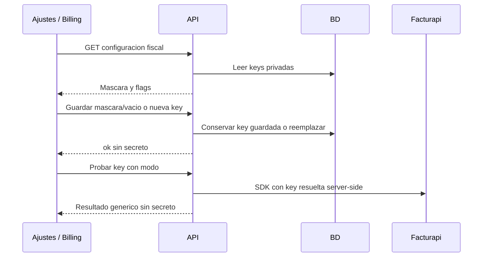
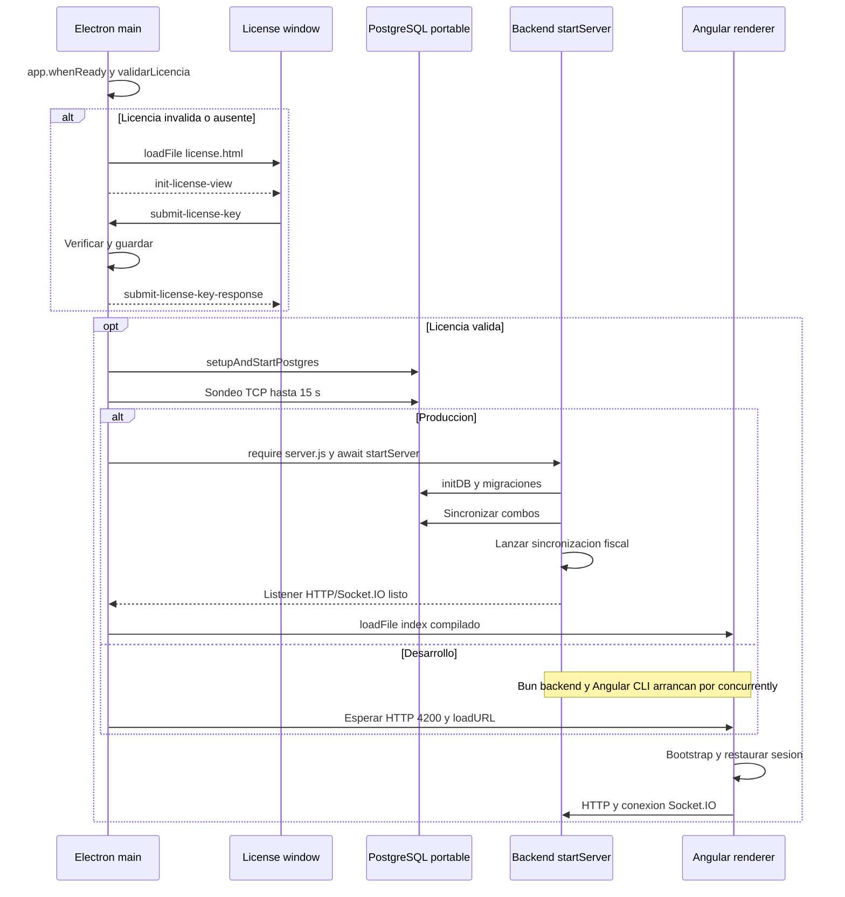
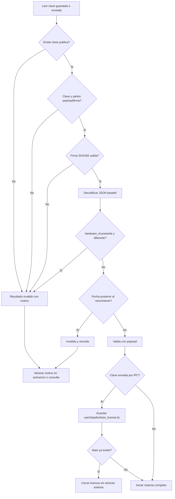
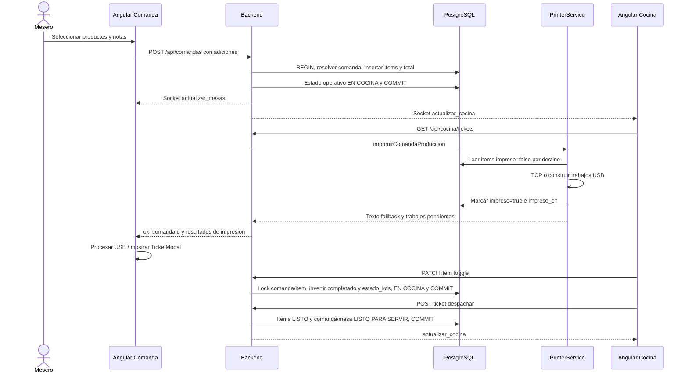
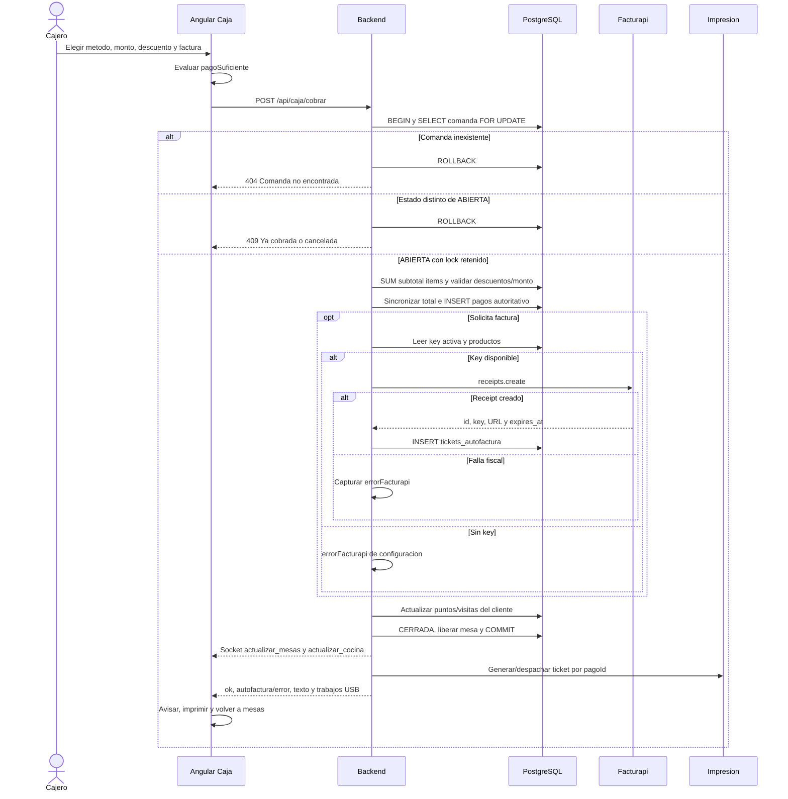
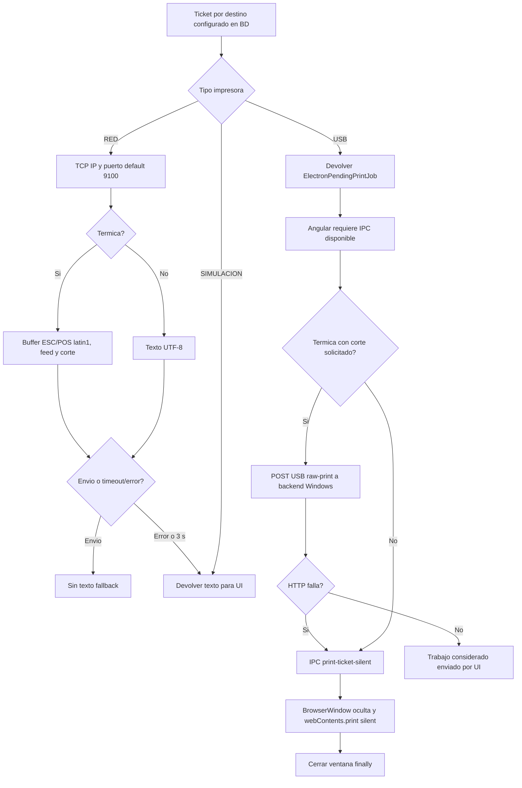
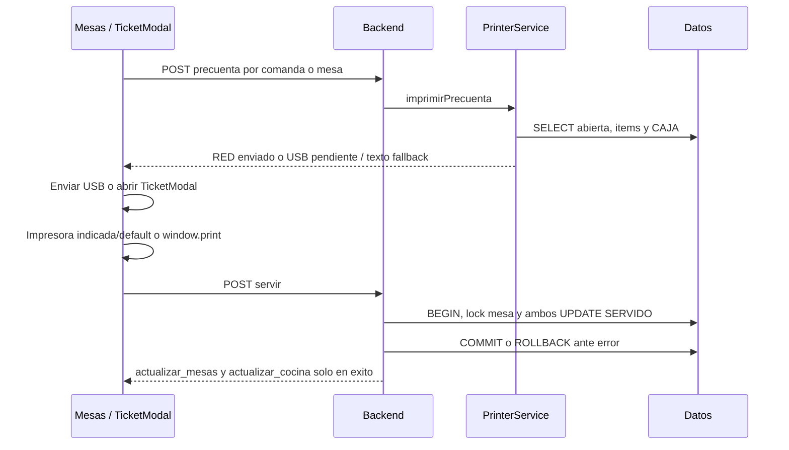

# 04. Flujos y funcionalidad (As-Built)

Fecha: 2026-11-09. Fuentes: [main.js](../../main.js), [license.html](../../license.html), [index.ts](../../backend-borboto/index.ts), [db.ts](../../backend-borboto/src/db.ts) y los servicios/componentes catalogados en [02](02-especificacion-componentes.md). Los diagramas son lectura del codigo, no resultado de una prueba en dispositivos.

Revision [SDD-001](SDD-001-estabilizacion-comandas-cobro.md) implementada: rollback en cancelacion, cobro con FOR UPDATE/estado ABIERTA y subtotal generado en lecturas. Veinticuatro escenarios controlados pasan y server.js fue regenerado; no se ejecutaron pruebas sobre PostgreSQL real ni dispositivos. El typecheck conserva errores previos de declaraciones Multer, sin regresiones semanticas nuevas.

Revision [SDD-002](SDD-002-integridad-mesa-cobro-y-sockets.md) implementada: parte A elimina los errores Multer con declaracion local; backend, Angular y raiz pasan --noEmit con cero errores. Se agregan indice unico 004, apertura/movimiento bloqueados, calculo financiero servidor y teardown Socket. Mocks pg/client/socket y comprobaciones SQL/AST en memoria, sin iniciar ni conectar PostgreSQL/Electron. Bundle regenerado; migracion aun no ejecutada.

### Integridad de mesa y cobro desde SDD-002

Revision [SDD-003](SDD-003-precuenta-servido-y-ticket-modal.md) implementada: precuenta real sin pagos ni flags, SERVIDO sincronizado y fallback TicketModal. Validacion con mocks Node/VM de pg/client/servicios/window, no PostgreSQL/Electron activos. Typechecks backend/Angular/raiz y bundle/sintaxis pasan.

Apertura bloquea SELECT id,estado de mesa FOR UPDATE antes de verificar si tiene ABIERTA; movimiento bloquea origen/destino en orden numerico estable y comprueba destino. Conflicto o unique_violation 23505 en abrir/mover/agregar produce rollback y 409 La mesa ya tiene una comanda abierta. Origen igual a destino se rechaza 400. El indice parcial de 004 impide duplicados por cualquier escritor una vez instalado; si existen duplicados historicos la migracion aborta sin cambiar pedidos.

Cobro, despues del lock de comanda, suma subtotal persistido. Valida descuento manual acotado, promocion activa calculada desde BD o puntos contra saldo del cliente bloqueado; no combina promocion y puntos. Calcula total=max(0,subtotal-descuento) y cambio en centavos; EFECTIVO debe cubrir total o cuota por partes enteras positivas, de lo contrario 400 y rollback. Sincroniza total de comanda antes de guardar pago; devuelve cifras autoritativas adicionales. Un totalCuenta cliente manipulado no gobierna el pago. Consumo fiscal agrupado usa ese total; desglosado por producto conserva la limitacion de conciliacion con descuentos.

Socket conserva callback por suscripcion y unsubscribe retira la misma referencia con off; Mesas/Cocina no acumulan ese listener tras navegar y desuscribirse. Las pruebas de concurrencia simulan el lock; no verifican una instancia PostgreSQL real ni ejecutan migraciones.

## Casos de uso actuales

Revision [SDD-099](SDD-099-cierre-integral-arquitectura-y-modulos.md): division informa aportacion por persona pero el cierre requiere total neto completo; cero tras descuento valido no bloquea Caja. Corte calcula resumen SQL serializado y evita duplicado sin pagos; error de carga bloquea envio. CRUD promos/combos atomico publica catalogo; Dashboard HOY envia ambos limites locales y busqueda libre por folio/cliente no fuerza hoy ni es pisada por stats.

Impresion fallida/ausente no marca items; USB generado conserva false y lleva itemIds. Exito RAW/IPC invoca ack; fallo o ack perdido deja pendientes y Comanda avisa antes de reintentar. Ticket navegador abre ventana dedicada. Pago confirma y libera cliente antes de HTTP fiscal; intento durable guarda solicitud/estado antes de receipts.create con external_id por pago. Fallo INSERT posterior no deshace venta: endpoint o sync buscan receipt remoto y persisten sin otra creacion; si aun no es visible, conflicto recuperable sin reemision. Sesion HMAC/PIN compatibles, bootstrap exclusivo, preload y shutdown compartido se conservan. Cierre SDD-099 Implementado; pruebas solo en memoria.

Revision [SDD-004](SDD-004-proteccion-secretos-y-contratos-admin.md): proteccion de respuestas administrativas, PIN opcional al editar, keys enmascaradas/preservadas y contratos SAT/destino completos. 36 casos con mocks pg/servicios Angular/proveedor y verificaciones de bindings pasan; los tres typechecks y bundle/sintaxis pasan sin instancia PostgreSQL activa.

### Secretos y catalogo desde SDD-004

GET usuarios no proyecta PIN; devuelve pin vacio y tienePin:true. POST exige 4..6 digitos; PUT vacio/omitido conserva PIN, nuevo valido cambia y 23505 devuelve 409. Respuestas de POST/PUT no contienen PIN. Ajustes limpia el campo al editar y permite guardar sin cambiarlo, manteniendo obligatoriedad en alta.

GET fiscal enmascara keys y devuelve flags. POST fiscal lee keys privadas y conserva si request omite/envia vacio/mascara; nuevas keys sustituyen y CSD usa la activa resuelta. POST test selecciona modo por isLive o configuracion guardada, resuelve key privada y no reenvia mensajes de error del proveedor. Billing usa flags para validar alta/edicion, permite prueba con key guardada y recarga mascaras tras guardar. No hay borrado explicito de keys ni control de concurrencia adicional del UPSERT.

Categoria alta persiste destino con default COCINA, tipos/UI incluyen CAJA. Producto alta/edicion/listado admin incluyen clave_sat; PUT omitido conserva y vacio/null limpia. Los formularios mantienen resto de flujos.

| Caso | Actor / condicion | Resultado implementado |
| --- | --- | --- |
| Activar y renovar licencia | Puesto Electron, clave firmada | Verifica firma/equipo/vencimiento; guarda .lic; inicio o renovacion sin recrear main existente |
| Configurar primer administrador | Sin filas usuarios | Registro ADMIN con nombre/PIN, sesion local y navegacion |
| Login, cambio de turno y logout | Usuario activo con PIN | Reemplaza/borra usuario en localStorage; permisos de UI por rol/dispositivo |
| Abrir mesa | Operador autorizado en UI | Comensales, comanda ABIERTA/PENDIENTE y notificacion global |
| Mostrador / domicilio | Cliente seleccionado o creado | Comanda sin mesa, origen/folio diario M-n o E-n; proyeccion en tablero |
| Mover/asignar mesa | Comanda y destino | Traslada mesa asociada; asignacion verifica ABIERTA y conflicto; origen comercial se conserva |
| Registrar consumo | Mesa o comanda seleccionada | Borrador por producto/notas, agrega nuevas lineas, suma total, envia cocina e impresion por destino |
| Preparar/despachar | Cocinero | Toggle completado; despacho pone todos LISTO y pedido LISTO PARA SERVIR |
| Servir | Endpoint existente | Lock de mesa y transaccion; mesa y comandas ABIERTA pasan a SERVIDO; ambos eventos mesas/cocina |
| Precuenta | Accion de mesa/pedido | Texto NO ES COMPROBANTE DE PAGO, total de items y CAJA RED/USB/fallback; sin cerrar comanda ni cambiar flags |
| Detalle/cancelacion | Comanda abierta | Motivo sobre notas, CANCELADA, items completados y mesa liberada |
| Cobrar | ADMIN/CAJERO en Electron por permisos UI | Efectivo/tarjeta/transferencia, descuentos/puntos, metadatos de division, pago y cierre total |
| Autofactura | Solicitud al cobrar y key configurada | Receipt Facturapi, codigo/URL/expiracion; cliente completa proceso fuera del POS |
| Corte de caja | Usuario de caja | Resumen desde ultimo corte por usuario; guarda efectivo/fondo/diferencia y reporte Sheets |
| Ventas y reimpresion | ADMIN Electron | Estadisticas, consulta max 100 tickets y reimpresion por pago |
| Administracion | ADMIN Electron | CRUD, importacion primera hoja XLSX/CSV, imagenes y datos fiscales/negocio/banco |
| Impresoras | Configuracion por destino | RED/USB/SIMULACION, ancho 58/80 mm, termica y corte, prueba |
| Sincronizacion fiscal y reporte | Arranque, endpoint manual, corte/senales | Facturas locales por periodo y conteo enviado a Sheets |

Limites de capacidad: precuenta se imprime o visualiza para impresion manual, pero no garantiza snapshot durante cambios concurrentes ni entrega fisica. No se implementa pasarela de tarjeta, confirmacion bancaria, logistica de reparto ni cobros parciales acumulados. Los filtros de pedidos externos no convierten GET mesas en un historial de pedidos cerrados.

## Arranque y apagado

1. Electron define isDev desde NODE_ENV, rutas, dotenv y handlers IPC/errores.
2. app.whenReady lee userData/borboto_license.lic y valida. Si falla, muestra license.html; no arranca el sistema completo desde esa rama hasta activar.
3. iniciarSistemaCompleto ejecuta setupAndStartPostgres: intenta taskkill /F /IM postgres.exe /T, crea cluster si falta con initdb y archivo temporal de password, elimina pid, intenta stop previo y ejecuta pg_ctl start.
4. Espera conexion TCP 127.0.0.1:DB_PORT, cada 200 ms, timeout 15 s. Esto confirma puerto abierto, no credenciales/esquema.
5. En produccion requiere server.js y espera startServer. En desarrollo no inicia backend desde main: lo ejecuta concurrently via Bun.
6. startServer crea/verifica BD, aplica esquema/migraciones, sincroniza combos, lanza sincronizacion fiscal sin bloquear su termino y escucha en 0.0.0.0. Al escuchar dispara reporte Sheets no bloqueante.
7. Crea ventana principal. Desarrollo espera HTTP 4200 cada 500 ms sin timeout explicito; produccion busca cuatro candidatos index compilado y usa loadFile.
8. Angular importa zone.js, bootstrapApplication(App,appConfig), HttpClient, animaciones, rutas hash y precarga. Sesion se restaura desde localStorage y guards deciden acceso.

did-fail-load vuelve a cargar raiz. En produccion before-input-event bloquea F5 y Ctrl/Cmd+R. Ante fallo de iniciarSistemaCompleto, registra error, intenta notificar (puede no existir mainWindow), cierra listener, detiene PG y termina app. window-all-closed termina salvo macOS; will-quit cierra servidor retenido y detiene PG. Backend SIGINT/SIGTERM espera reporte Sheets, pool.end y process.exit; no es la misma ruta que will-quit de Electron ni garantiza su reporte final.

El cierre forzado global postgres.exe no se limita al cluster Borboto. Las rutas activas dependen de cwd/userData/resources. No se verificaron privilegios, puerto ocupado ni instalacion portable en ejecucion. EADDRINUSE se registra y rechaza: el mensaje de liberar puerto no corresponde a una liberacion implementada.

## Licenciamiento

La verificacion usa [licencia_publica.pem](../../licencia_publica.pem). getPublicKeyPath prueba resources, __dirname, tools y cwd. WMIC csproduct uuid obtiene hardware Windows; si no es util, MD5 uppercase de COMPUTERNAME-USERNAME. validarLicencia divide la clave, verifica SHA256 sobre payloadBase64 y luego decodifica JSON. Si hardware_id existe, compara case-insensitive. Vencimiento se concatena con T23:59:59 y se compara con hora local.

license.html valida texto no vacio y maneja init-license-view/respuesta. Ajustes consulta get-hardware-id/get-license-status y renueva por send/once; usa NgZone para actualizar vista. Fuera Electron, consultarEstadoLicencia muestra datos demo y renovar no usa el canal real; no constituye una licencia valida del backend.

No hay validacion estricta del esquema payload ni timer que cierre ventas al vencer durante una sesion ya abierta. Los servicios fiscales leen el payload local sin verificar firma, y sus rutas de busqueda de .lic son heuristicas APPDATA/home/cwd, distintas de app.getPath(userData). El backend independiente no aplica la compuerta de licencia de Electron.

## Pedido y cocina

Revision UX [SDD-023](SDD-023-filtros-menu-mesas-responsive-y-kds.md): clic en categoria usa change del listbox y signal normalizada; productosFiltrados es computed, Todas restablece lista completa. En Mesas, bajo 1200px el operador cambia entre salon/mostrador/domicilio desde selector superior persistente sin recorrer todas las mesas; desktop muestra ambos paneles. Cards y acciones permiten wrap sin scroll horizontal. KDS no oculta ticket al completar checks: Pendientes de despacho conserva todos los no despachados, En Preparacion conserva PREPARANDO/LISTO, y Listos por Despachar tiene contador. Ultimo check destaca boton y estado listo, pero espera confirmacion HTTP de checks para habilitar despacho; solo despacho exitoso retira tarjeta. Rollback de error HTTP conservado.

Desde [SDD-009](SDD-009-transferencias-folios-y-direccion-envio.md), mover por origen/legacy y asignar-mesa usan trasladarComanda: validar IDs -> BEGIN -> lock comanda -> validar ABIERTA/identidad -> mesas ascendentes FOR UPDATE -> comprobar destino -> trasladar comanda y estado operativo/comensales -> liberar solo origen distinto -> COMMIT -> eventos mesas/cocina. Igualdad devuelve 400, origen sin ABIERTA/comanda o mesa ausente 404, terminal/destino ocupado/23505 409; rechazos de validacion no escriben destino y fallos SQL revierten. Externa sin mesa solo asigna destino, conservando tipo/folio. No fusiona cuentas.

Crear MOSTRADOR/ENVIO usa transaccion existente y advisory lock exclusivo (namespace 9009, claves 1/2) antes de MAX sufijo numerico del dia; COUNT+1 solo fallback sin sufijos. El lock permanece hasta insertar y COMMIT/ROLLBACK. Dialog envio habilita contacto de cliente existente; al cambiar direccion/telefono/notas usa actualizarCliente preservando otros campos, espera exito antes de confirmado/clienteId. Error notifica y deja abierto; guardando evita doble confirmacion. Los datos cambian en el directorio compartido, no en un snapshot del pedido. Si no cambian, confirma sin PUT. Alta nueva conserva flujo.

Desde [SDD-014](SDD-014-catalogos-mesas-admin-y-seleccion-comanda.md), Comanda observa queryParamMap y solo acepta IDs enteros positivos; sin identidad valida limpia comanda/mesa/origen/items guardados y borrador. Las cargas por mesa/ID comparten helper y mapeo tipado de precios/subtotales a number. Antes de cargar se invalida token, cancela Subscription previa y limpia seleccion; respuestas/errores antiguos no pisan la nueva, incluso si llegan despues de unsubscribe. Comanda escucha actualizar_productos y recarga menu automaticamente; recargas tambien cancelan/ignoran anteriores, sin reescribir consumos o borrador. OnDestroy retira listeners de ruta/socket y cancela cargas/seleccion. Error vigente de seleccion limpia estado; error de menu conserva ultimo catalogo.

El borrador de ComandaService distingue itemsGuardados y itemsComanda. Agregar igual producto y notas incrementa cantidad; modificar notas es por indice; enviar manda solo nuevas lineas con productoId, cantidad y precio. Desde SDD-008 POST comandas bloquea la existente con FOR UPDATE y exige ABIERTA (404 ausente, 409 cerrada/cancelada); conserva/reusa la abierta por mesa o crea una. Valida IDs/cantidades enteros positivos y carga precio/disponibilidad de productos dentro de la transaccion; ignora precio cliente, acepta cero, rechaza producto ausente 400/no disponible 409 con rollback. Inserta lineas PENDIENTE y suma totalAdicional; comanda y mesa asociada pasan EN COCINA; eventos tras COMMIT.

Desde SDD-010, cada item KDS usa boton nativo clic/Enter/Espacio y aria-pressed. Toggle optimista actualiza completado/estado_kds y agregado; fallo HTTP restaura item previo sin borrar otros cambios. Una peticion local pendiente bloquea ese item y despacho hasta completar. PENDIENTE significa ninguno listo, PREPARANDO mezcla, LISTO todos; LISTO es filtro visible y permite despacho. El estado operativo de mesa/comanda se mantiene EN COCINA durante preparacion (enum sin PREPARANDO). Locks/404/409 de SDD-008 conservados; eventos cocina/mesas post-COMMIT. GET excluye LISTO PARA SERVIR/SERVIDO para evitar reaparicion tras recarga; adiciones nuevas EN COCINA vuelven a incluir ticket. Minutos calculados desde apertura, minimo 1; avanzan en recargas HTTP, no por contador persistido ni reloj cliente.

Cancelacion solo acepta ABIERTA; pone CANCELADA/fecha_cierre, estado operativo DISPONIBLE, libera mesa, completa items y antepone notas. Desde SDD-001, las respuestas tempranas 404/400 ejecutan ROLLBACK antes de retornar; catch intenta rollback ante error precommit y finally libera una vez. Si rollback falla, release(Error) descarta la conexion en lugar de devolverla reutilizable al pool. Tras COMMIT confirmado no se intenta revertir. El SELECT de cancelacion no toma FOR UPDATE: la serializacion entre cancelacion y cobro no forma parte de esta correccion.

Lecturas de items: GET comanda activa/por ID entrega ci.subtotal (linea completa) y precio_unitario, manteniendo producto.precio unitario. Tres unidades de 12.50 muestran 37.50 tanto en desglose como en totalComanda; Caja carga estos items por separado de su cabecera. No fue necesario modificar servicios o templates Angular.

## Cobro y autofactura

CajaService calcula total original/descuento, cambio y pagoSuficiente; efectivo debe cubrir total o cuota por persona, otros metodos se consideran suficientes si total>0. Cupon porcentaje/monto descuenta sobre original y se limita superiormente a ese subtotal. Canje limita puntos a saldo y ceil(total original), usa 1 punto=$1, limpia promocion y no se acumula como descuento independiente.

Desde SDD-002 el backend calcula total/descuento validado/cambio y comprueba monto recibido; SDD-001 exige ABIERTA bajo FOR UPDATE antes de pagos o efectos fiscales. Dos cobros concurrentes esperan por la misma fila: tras COMMIT del primero, el segundo observa CERRADA y devuelve 409 despues de rollback, sin otro pago/impresion/evento. Inexistente devuelve 404. Errores precommit intentan rollback y descartan conexion si no pueden limpiarla. Idempotencia por estado, no replay ni garantia contra adiciones simultaneas que no toman el lock. Dividir cuenta guarda metadatos y cierra toda la cuenta: no hay saldo parcial persistente. Facturapi se invoca dentro de transaccion SQL, sin compensacion distribuida de receipt externo si falla SQL despues.

SDD-008 sustituye la limitacion anterior sobre adiciones simultaneas: adicion, cancelacion y KDS adquieren el lock comun de comanda antes de escribir. El cobro libera solo mesa_id de la comanda bloqueada; pedidos externos con NULL no liberan una mesa enviada por cliente. Los mocks verifican SQL/orden y rechazos, no el scheduler de PostgreSQL. Ver [SDD-008](SDD-008-ciclo-atomico-comanda-y-precios.md).

Para autofactura: EFECTIVO -> payment_form 01, TARJETA -> 04, TRANSFERENCIA -> 03. agruparConsumo crea un solo concepto CONSUMO DE ALIMENTOS Y BEBIDAS con product_key 90101501, unit_key E48 y precio totalCuenta. Sin agrupar usa lineas por producto y clave producto/categoria/default; el fallback de clave es 90101501, tax_included=true. dias_vigencia_ticket se guarda, pero receipts.create no envia ese parametro: la expiracion local se toma del receipt externo.

Cliente al cobrar: visitas+1; puntos nuevos = floor(totalCuenta/pesosPorPunto)*factorPuntos; resta canje con minimo cero, suma nuevos y marca frecuente al alcanzar visitas requeridas. UI puntosPorGanar usa floor(total/10), y el canje sigue 1 punto=$1; no se debe asumir que reproduce todos los parametros de negocio.

## Impresion

Produccion separa COCINA/BARRA por categorias.destino_impresion; CAJA/NINGUNO no generan esos tickets. Marca todos los items consultados impreso=true incluso si no hay impresora, si el envio devuelve fallback o si USB aun no se confirma. Cobro sin impresoras CAJA genera ticket simulado 80mm. No hay retry persistente ni confirmacion de papel entregado. RAW requiere Windows y usa temporal .bin con PowerShell/C# winspool; la UI solo evalua exito HTTP, no el campo ok=false de un 200. Electron escapa contenido/titulo para HTML; ancho usa 220/300 px, no una garantia fisica del driver.

La prueba HTTP USB se rechaza para usar Electron desde ajustes. GET impresoras/system esta retirado (410). Desde SDD-003 TicketModal usa printerName, o consulta default del sistema, o window.print si no hay default o falla envio/listado. window.print solicita imprimir ventana actual: no confirma impresion ni aisla contenido del resto de la UI. TicketCobroDialog tambien tiene window.print, pero no es el dialog de cobro principal.

### Precuenta y SERVIDO desde SDD-003

Mesas llama precuenta por comanda o mesa fisica; backend valida ABIERTA/items, lee datos de negocio y genera ticket 58/80mm con cantidades/precio unitario/subtotal y suma real. Consulta CAJA activa y usa RED, USB pendiente o texto fallback. No escribe pagos, comanda, mesa ni flags impreso/impreso_en. USB fallido se visualiza tambien para accion manual. Lecturas separadas no son una transaccion snapshot.

Servir adquiere client, BEGIN y SELECT mesa FOR UPDATE. Inexistente -> ROLLBACK/404; existente -> UPDATE mesas SERVIDO y UPDATE comandas ABIERTA estado_operativo SERVIDO, COMMIT, actualizar_mesas y actualizar_cocina. Error precommit intenta rollback, finally libera una vez; si rollback falla descarta con release(Error). No cambia estado_kds/completado ni cierra comanda.

Desde [SDD-010](SDD-010-kds-entrega-tiempos-y-finalizados.md), MesaCard ofrece SERVIR cuando LISTO PARA SERVIR y las tarjetas MOSTRADOR/ENVIO ofrecen ENTREGAR. Mesas.onAccionMesa llama MesaService.marcarServido(Mesa), POST por comanda cuando hay comandaId; ruta fisica se conserva como fallback legacy. La nueva ruta bloquea comanda, exige existencia 404 y ABIERTA 409, actualiza SERVIDO y solo mesa_id persistida no NULL, COMMIT y ambos eventos. UI notifica exito/error y recarga mesas; pedido queda abierto para cobrar. GET mesas incluye externas CERRADA cuya fecha_cierre es de hoy servidor, estado DISPONIBLE y minutos 0; ACTIVOS las oculta, DISPONIBLE muestra Cobrados/Finalizados, TODOS muestra ambas. Tarjetas finalizadas no ofrecen editar/mover/cobrar. No incluye canceladas ni historico anterior a hoy.

## Sincronizacion fiscal, reporte y administracion

[sincronizarFacturas.ts](../../backend-borboto/src/sincronizarFacturas.ts) selecciona key segun modo, pagina invoices.list de 50 y filtra fechas: por defecto ultimo ano hasta hoy; si hay vencimiento, inicio un ano antes de vencer y fin min(hoy,vencimiento). Vincula ticket por receipt, monto PENDIENTE, external_id y metadatos/codigos/pago. Upsert uuid_sat conserva ticket previo si nuevo es null. Sin UUID usa DRAFT_id; estado ticket pasa CANCELADA para canceled y TIMBRADA en otro caso. Construye URLs PDF/XML de dashboard Facturapi; no descarga archivos al filesystem.

[reporteFacturas.service.ts](../../backend-borboto/src/services/reporteFacturas.service.ts) cuenta todas las filas de facturas, no solo activas ni un periodo. Resuelve hardware/nombre desde env, licencia y fallbacks; envia GET con token, hardware_id, cliente, total_facturas. Timeout fetch 10 s; captura errores y devuelve success=false. Arranque y corte lo disparan sin esperar; SIGINT/SIGTERM esperan. Hay endpoint de prueba manual, sin programador periodico.

Administracion carga catalogos mediante HTTP; desde SDD-014 Ajustes usa GET /api/admin/mesas para filas fisicas con zona_id, sin pedidos virtuales. Copia de edicion conserva zona al cambiar numero/capacidad; PUT valida numero no vacio y zona numerica entera positiva, 400 invalida/404 ausente. POST/PUT/DELETE productos emiten actualizar_productos tras exito; PUT conserva PRODUCTO_ACTUALIZADO y devuelve 404 ausente. DELETE solo desactiva ante FK 23503 y verifica RETURNING; otros errores 500 sin mutacion alternativa ni evento. Importacion emite el mismo evento tras COMMIT. Menu Comanda lo escucha mientras la pantalla esta activa. Imagen usa Multer/Jimp y URL relativa, Excel/CSV usa FileReader/XLSX y primera hoja, luego POST lote crea categorias faltantes. Promociones COMBO_PRECIO se materializan en categoria Combos y Promociones y productos con promocion_id; sync desactiva productos de promociones que ya no correspondan. El borrado de promocion hace SET NULL en productos, por lo que no debe inferirse que todo producto antiguo del combo se elimina automaticamente; invalidacion de catalogo desde cambios indirectos de promociones queda fuera de SDD-014.

## Errores y validaciones

- UI: Validators en login/fiscal, campos requeridos, patrones RFC/CP, email, dias 1..30; snackbars y confirmaciones; apertura limita entrada de comensales en dialog. No sustituyen validacion de servidor.
- HTTP: checks especificos para campos faltantes, lote no vacio, folio/pago/impresora numericos, cuenta/comanda inexistente, estado ABIERTA en asignacion/cliente/cancelacion y conflicto de mesa destino. SDD-001 agrega existencia/ABIERTA con lock en cobro (404/409).
- SQL: enum, FK, UNIQUE, precio>=0 y cantidad>0. No valida que un pago coincida con total real, que un PIN sea hash o que origen/folio sean unicos.
- Transacciones de negocio suelen usar client retenido, BEGIN/COMMIT/ROLLBACK y release; SDD-001 corrige returns de cancelacion y cubre errores precommit de cancelacion/cobro con rollback o descarte de conexion. Migraciones siguen usando Pool.query y otros handlers no se refactorizaron; no afirmar atomicidad uniforme.
- Errores de imagen/CSD y red externa se capturan en handlers, pero errores de middleware Multer no tienen normalizacion JSON central.
- Electron/App interceptan warn/error, uncaughtException/unhandledRejection y errores del renderer; notifican con deduplicacion 2.5 s y texto de 220 caracteres. Filtran mensajes PRINT/DEBUG y logs info del puente.
- AuthService.getHasUsers convierte fallo de GET usuarios en false, pudiendo mostrar registro inicial cuando falla la red. El servidor sigue rechazando registro si ya existen usuarios.
- Existen credenciales/tokens por defecto; SDD-004 elimina PIN real de GET/POST/PUT usuarios y enmascara keys de GET fiscal, conservandolas server-side. CORS abierto, falta auth HTTP y PINs en texto en BD siguen pendientes. No se reproducen valores sensibles ni se los presenta como practicas recomendadas.

No se ejecutaron ventas, migraciones, impresion fisica, verificacion de licencia de un cliente ni solicitudes fiscales durante la elaboracion: se documento el comportamiento de las fuentes sin modificar ni operar datos del proyecto.