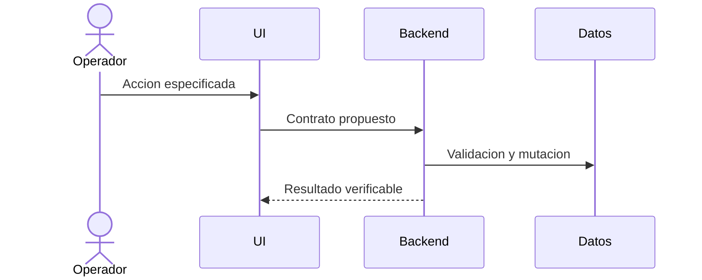
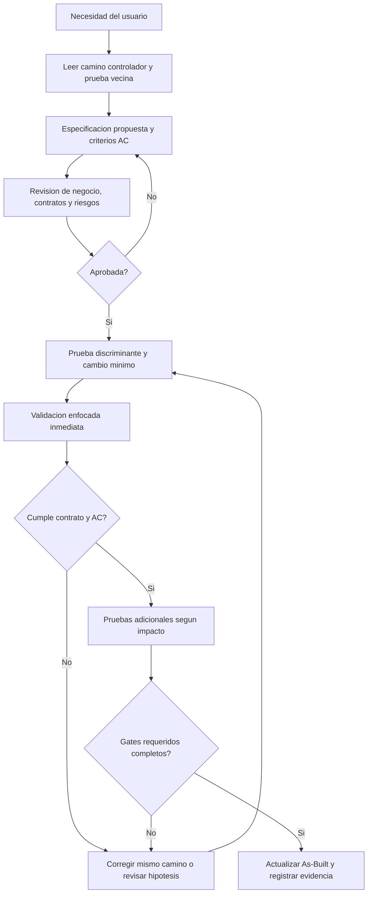

# 05. Reglas SDD y convenciones

Fecha: 2026-11-09. Este documento separa **convenciones observadas As-Built** de **flujo SDD propuesto para cambios futuros**. El flujo propuesto no es una capacidad implementada ni una regla aplicada retroactivamente a las fuentes.

## Convenciones observadas

Fuentes: [package.json](../../package.json), [angular.json](../../angular.json), [tsconfig.json](../../tsconfig.json), [tsconfig backend](../../backend-borboto/tsconfig.json), [instrucciones del repositorio](../../.github/copilot-instructions.md), [app.routes.ts](../../src/app/app.routes.ts), [index.ts](../../backend-borboto/index.ts) y catalogos de [02](02-especificacion-componentes.md).

| Area | Lo que existe hoy |
| --- | --- |
| Organizacion Angular | core/models, core/services, core/guards, core/pipes; features por pantalla y shared/components; archivos TS/HTML/SCSS y specs vecinos |
| Nombres | Dominio principalmente en espanol; PascalCase para clases/interfaces, camelCase para metodos y aliases HTTP; SQL snake_case; mezcla de sufijos Component/Service con clases App, Comanda, Caja, Cocina |
| Componentes | Standalone con imports locales, Material; input()/output() en cards/resumen; MAT_DIALOG_DATA/MatDialogRef en dialogs; muchos OnPush, pero no todos |
| Estado | providedIn:root e inject(); signals/set/update y computed; effect de tema; campos mutables en formularios; no NgRx observado |
| Templates/formularios | Control flow Angular moderno y bindings; formularios reactivos y FormsModule coexistentes; templates externos e inline, SCSS global y local |
| Routing | loadComponent, authGuard/roleGuard, hash location y PreloadAllModules; adminGuard presente pero no conectado en routes |
| Tipado | strict en ambas configuraciones y strictTemplates; se usa any en DTO/datos externos, casts y window.require; interfaces no se generan desde SQL |
| Backend | index.ts concentra handlers y SQL; modulo printer separado y servicios fiscales; imports con y sin extension .ts; compatibilidad Facturapi ESM/CJS mediante helper |
| Datos | SQL parametrizado $n para valores; pg.Pool; transacciones con client en negocio; migrations numeradas y registradas, mas DDL no versionado en db.ts |
| HTTP | /api sin version de ruta, PUT para CRUD, PATCH puntual; filas o {ok,mensaje}; errores variables; no contrato OpenAPI/runtime central |
| Eventos | Broadcast actualizar_mesas/actualizar_cocina y eventos de producto de nombres distintos; UI recarga HTTP |
| Electron | CommonJS, globals de ventanas/listener, IPC directo sin preload; nodeIntegration habilitado y contextIsolation deshabilitado |
| UI transversal | NotificationService normaliza/deduplica snackbars; ThemeService persiste tema; permisos segun dispositivo solo frontend |
| Build | Bun raiz; Angular build; server.js generado por esbuild, no editar manualmente; dist Electron Windows NSIS x64 |
| Pruebas | spec.ts Angular/TestBed vecinos; algunos tests de estado de servicios, varios tests basicos de creacion; no script test raiz pese a target angular test |

### Instrucciones declaradas frente a cumplimiento observado

Las instrucciones del repositorio piden evitar any, componentes standalone sin standalone:true, signals, OnPush, inject, input/output, formularios reactivos, control flow nativo, NgOptimizedImage y accesibilidad AXE/WCAG AA. Esto es una **politica declarada**, no prueba de cumplimiento. El manifiesto utiliza Angular 19 aunque la instruccion menciona el default de Angular v20+. Las fuentes contienen standalone:true, any, FormsModule y componentes sin OnPush. No hay resultado de auditoria AXE en esta inspeccion.

No se inventa un pipeline obligatorio de lint, cobertura, CI, conventional commits o feature flags. angular.json define target test con @angular/build:unit-test, pero package.json no define script test. La compatibilidad del target con el entorno instalado requiere verificacion, no se presume por existir el JSON. Los comandos de build pueden producir archivos fuera de docs y por eso no se ejecutaron para este cambio documental.

## Principios SDD propuestos

1. Especificar primero el comportamiento, contratos y criterios observables. Separar evidencia actual de objetivo futuro con etiquetas As-Built/Propuesto.
2. Trazar cada regla a pantalla, servicio, endpoint/IPC/evento, tabla y prueba. Una interfaz TS no cuenta como validacion runtime.
3. Definir quien es autoridad de cada dato y cada permiso. No copiar al diseno nuevo las limitaciones de auth HTTP, importes enviados por cliente o impresion sin confirmacion como si fueran garantias.
4. Mantener compatibilidad explicita: clientes LAN/Electron, aliases snake/camel, NULL para pedidos sin mesa, manejo de NUMERIC y build empaquetado.
5. Especificar fallos y estados intermedios: venta confirmada con error fiscal, cola de impresion, timeout, offline, reintento y efectos externos no reversibles.
6. Aplicar cambios pequenos sobre abstractions existentes; no crear capas/archivos sin una necesidad documentada. No editar bundles generados a mano.
7. Actualizar As-Built solo al verificar implementacion. Un diagrama objetivo no reemplaza la descripcion real del sistema desplegado.

## Plantilla de futura funcionalidad

Plantilla propuesta para una especificacion posterior; aqui se incluye como contenido, sin crear archivos adicionales ni imponer rutas nuevas ahora.

````markdown
# SDD-XXX: Nombre literal de la funcionalidad

Estado: Propuesto | En revision | Aprobado | Implementado | Verificado
Responsable:
Fecha / revision:
Fuentes As-Built relacionadas:

## Problema y alcance
Necesidad del usuario y resultado observable.
Incluido:
Excluido:
Actores y dispositivos (Electron / navegador LAN):

## Evidencia actual
Archivos/simbolos que controlan el comportamiento.
Contrato y estados actuales.
Limites conocidos que este cambio modifica o conserva.
Hipotesis comprobable y prueba barata que puede refutarla.

## Reglas y criterios de aceptacion
REQ-01: regla de negocio concreta y autoridad de calculo/permiso.
AC-01 (REQ-01): Dado ..., cuando ..., entonces ...
AC-02: error, reintento, duplicado o desconexion.
AC-03: accesibilidad y dispositivos soportados.

## Contratos
HTTP: metodo/ruta, cuerpo/query, respuesta y errores por status.
IPC: canal, direccion, campos obligatorios y rechazo.
Socket: evento, payload, emisor, receptor y recarga/teardown.
Tipos TS, nulabilidad, formato de fechas e importes.
Compatibilidad con clientes anteriores.

## Datos y estados
Tablas/columnas/FK/checks/indices afectados.
Migracion versionada, backfill y estrategia no destructiva.
Transaccion, concurrencia e idempotencia.
Estados antes/despues y compensacion de efectos externos.

## Diseno propuesto
Componentes/servicios responsables; E/S, dependencias y estado.
Diagrama Mermaid de secuencia; ER si cambia persistencia.



## Seguridad, operacion y accesibilidad
Autorizacion de servidor, limites de entrada y secretos.
Logs sin credenciales/datos personales innecesarios.
Timeouts, modo offline y recuperacion.
Foco, teclado, ARIA, contraste y criterios AXE.

## Plan de verificacion
TEST-01 vinculado a REQ-01/AC-01.
Prueba local minima antes de ampliar cambios.
Pruebas de contrato/datos/IPC segun impacto.
Comandos realmente disponibles y resultados esperados.
Validacion manual de hardware/instalador si aplica.

## Entrega y decisiones
Orden de implementacion y archivos previstos.
Decisiones, alternativas descartadas y motivo.
Riesgos y pendientes explicitamente aceptados.
Evidencia de pruebas y actualizacion As-Built al cerrar.
````

## Flujo de trabajo propuesto



### Gates propuestos, no pipeline actual

| Cambio | Verificacion a acordar antes de programar |
| --- | --- |
| UI local | Test vecino y compilacion/typecheck disponible; foco/teclado y AXE si cambia vista |
| Servicio compartido | Casos de estado inicial/reset, derivaciones y errores, consumidores afectados |
| HTTP/datos | Request/response y status, validacion servidor, autorizacion, transaction rollback, duplicados/concurrencia |
| Migracion | BD temporal con esquema anterior y actual, backfill/nulls/FK/indices; nunca ejecutar 000_init contra datos reales sin decision explicita |
| IPC/impresion | Contrato renderer/main, rechazo, colas ausentes, RAW vs Electron, resultado negativo y hardware real |
| Licencia/arranque | Ausente, firma invalida, hardware distinto, fechas invalidas/vencidas, puerto ocupado y paths empaquetados |
| Fiscal/reporte | Dobles de servicio externo, timeout y fallo despues del efecto remoto; ninguna credencial real en pruebas |
| Documentacion | Cobertura de fuentes/contratos, enlaces y Mermaid; cambios solo en alcance autorizado |

### Trazabilidad y cierre

Usar una tabla REQ -> AC -> archivos/simbolos -> TEST -> evidencia; registrar decisiones no resueltas antes de implementar. Marcar Verificado solo con resultados disponibles, y declarar pruebas no ejecutadas. Para builds usar los scripts existentes (build, build:server, dist); para tests evaluar `bunx ng test` y su target real antes de declarar un gate ejecutable. No introducir un comando inexistente `bun run test` como convencion actual.

Ejemplo implementado: [SDD-003](SDD-003-precuenta-servido-y-ticket-modal.md) define precuenta real desde items persistidos, destino CAJA y fallback USB/texto; no registra pago ni cambia flags de produccion. [SDD-099](SDD-099-cierre-integral-arquitectura-y-modulos.md) agrega impresion de navegador aislada y estado contextual. Entrega fisica real no se presume por generar un trabajo USB.

El cierre maestro SDD-099 registra implementacion por bloques y evidencia mediante mocks/tsc. La revision durable final implementa ack USB e intento/recuperacion fiscal por pago y marca los paquetes Implementado dentro de esos contratos. Consultar matriz y limites: mocks no certifican PostgreSQL, Electron, Facturapi ni hardware reales, y un ack perdido no garantiza exactamente-una-vez fisico.

## Mantenimiento de estas especificaciones

[01](01-arquitectura-general.md) explica despliegue; [02](02-especificacion-componentes.md) asigna responsabilidades; [03](03-contratos-y-datos.md) fija contratos observados; [04](04-flujos-y-funcionalidad.md) describe efectos/errores. Cambiar cada documento afectado al terminar una funcionalidad verificada y conservar distincion entre lo observado y lo propuesto. No incluir secretos de .env, claves privadas, PIN reales, tokens de webhook ni payloads de licencia de clientes.