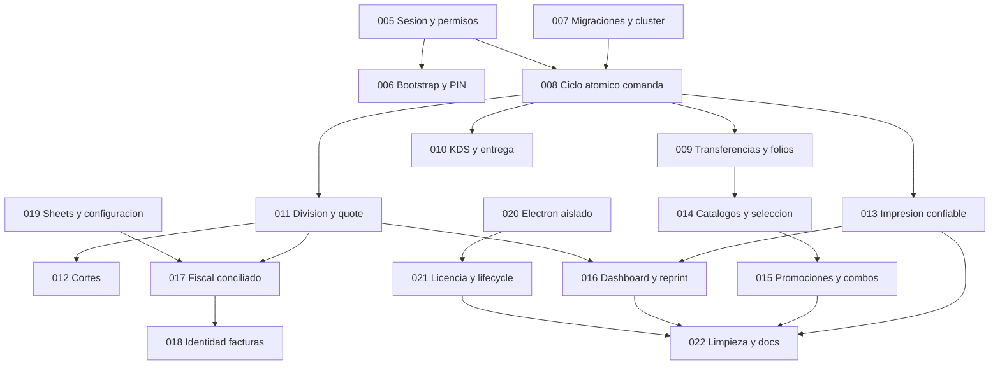

# 06. Auditoria funcional y refactorizacion por modulo

Fecha: 2026-11-09. Estado: Auditoria documental / hoja de ruta propuesta, no implementacion.

## Alcance y metodo

Se contrastaron las especificaciones [01](01-arquitectura-general.md), [02](02-especificacion-componentes.md), [03](03-contratos-y-datos.md), [04](04-flujos-y-funcionalidad.md), [05](05-reglas-sdd-y-convenciones.md) y [SDD-001](SDD-001-estabilizacion-comandas-cobro.md), [SDD-002](SDD-002-integridad-mesa-cobro-y-sockets.md), [SDD-003](SDD-003-precuenta-servido-y-ticket-modal.md), [SDD-004](SDD-004-proteccion-secretos-y-contratos-admin.md), contra Angular, backend, SQL y Electron actuales.

Solo se crea este documento. No se ejecutaron builds, migraciones, backend, Electron, impresoras, Facturapi o conexiones PostgreSQL. La evidencia es lectura de codigo y busqueda de consumidores; los resultados de arneses y typechecks de SDD-001..004 son evidencia historica documentada, no pruebas repetidas en esta auditoria. No se inspeccionan datos de clientes ni se reproducen secretos.

Cada hallazgo tiene identificador, evidencia de archivo y funcion/linea, impacto y paso concreto. Una ausencia de referencias significa ausencia en las fuentes inspeccionadas, no prueba de que un cliente externo nunca use el endpoint. Las condiciones de carrera se deducen del orden de lectura/escritura; no se afirmaron reproducciones con BD real.

Prioridades utilizadas literalmente:

- **Crítica (Bloqueante/Datos)**: integridad financiera, acceso privilegiado, perdida de datos o riesgo al host.
- **Alta (Funcionalidad rota en UI)**: accion inaccesible, resultado visible incorrecto o flujo operativo incompleto.
- **Media (Deuda técnica/Limpieza)**: duplicacion, contratos fragiles, trazabilidad y capacidades no expuestas sin rotura actual demostrada.

## Resumen ejecutivo

SDD-001..004 corrigieron defectos concretos, pero no completaron todas las fronteras del sistema. La prioridad siguiente no es dividir index.ts por carpetas: primero se deben estabilizar autorizacion, transacciones, autoridad del precio, cierre/adiciones concurrentes y conciliacion de pagos/facturas. Despues, corregir los caminos UI y consolidar abstracciones con pruebas.

| Modulo | Prioridad principal | Motivo dominante |
| --- | --- | --- |
| 1. Autenticacion | Crítica (Bloqueante/Datos) | Permisos solo frontend; requests HTTP no autenticadas |
| 2. Mesas y pedidos | Crítica (Bloqueante/Datos) | Transferencias con validaciones desiguales y folios concurrentes |
| 3. Comandas | Crítica (Bloqueante/Datos) | Adiciones a cerradas y precio suministrado por cliente |
| 4. Cocina | Alta (Funcionalidad rota en UI) | Preparacion por item no accesible, estados/tiempos incoherentes |
| 5. Caja | Crítica (Bloqueante/Datos) | Division cobra cuota pero registra total y cierra todo; cortes no autoritativos |
| 6. Impresion | Crítica (Bloqueante/Datos) | Se marca impreso sin confirmacion; perdida de reintento operacional |
| 7. Ajustes | Alta (Funcionalidad rota en UI) | zona_id ausente, alcance de promociones no persistido |
| 8. Dashboard | Alta (Funcionalidad rota en UI) | Fecha impide encontrar tickets antiguos y reimpresion puede anunciar exito falso |
| 9. Facturacion/Sheets | Crítica (Bloqueante/Datos) | Conciliacion por monto y efecto fiscal no atomico; token devuelto en URL |
| 10. Escritorio/PG | Crítica (Bloqueante/Datos) | taskkill global, renderer privilegiado e inicializacion destructiva |

## 1. Autenticacion, sesiones y roles

### Estado actual y correcciones

[AuthService](../../src/app/core/services/auth.service.ts#L27) restaura usuario mediante signal/localStorage, login por PIN y cierre de sesion. [RoleAccessService](../../src/app/core/services/role-access.service.ts#L23) establece matriz Electron/navegador: navegador permite MESERO/COCINERO; Electron conserva administracion/caja segun rol. [roleGuard](../../src/app/core/guards/role.guard.ts#L7) aplica esa matriz a rutas.

SDD-004 elimina PIN de GET/POST/PUT usuarios, valida PIN nuevo 4..6 digitos, preserva vacio en PUT y responde 409 por duplicado: [handlers usuarios](../../backend-borboto/index.ts#L721). [AjustesComponent.habilitarEdicionEmpleado](../../src/app/features/ajustes/ajustes.ts) limpia el campo de edicion. Esto protege respuestas, no autentica peticiones.

### Hallazgos

| ID / prioridad | Evidencia exacta e impacto |
| --- | --- |
| AU-01 / Crítica (Bloqueante/Datos) | [index.ts](../../backend-borboto/index.ts), registro app.use(cors())/express.json() y handlers /api/auth, /api/usuarios: no middleware de sesion/rol. AuthService.obtenerUsuarioGuardado devuelve JSON casteado, sin validar sesion server-side. Un request directo puede operar CRUD y usuarioId recibido; cambiar el rol local afecta guards, no constituye autorizacion de backend. |
| AU-02 / Alta (Funcionalidad rota en UI) | [AuthService.getHasUsers](../../src/app/core/services/auth.service.ts#L31) transforma error HTTP en false; [LoginComponent.verificarSistema](../../src/app/features/login/login.ts#L64) muestra registro inicial ante ese false. Backend caido parece sistema nuevo, no un estado de conexion fallida. |
| AU-03 / Crítica (Bloqueante/Datos) | [register-first-admin](../../backend-borboto/index.ts#L732) hace COUNT e INSERT sin exclusividad de bootstrap; dos requests con PIN distinto pueden crear dos primeros administradores. [LoginComponent.onSubmitRegister](../../src/app/features/login/login.ts#L103) comprueba dispositivo despues del POST: en navegador se puede crear ADMIN y luego mostrar rechazo. PIN inicial solo exige presencia en ese handler, distinto de POST usuarios. PIN en SQL sigue texto; login carece de rate limit. |

### Codigo muerto/duplicado

[adminGuard](../../src/app/core/guards/admin.guard.ts#L6) no aparece en [app.routes.ts](../../src/app/app.routes.ts), que usa authGuard/roleGuard. Es candidato confirmado a consolidacion de guards, no a borrar reglas ADMIN. AuthService.getHasUsers/getUsuarios comparten lectura de usuarios con DTO any; conviene separar bootstrap de catalogo de empleados.

### Refactorizacion recomendada

1. AU-01: introducir sesion validada por backend, autorizacion por endpoint y usuarioId obtenido de la sesion; adaptar AuthService, roleGuard y RoleAccessService sin convertir isElectron en credencial. Primero cubrir usuarios/caja/ajustes, despues comandos LAN.
2. AU-02: getHasUsers debe devolver estado explicito existente/vacio/error; verificarSistema debe mostrar error/reintento y no activar alta ante fallo HTTP.
3. AU-03: especificar bootstrap exclusivo, validar PIN igual que alta normal y negar alta inicial de cliente no autorizado antes de mutar. Migrar PIN a hash y verificarlo con estrategia compatible con datos existentes; limitar intentos y revalidar usuario activo al restaurar sesion.

Aceptacion: request sin sesion no cambia datos; rol no autorizado no accede; desconexion nunca parece primer uso; dos bootstraps solo confirman uno; no se rompen cambio de turno ni PIN existentes durante migracion.

## 2. Mesas, mostrador y envios

### Estado actual y correcciones

[GET mesas](../../backend-borboto/index.ts#L270) une mesas fisicas y pedidos externos abiertos con id negativo sintetico y comandaId real. [MesaService](../../src/app/core/services/mesa.ts#L109) filtra por origen/estado/fecha. Los dialogs crean/seleccionan clientes y Mesas navega por identidad de comanda.

SDD-002 agrega lock de mesa en abrir/mover y [indice unico parcial](../../Database/migrations/004_unique_open_comanda_per_mesa.sql); SDD-003 implementa precuenta y [servir](../../backend-borboto/index.ts#L859) sincroniza mesa/comandas abiertas, emitiendo mesas y cocina. No se verifico aplicacion de 004 sobre una instalacion.

### Hallazgos

| ID / prioridad | Evidencia exacta e impacto |
| --- | --- |
| ME-01 / Alta (Resuelto SDD-010) | [GET mesas](../../backend-borboto/index.ts) incluye externas CERRADA del dia por fecha_cierre como DISPONIBLE. [MesaService](../../src/app/core/services/mesa.ts) conserva ACTIVOS separado de DISPONIBLE/TODOS; finalizadas sin acciones mutantes. Historial anterior a hoy excluido del alcance. |
| ME-02 / Crítica (Resuelto SDD-009) | [trasladarComanda](../../backend-borboto/index.ts) unifica tres rutas, comanda FOR UPDATE primero y mesas ascendentes despues. IDs/igualdad 400, ausencia 404, estado/destino/23505 409; origen sin ABIERTA no mueve estado huerfano; externa NULL no libera mesa ajena. Estado operativo/folio conservados, eventos post-COMMIT. |
| ME-03 / Alta (Resuelto SDD-010) | [MesaCard](../../src/app/features/mesas/components/mesa-card/mesa-card.html) expone SERVIR y [Mesas](../../src/app/features/mesas/mesas.html) ENTREGAR para externas listas. MesaService.marcarServido usa POST por comanda, FOR UPDATE/ABIERTA y SERVIDO sin exigir mesa_id; legacy por mesa conservado. |
| ME-04 / Crítica (Resuelto SDD-009) | [generarFolioOrigen](../../backend-borboto/index.ts) usa advisory lock transaccional por tipo y MAX sufijo diario, retenido hasta insertar/COMMIT. [CrearEnvioDialog](../../src/app/features/mesas/components/crear-envio-dialog/crear-envio-dialog.ts) habilita contacto existente y persiste cambios antes de close, fallo no confirma. Sin snapshot por pedido ni reparacion de duplicados historicos. |

### Codigo muerto/duplicado

POST /api/mesas/mover sigue legacy sin consumidor Angular encontrado, pero SDD-009 lo conserva como alias de la misma politica transaccional; MesaService.moverMesa usa origenId. CrearMostradorDialog/CrearEnvioDialog aun repiten seleccion/alta; contacto existente de envio ahora se persiste antes de confirmar.

### Refactorizacion recomendada

1. ME-02: unificar transferencia/asignacion con locks en orden estable, estado ABIERTA comprobado bajo lock, origen/destino distintos y 409 uniforme; no limpiar mesa si origen=destino. Reusar politica en los tres handlers, no solo mover codigo a un router.
2. ME-01/03: separar consulta de pedidos historicos de tablero abierto; definir transicion por comanda para ENVIO/MOSTRADOR y conectar SERVIR/ENTREGAR en MesaCard/Mesas/MesaService con permisos y estados validos.
3. ME-04: reservar consecutivo transaccional por origen/fecha; persistir direccion del pedido como snapshot o actualizar cliente mediante decision explicita. No aparentar guardado de cambios locales descartados.

Aceptacion: filtros finalizados devuelven cerradas; transferencias simultaneas no liberan cuentas ajenas; entregas funcionan sin mesa_id; editar direccion de cliente existente tiene efecto definido; folios concurrentes no se repiten.

## 3. Comandas y menu

### Estado actual y correcciones

[ComandaService](../../src/app/core/services/comanda.ts), cargarComandaPorId/cargarComandaActivaPorMesa, separa itemsGuardados/itemsComanda, calcula borrador y manda adiciones. [Comanda.enviarCocina](../../src/app/features/comanda/comanda.ts#L62) invoca POST y procesa trabajos USB/texto. SDD-001 corrige subtotal real en [lecturas](../../backend-borboto/index.ts#L645) y rollback de cancelacion; SDD-002 traduce unique_violation al agregar.

### Hallazgos

| ID / prioridad | Evidencia exacta e impacto |
| --- | --- |
| CO-01 / Crítica (Bloqueante/Datos) | [POST comandas](../../backend-borboto/index.ts#L921) lee por ID sin FOR UPDATE y solo verifica existencia, no ABIERTA. Puede insertar items en CERRADA/CANCELADA y cambiar estado_operativo a EN COCINA. Al coincidir con cobro, el SUM puede excluir esas nuevas lineas antes de cerrar; al coincidir con cancelacion, el ultimo UPDATE puede dejar estado mixto. |
| CO-02 / Crítica (Bloqueante/Datos) | [precioUnitario/cantidad](../../backend-borboto/index.ts#L978) procede de item.precio/producto.precio cliente y usa || como default; cero y ausencia no se distinguen. No comprueba disponibilidad/catalogo ni precio vigente. El subtotal autoritativo de cobro suma valores ya aceptados de este camino, por lo que no garantiza autoridad del precio. |
| CO-03 / Alta (Resuelto SDD-014) | [Comanda](../../src/app/features/comanda/comanda.ts) limpia ruta sin IDs validos, escucha actualizar_productos y retira ruta/socket al destruirse. [ComandaService](../../src/app/core/services/comanda.ts) comparte carga/mapeo con Subscription y token para rechazar respuestas/errores viejos; menu tambien cancelable, reset invalida pendientes. |

### Codigo muerto/duplicado

SDD-014 unifica cargarComandaActivaPorMesa/cargarComandaPorId mediante carga/mapeo tipado y reset compartidos. obtenerDesgloseMesa/obtenerDesgloseComanda y la carga de caja aun duplican contratos inline. No se confirma un componente de menu muerto: MenuProductos y OrdenResumen son consumidores activos. Evitar eliminarlos por ser presentacionales.

### Refactorizacion recomendada

1. CO-01/02: en POST comandas y cancelar, adquirir mismo lock de comanda que cobrar, validar ABIERTA dentro del lock y cargar precio/disponibilidad de productos server-side. Validar cantidad entera positiva y precio monetario, sin usar || para valores validos cero.
2. CO-03: reset explicito al entrar sin identidad; construir flujo cancelable de seleccion (switchMap o mecanismo equivalente) con DTO tipado y una funcion pura de mapeo. Mantener borrador separado hasta confirmar exito; refresh menu por evento de catalogo.

Aceptacion: cerrada no recibe adiciones; cobro/cancelacion/adicion se serializan; manipular precio no altera venta; cambiar rapidamente pedido no muestra respuesta previa. Preservar subtotal completo de SDD-001.

## 4. Cocina / KDS

### Estado actual y correcciones

[CocinaService](../../src/app/core/services/cocina.ts#L49) carga tickets y despacha; [Cocina](../../src/app/features/cocina/cocina.ts) escucha actualizar_cocina y desuscribe. SDD-002 corrige teardown socket; SDD-003 emite actualizar_cocina al servir. Backend despacho fija completado/LISTO y LISTO PARA SERVIR en mesa/comanda.

### Hallazgos

| ID / prioridad | Evidencia exacta e impacto |
| --- | --- |
| KD-01 / Alta (Resuelto SDD-010) | [KdsCard](../../src/app/features/cocina/components/kds-card/kds-card.html) tiene botones nativos/aria-pressed y output itemToggle; [CocinaService](../../src/app/core/services/cocina.ts) revierte fallo por item, evita duplicados locales y calcula agregado. Backend sincroniza completado/estado_kds y EN COCINA operativo. |
| KD-02 / Alta (Resuelto SDD-010) | [GET tickets](../../backend-borboto/index.ts) excluye LISTO PARA SERVIR/SERVIDO y normaliza PENDIENTE/PREPARANDO/LISTO por items; alias mesaNumero unico. LISTO visible y despacho permitido aunque todos completados. |
| KD-03 / Alta (Resuelto SDD-010) | GET cocina/mesas calcula minutos desde fecha_apertura, minimo 1 abiertas y 0 sin abierta/finalizadas. Tiempo avanza al recargar HTTP; reloj incremental cliente/reconexion cancelable permanecen recomendacion futura. Rollback toggle implementado; cobro emite cocina desde SDD-008. |
| KD-04 / Crítica (Bloqueante/Datos) | [toggle](../../backend-borboto/index.ts#L1168) y [despachar](../../backend-borboto/index.ts#L1182) no validan bajo lock que la comanda siga ABIERTA ni la existencia del ticket antes de escribir. Pueden cambiar estado operativo despues de cierre/cancelacion o devolver ok para ID inexistente. |

### Codigo muerto/duplicado

SDD-010 conecta toggleItemCompletado y elimina alias mesaNumero duplicado. completado/estado_kds se sincronizan en SQL; agregado DTO deriva de items y estado_operativo diferencia preparacion, despacho y entrega. Reloj cliente incremental no implementado.

### Refactorizacion recomendada

1. KD-04: validar transiciones/existencia bajo lock comun del ciclo de comanda y rechazar cerradas; incluir eventos KDS tras cobro/cancelacion.
2. KD-01/02: definir estado de preparacion agregado e item; conectar accion accesible por item en KdsCard y flujo optimista con rollback; separar tickets activos de despachados en filtros/DTO.
3. KD-03: calcular duracion desde fecha_apertura en servidor y reloj UI, no contador persistido manual; refrescar tras reconexion y cancelar cargas viejas.

Aceptacion: preparar parcialmente es accion posible; estados y filtros concuerdan; ticket cobrado desaparece; tiempos progresan sin mutar BD cada minuto; fallo de toggle no deja UI falsa.

## 5. Caja, cobros, puntos y cortes

### Estado actual y correcciones

SDD-001 bloquea la comanda al cobrar y rechaza repeticion por estado. SDD-002 suma items, valida descuentos/promocion/puntos y monto, calcula cambio y retorna cifras server-side: [cobrar](../../backend-borboto/index.ts#L1246). [CajaService](../../src/app/core/services/caja-service.ts) mantiene seleccion, metodo, promociones y puntos; [CorteCajaDialog](../../src/app/features/caja/components/corte-caja-dialog/corte-caja-dialog.ts#L67) carga resumen por usuario.

### Hallazgos

| ID / prioridad | Evidencia exacta e impacto |
| --- | --- |
| CJ-01 / Crítica (Bloqueante/Datos) | [cobrar totalExigible](../../backend-borboto/index.ts#L1326) permite monto de una cuota si dividirCuenta, pero INSERT pagos guarda totalCuenta completo y despues cierra toda comanda. Ejemplo total 100/2: 50 efectivo permite cerrar y registrar venta 100, sin segundo pago. No es soporte de cobros parciales; es incoherencia operacional que exige decision de contrato. |
| CJ-02 / Alta (Funcionalidad rota en UI) | [pagoSuficiente](../../src/app/core/services/caja-service.ts#L68) rechaza total<=0, mientras backend admite total cero tras descuento/canje. UI preview puntosPorGanar=floor(total/10), pero [puntosNuevos](../../backend-borboto/index.ts#L1496) usa pesos_por_punto/factor configurados. El canje por ceil(total) puede dejar descuento solicitado mayor al subtotal fraccionario y backend rechazar antes de acotarlo. UI no redondea cuota igual que backend y no declara/aplica totalCuenta/descuento/cambio retornados en DTO de cobrarYCerrarMesa. |
| CJ-03 / Crítica (Bloqueante/Datos) | [POST corte](../../backend-borboto/index.ts#L1620) guarda sumas/diferencia recibidas, no recalcula bajo lock ni delimita un turno persistido; dos confirmaciones pueden generar cortes repetidos. [CorteCajaDialog.confirmarCorte](../../src/app/features/caja/components/corte-caja-dialog/corte-caja-dialog.ts#L99) no bloquea envio repetido. Si GET del resumen falla, loading termina y puede enviarse estado de importes iniciales. |
| CJ-04 / Crítica (Bloqueante/Datos) | [mesaIdReal](../../backend-borboto/index.ts#L1483) usa mesaId del request cuando la comanda tiene mesa_id null; cliente puede provocar liberacion de mesa no asociada. SDD-002 controla total, no este vinculo ni permisos de descuento manual. |

### Codigo muerto/duplicado

TicketCobroDialog existe pero la Caja activa abre TicketModal; sus referencias encontradas son componente/spec, no flujo productivo. Alias mesaNumero/itemsComanda/cambioCalculado duplican nombres por compatibilidad; retirarlos solo al migrar templates. Calculos descuento/cuota/puntos estan duplicados entre UI y backend.

### Refactorizacion recomendada

1. CJ-01/04: elegir division informativa con pago completo o implementar pagos parciales reales; hasta ese contrato, no confirmar venta completa con una cuota. Resolver mesa solo desde comanda bloqueada, nunca fallback del request.
2. CJ-02: DTO de quote/cobro autoritativo, mismos centavos y parametros de lealtad para preview; caso cuenta cero aceptado segun politica; recalcular saldo/canje al confirmar. Usar cifras retornadas para ticket/UI, no estimaciones previas.
3. CJ-03: introducir turno/corte exclusivo, sumar pagos server-side, validar efectivo contado y fecha de corte; bloquear confirmacion repetida y deshabilitar corte si no cargo resumen.

Aceptacion: dinero recibido y venta registrada se concilian; cero total tiene camino definido; puntos visibles coinciden con persistidos; un corte concurrente confirma una vez; cobro externo nunca libera mesa ajena.

## 6. Impresion y tickets

### Estado actual y correcciones

Backend [PrinterService](../../backend-borboto/src/modules/printer/printer.service.ts) soporta RED, USB pendiente y SIMULACION; templates separan produccion, cobro y precuenta. SDD-003 agrega [imprimirPrecuenta](../../backend-borboto/src/modules/printer/printer.service.ts#L72), sin pagos/flags, y TicketModal usa nombre/default/window.print. [IPC main](../../main.js#L311) lista colas e imprime con ventana oculta y HTML escapado.

### Hallazgos

| ID / prioridad | Evidencia exacta e impacto |
| --- | --- |
| IM-01 / Crítica (Bloqueante/Datos) | [imprimirComandaProduccion](../../backend-borboto/src/modules/printer/printer.service.ts#L599) selecciona impreso=false y acumula todos los IDs; [UPDATE impreso](../../backend-borboto/src/modules/printer/printer.service.ts#L738) ocurre incluso sin impresora, con fallback de error o USB no confirmado. Reintentar no vuelve a seleccionar esos items. Dos ejecuciones concurrentes tambien pueden seleccionar las mismas lineas antes de marcar. |
| IM-02 / Alta (Funcionalidad rota en UI) | [UI printTicketSilently](../../src/app/core/services/printer.service.ts#L102) resuelve RAW en next sin verificar respuesta.ok; [ruta RAW](../../backend-borboto/src/modules/printer/printer.routes.ts), /usb/raw-print, puede responder 200 con ok=false fuera Windows. [imprimirTicketCobro](../../backend-borboto/src/modules/printer/printer.service.ts#L761) captura errores y retorna null; reprint puede devolver ok:true sin texto ni trabajo. |
| IM-03 / Alta (Funcionalidad rota en UI) | [TicketModal.imprimirConNavegador](../../src/app/features/ticket-modal/ticket-modal.ts) fallback imprime window actual; [ticket-modal.html](../../src/app/features/ticket-modal/ticket-modal.html) siempre rotula MODO SIMULACION. Puede incluir UI ajena al ticket o dar etiqueta confusa a una precuenta real. [DatosTicketCobro/generarTemplateCobro](../../backend-borboto/src/modules/printer/templates/ticket-templates.ts#L28) no tienen descuento/cuotas; las lineas brutas no explican el total descontado ni la division. |

### Codigo muerto/duplicado

[printer.config.ts](../../backend-borboto/src/modules/printer/printer.config.ts#L10), CONFIG_IMPRESORAS, no tiene import encontrado en la ruta activa, que usa BD. GET impresoras/system retorna 410 deliberadamente: endpoint retirado, no deteccion rota. Helpers CIM/PowerShell siguen referenciados dentro de enviarDirectoAImpresora; no declarar todo ese bloque muerto porque flujo habitual USB sea pendiente.

### Refactorizacion recomendada

1. IM-01: separar generar/despachar/confirmar y estado de trabajo por destino/impresora; confirmar flags solo tras aceptacion definida, reclamar jobs sin duplicacion y soportar reintento. No tocar flags de precuenta.
2. IM-02: evaluar ok de RAW, propagar fallo de ticket a endpoint y evitar ok vacio; unificar procesamiento USB de Mesas/Comanda/Caja/Dashboard, con fallback que conserve texto si falla.
3. IM-03: DTO de ticket con subtotal/descuento/total recibido/parte; vista de impresion aislada y label por clase de documento. Validar geometria 58/80mm antes de afirmar compatibilidad fisica; retirar config/endpoint legacy solo con politica de compatibilidad.

Aceptacion: fallo RED no consume reintento; USB negativo activa fallback; reprint inexistente no anuncia exito; impresion manual solo contiene ticket y totales conciliados.

## 7. Ajustes, catalogos, promociones y combos

### Estado actual y correcciones

[AjustesComponent](../../src/app/features/ajustes/ajustes.ts) administra catalogos y FileReader/XLSX primera hoja; imagenes usan Multer/Jimp en [upload](../../backend-borboto/index.ts#L246). SDD-004 completa destino CAJA y clave_sat, PIN opcional al editar y keys por mascara/flags. [sincronizarCombosComoProductos](../../backend-borboto/src/db.ts#L102) materializa COMBO_PRECIO como producto y desactiva promociones que dejan de corresponder.

### Hallazgos

| ID / prioridad | Evidencia exacta e impacto |
| --- | --- |
| AD-01 / Alta (Resuelto SDD-014) | [GET admin mesas](../../backend-borboto/index.ts) proyecta solo mesas fisicas con zona_id y zona. [Ajustes](../../src/app/features/ajustes/ajustes.ts) consume endpoint exclusivo, filtra identidades externas y conserva zona al editar; PUT mesa valida numero/zona 400 y existencia 404. Union operacional permanece para tablero. |
| AD-02 / Alta (Funcionalidad rota en UI) | [ajustes.html](../../src/app/features/ajustes/ajustes.html#L1209) permite aplica_a/CATEGORIA/PRODUCTO; [promociones SQL](../../Database/000_init.sql), tabla promociones, y [CRUD promocion](../../backend-borboto/index.ts#L2024) no almacenan esos campos. Backend descuento se aplica a subtotal completo. UI aparenta una regla que no existe. |
| AD-03 / Crítica (Bloqueante/Datos) | [DELETE promocion](../../backend-borboto/index.ts#L2054) ocurre antes de sync; [productos.promocion_id SET NULL](../../Database/000_init.sql#L137) borra vinculo y sync solo desactiva promocion_id no NULL: producto de combo eliminado puede seguir vendible sin su promocion. Sync captura error sin propagarlo y CREATE/UPDATE promocion puede responder exito con productos desincronizados. Tampoco hay UNIQUE de producto por promocion en el esquema. |
| AD-04 / Alta (Resuelto SDD-014) | [CRUD productos](../../backend-borboto/index.ts) publica actualizar_productos uniforme (PUT conserva legacy), PUT/DELETE ausente 404 y DELETE solo desactiva ante FK 23503, con RETURNING verificado. Comanda recarga menu por socket con teardown; importacion emite tras COMMIT. Cambios indirectos de promociones fuera de alcance. |
| AD-05 / Media (Deuda técnica/Limpieza) | Upload usa cwd/uploads y validacion MIME del cliente, resize 600x600, sin manejo JSON central de errores Multer; importador normaliza primera hoja y no ofrece reporte por fila. Son limites de validacion/operacion, no evidencia de que Jimp o XLSX fallen siempre. |

### Codigo muerto/duplicado

Objetos de alta/edicion y CRUD de Ajustes repiten validacion/reset; dividir por responsabilidad despues de fijar DTO, no por tamaño arbitrario. Campos de alcance promocional son contrato fantasma, no eliminarlos sin decidir producto. sharp esta declarado pero upload usa Jimp; candidato a retirar dependencia solo tras inspeccionar consumidores/build completo.

### Refactorizacion recomendada

1. AD-01: endpoint administrativo de mesas fisicas con zona_id y DTO propio; Ajustes no debe editar union operacional de pedidos. Revalidar existencia en PUT.
2. AD-02/03: decidir alcance soportado y persistirlo con migracion/tests o retirar controles no implementados; relacion combo-producto exclusiva, baja logica explicita antes de perder FK, sync dentro del caso de uso atomico y errores visibles.
3. AD-04/05: unificar evento/DTO catalogo y suscriptores de menu; 404 consistente y fallback de borrado solo por FK. Validacion de lote por fila y nombres de uploads en directorio writable del puesto; comprobar formato real de imagen y errores de middleware.

Aceptacion: editar nombre de mesa no pierde zona; alcance de promocion modifica solo lineas declaradas; borrar combo lo retira del menu; cambio de precio/disponibilidad refresca clientes; importacion informa filas rechazadas.

## 8. Dashboard y ventas

### Estado actual y correcciones

[DashboardComponent](../../src/app/features/dashboard/dashboard.ts#L78) usa stats, tickets y reprint; [stats](../../backend-borboto/index.ts#L2208) agrega ventas/metodos/categorias, [tickets](../../backend-borboto/index.ts#L2274) consulta hasta 100 con folio/cliente. Reprint usa pago existente, no genera otro pago. Consume mejoras de cobro/impresion de SDD previos, pero no tuvo una fase dedicada.

### Hallazgos

| ID / prioridad | Evidencia exacta e impacto |
| --- | --- |
| DV-01 / Alta (Funcionalidad rota en UI) | [establecerRangoPredeterminado](../../src/app/features/dashboard/dashboard.ts#L109) usa toISOString (UTC); [cargarTickets](../../src/app/features/dashboard/dashboard.ts#L146) en HOY envia fechaInicio sin fechaFin, que el backend interpreta >=. Tambien restringe busqueda por folio/cliente a desde hoy aunque backend permite historial sin filtro de fecha. Cerca de medianoche puede divergir dia local/SQL. |
| DV-02 / Alta (Funcionalidad rota en UI) | [cargarEstadisticas](../../src/app/features/dashboard/dashboard.ts#L122) asigna tickets=resp.tickets y borra resultado de filtro folio/cliente; stats limita 15 y consulta tickets 100, sin distinguir conjuntos ni pagina. [ventas categorias](../../backend-borboto/index.ts#L2230) suma lineas brutas mientras resumen usa pagos descontados: no se concilian cuando hay descuentos. |
| DV-03 / Alta (Funcionalidad rota en UI) | [reprint](../../backend-borboto/index.ts#L2342) puede responder ok:true con resultado null de PrinterService; [reimprimirTicket](../../src/app/features/dashboard/dashboard.ts#L175) anuncia enviado aunque no haya texto/job. PUT filtros/rangos no tiene validacion uniforme de fecha/orden. |

### Codigo muerto/duplicado

No se encontro pagina Dashboard muerta. El HttpClient inline repite DTO/query strings/procesamiento USB respecto a servicios core; extraer DashboardService despues de fijar contrato de filtros. Los tickets de stats y tickets filtrados son dos consultas distintas, no sustituir una por otra silenciosamente.

### Refactorizacion recomendada

1. DV-01: fecha de negocio local comun y query explicita [inicio,fin]; politica de busqueda global de folio independiente de HOY, con filtros visibles coherentes.
2. DV-02: separar resumen y resultados de historial; paginacion/limites explicitos y definicion de ventas netas/brutas por categoria reconciliable con descuentos.
3. DV-03: reprint 404 por pago inexistente y estado real de envio; no anunciar success vacio. Tipar respuestas y centralizar query params/servicio, con pruebas de fechas y tickets antiguos.

Aceptacion: folio antiguo aparece sin cambiar inadvertidamente rango; HOY no incluye dia siguiente; resumen e historial no se pisan; categorias y totales explican descuentos.

## 9. Facturacion Facturapi y reporte Sheets

### Estado actual y correcciones

SDD-004 [GET/POST/test fiscal](../../backend-borboto/index.ts#L2067) enmascara keys y resuelve guardadas por modo, sin reenviar errores del proveedor en esas rutas. [BillingComponent](../../src/app/features/billing-component/billing-component.ts) usa flags y recarga mascara. [realizarSincronizacionFacturas](../../backend-borboto/src/sincronizarFacturas.ts) pagina 50 y hace upsert local; reporte cuenta facturas y usa timeout fetch. No considerar cifradas las keys por estar enmascaradas en HTTP.

### Hallazgos

| ID / prioridad | Evidencia exacta e impacto |
| --- | --- |
| FA-01 / Crítica (Bloqueante/Datos) | [receipt al cobrar](../../backend-borboto/index.ts#L1372) usa lineas originales sin repartir descuento, mientras total de pago ya es neto; agrupado si usa totalCuenta. Llama Facturapi dentro de transaccion SQL; si luego falla SQL, el recibo remoto no se revierte. dias_vigencia_ticket se almacena pero no se pasa a receipts.create. |
| FA-02 / Crítica (Bloqueante/Datos) | [sincronizarFacturas, fallback por monto](../../backend-borboto/src/sincronizarFacturas.ts#L148) toma ultimo PENDIENTE del mismo total, no identidad verificable; puede ligar factura a otro ticket. external_id parseado como ticketId no verifica existencia antes de FK. Upsert por uuid_sat y UNIQUE facturapi_invoice_id en [SQL](../../Database/000_init.sql#L251): factura primero sin UUID (DRAFT_id) y luego con UUID real puede intentar insertar otra fila con mismo invoice_id y fallar. No hay transaccion comun para factura/estado ticket. |
| FA-03 / Crítica (Bloqueante/Datos) | [enviarConteoAGoogleSheets](../../backend-borboto/src/services/reporteFacturas.service.ts#L120) incluye token en URL, la registra y devuelve resultObj.url; [GET test-sheets](../../backend-borboto/index.ts#L2193) expone ese objeto. Es fuga residual distinta de keys fiscales corregidas. obtenerConteoFacturasLocales retorna 0 ante error SQL, indistinguible de conteo real cero. |
| FA-04 / Alta (Funcionalidad rota en UI) | [POST fiscal](../../backend-borboto/index.ts#L2089) lee keys y despues UPSERT con valores resueltos; edicion con mascara puede sobrescribir cambio concurrente. Si modo live carece de key, puede guardar configuracion sin validar ese modo y omitir CSD. El clearTimeout de Sheets no esta en finally si fetch rechaza. |

### Codigo muerto/duplicado

obtenerInstanciaFacturapi esta duplicado en index.ts y sincronizarFacturas.ts. Lectura/decodificacion de licencia se repite en sync y reporte; no verifica firma como main. No se observa vista Angular que liste facturas locales, ni consumidor del endpoint sincronizar en Billing: existen API/servicio, no afirmar una pantalla fiscal completa.

### Refactorizacion recomendada

1. FA-01: contrato fiscal neto conciliado con pago, descuento y vencimiento; caso de uso separado de efectos externos con idempotencia/reintento y compensacion documentada. No mantener una conexion bloqueada durante toda latencia del proveedor si se diseña outbox.
2. FA-02: usar invoice_id como identidad estable, receipt_id verificable y relacion explicita; fallback ambiguo se reporta para reconciliacion, no se asigna por monto. Verificar external_id antes de FK; factura y estado ticket atomicos; pruebas draft->timbrada, cancelada, faltante y coincidencias de monto.
3. FA-03/04: no retornar ni registrar URL/token; credenciales externas seguras y cuerpo/cabecera apropiados al webhook; resultado de conteo con error, no cero falso; timeout siempre limpio. Actualizacion de configuracion atomica con preservacion SQL de keys no modificadas y validacion del modo activo.

Aceptacion: factura/receipt total concilia pago; duplicado remoto no crea segunda factura; un monto igual no asocia tickets ajenos; respuestas/logs Sheets nunca contienen token; cambio simultaneo de key no se revierte por mascara antigua.

## 10. Escritorio, licenciamiento y ciclo de vida PG

### Estado actual y correcciones

[main.js](../../main.js), iniciarSistemaCompleto, valida licencia antes de iniciar PG/backend y renderer; verificacion SHA256 y hardware, ventana de activacion y shutdown. [db.ts.initDB](../../backend-borboto/src/db.ts#L177) crea BD, aplica archivos ordenados y DDL adicional. SDD-002 agrega 004 y declaracion Multer local; SDD-003/004 se empaquetan en server.js generado. Esto no demuestra validacion de instalador ni migracion aplicada.

### Hallazgos

| ID / prioridad | Evidencia exacta e impacto |
| --- | --- |
| EP-01 / Crítica (Bloqueante/Datos) | [setupAndStartPostgres](../../main.js#L128) ejecuta taskkill de todos los postgres.exe, no solo cluster Borboto. [applySqlMigration](../../backend-borboto/src/db.ts#L82) y initDB usan Pool.query para BEGIN/SQL/COMMIT; no garantizan cliente unico al cruzar consultas. Si falta marcador 000_init.sql en BD con datos, [initDB](../../backend-borboto/src/db.ts#L223) puede aplicar [SQL destructivo](../../Database/000_init.sql#L9). |
| EP-02 / Crítica (Bloqueante/Datos) | [createMainWindow](../../main.js#L487) y ventana licencia tienen nodeIntegration:true/contextIsolation:false sin preload aislado. Codigo de renderer comprometido tiene frontera privilegiada al host. Es riesgo de arquitectura, no afirmacion de XSS reproducido. Credenciales default aparecen en main/db, sin reproducir valores aqui. |
| EP-03 / Alta (Funcionalidad rota en UI) | [validarLicencia](../../main.js#L242) no valida esquema/fecha estricta; hardware_id es opcional y fecha invalida produce Invalid Date que no satisface comparacion de vencimiento. Una licencia firmada malformada puede aceptarse; no equivale a falsificar firma. No hay revision periodica del vencimiento. [Ajustes.consultarEstadoLicencia](../../src/app/features/ajustes/ajustes.ts#L204) muestra licencia demo en navegador. |
| EP-04 / Alta (Funcionalidad rota en UI) | [loadApp/checkReady](../../main.js#L497) espera 4200 sin limite y carga fallida reintenta; no hay estado de recuperacion estructurado. [will-quit](../../main.js#L579) cierra listener/PG, mientras [SIGINT/SIGTERM backend](../../backend-borboto/index.ts#L2434) tiene otro flujo de reporte/pool/end: no garantiza completar sync pendiente. [RuntimeConfigService](../../src/app/core/services/runtime-config.service.ts#L25) fija 3000 en Electron sin coordinar PORT backend. |

### Codigo muerto/duplicado

Lecturas de licencia/hardware en tres sitios tienen rutas/prioridades distintas. Puentes de consola en main y App son dos procesos distintos: no son codigo muerto por parecer duplicados; consolidar solo politica/formato/errores y evitar notificar mensajes sensibles. Candidatos de rutas index/dist repetidas deben sustituirse por manifest/path resolver compartido, no borrar compatibilidad a ciegas.

### Refactorizacion recomendada

1. EP-01: client retenido y transaccion de migracion con release/rollback seguro, lock de migracion y prohibicion de init destructivo sobre BD existente sin decision explicita. Administrar solo el PID/cluster propio y no eliminar postmaster.pid sin comprobar propiedad/liveness.
2. EP-02: preload/contextBridge con allowlist, contextIsolation:true/nodeIntegration:false; adaptar servicios IPC y license.html con validacion de payload/ventana. Externalizar credenciales default para instalacion; verificar paths writable/extraFiles sin exponer .env.
3. EP-03/04: validador puro unico de licencia/schema/hardware/date y fuente de estado real; politica de expiracion durante sesion; bootstrap con timeout/reintento visible y shutdown unico que coordine trabajos/pool/PG. Inyectar URLs runtime desde puerto/config efectiva.

Aceptacion: arranque no mata PostgreSQL ajeno ni aplica DROP por marcador perdido; renderer no usa require libre; licencia firmada sin fecha valida se rechaza; cierre respeta operaciones pendientes dentro de timeout definido; puerto configurado funciona en Electron.

## Deuda documental y de verificacion transversal

- [01](01-arquitectura-general.md) conserva listado migrations 001..003 y afirmacion de que no se regenero server.js durante la inspeccion original; distinguir snapshot inicial de revision posterior y agregar 004 en una futura actualizacion.
- [05](05-reglas-sdd-y-convenciones.md), ejemplo final, sigue diciendo precuenta no implementada/snackbar; contradice SDD-003 y codigo. Las secciones Evidencia actual de SDD-002..004 describen punto de partida; deben etiquetarse historicas para no reabrir defectos resueltos.
- [SDD-001](SDD-001-estabilizacion-comandas-cobro.md) registra typecheck con errores iniciales y nota posterior de limpieza; conservar historia, pero separar gate vigente. Los ultimos SDD documentan arneses transitorios: crear pruebas durables al implementar siguientes fases, reutilizando specs vecinos cuando corresponda.
- `any`, DTO duplicados, ngClass y standalone:true permanecen pese a politica [05]. Prioridad Media (Deuda técnica/Limpieza), salvo que un contrato concreto cause bug identificado arriba. No convertir una auditoria de estilo en reescritura masiva ni afirmar AXE aprobado por compilar.
- Una compilacion limpia no prueba SQL, locks, driver de impresion ni datos historicos. Mantener pruebas con clocks/HTTP/pg mocks y, solo en entorno autorizado posterior, integracion con BD desechable e instalador. No introducir esa ejecucion en esta fase documental.

## Hoja de ruta de sprints SDD

Todos los paquetes siguientes son **propuestos**, no aprobados para implementacion por este documento. Cada numero requiere su propia especificacion segun 05 antes del primer cambio; conservar compatibilidad, errores/rollback y evidencia. No agrupar una reescritura de todos los routers en un sprint.

| Paquete / prioridad | Hallazgos y alcance pequeno | Criterio de salida discriminante |
| --- | --- | --- |
| SDD-005 / Crítica (Bloqueante/Datos) | AU-01: sesion y autorizacion de endpoints privilegiados; AuthService/guards e index.ts; sin mezclar hashing o bootstrap | Mocks de requests sin sesion/rol indebido no ejecutan mutaciones; sesiones validas conservan caja/admin |
| SDD-006 / Crítica (Bloqueante/Datos) | AU-03 y AU-02: bootstrap exclusivo y PIN hash/rate limit, estado error de login; migracion con compatibilidad definida | Dos bootstrap solo crean uno; PIN existente migra sin lockout; fallo de red no habilita registro |
| SDD-007 / Crítica (Bloqueante/Datos) | EP-01: runner de migraciones y control exclusivo del cluster; db.ts/main.js, sin refactor de renderer | Client retenido en cada transaccion; marcador perdido no ejecuta DROP; comandos solo afectan cluster propio |
| SDD-008 / Crítica (Bloqueante/Datos) | CO-01, CO-02, KD-04, CJ-04: lock/estado/precio y mesa autoritativos de ciclo comanda; no cambiar UX de division | Cerrada rechaza adiciones/dispatch; carrera adicion-cobro no pierde items; precio request ignorado y mesa ajena intacta |
| SDD-009 / Crítica (Implementado) | ME-02, ME-04: [especificacion y evidencia](SDD-009-transferencias-folios-y-direccion-envio.md); transferencia unica, folio exclusivo y contacto persistido en cliente | Mocks de transferencias/folios concurrentes sin duplicados ni liberacion de destino; direccion editada persiste antes de confirmar; sin snapshot nuevo ni pruebas PostgreSQL reales |
| SDD-010 / Alta (Implementado) | ME-01, ME-03, KD-01, KD-02, KD-03: [especificacion y evidencia](SDD-010-kds-entrega-tiempos-y-finalizados.md); entrega/KDS/filtros/tiempos conectados | Preparacion por item, despacho sin reaparicion, entrega externa, cerradas de hoy y minutos desde apertura; mocks y tsc; PostgreSQL real/AXE no ejecutados |
| SDD-011 / Crítica (Bloqueante/Datos) | CJ-01, CJ-02: politica de division y quote/lealtad/centavos; CajaService, Caja, cobro y DTO ticket | Total recibido/venta concilian; cuota o pago completo segun contrato; cero total y puntos configurados funcionan |
| SDD-012 / Crítica (Bloqueante/Datos) | CJ-03: turno/corte idempotente y resumen autoritativo | Dos confirmaciones crean un corte; fallo de lectura impide enviar cifras por defecto |
| SDD-013 / Crítica (Bloqueante/Datos) | IM-01, IM-02: trabajos/confirmacion/reintento y resultado RAW/reprint tipado | Error o ausencia de impresora no marca entregado; callback ok=false no dispara exito; reintento no duplica |
| SDD-014 / Alta (Implementado) | AD-01, AD-04, CO-03: [especificacion y evidencia](SDD-014-catalogos-mesas-admin-y-seleccion-comanda.md); DTO mesas admin, menu refresh y seleccion cancelable | zona_id conservado, CRUD inexistente 404, fallback solo FK, respuesta vieja no pisa pedido/menu; mocks y tsc sin PostgreSQL |
| SDD-015 / Alta (Funcionalidad rota en UI) | AD-02, AD-03: alcance promociones y combo/producto atomico; decisiones SQL/producto explicitas | Categoria/producto promo coincide con descuento; borrar combo lo retira y fallo sync no informa exito |
| SDD-016 / Alta (Funcionalidad rota en UI) | DV-01, DV-02, DV-03: fecha negocio, historial independiente/paginado y exito real de reprint | Ticket antiguo por folio encontrado; HOY acotado; totales netos/brutos explicados y filtros no borrados |
| SDD-017 / Crítica (Bloqueante/Datos) | FA-01: conciliacion fiscal y efecto externo idempotente; requiere contrato financiero SDD-011 | Receipt total/vigencia concilian pago; fallo local despues de remoto tiene recuperacion, no duplicado |
| SDD-018 / Crítica (Bloqueante/Datos) | FA-02: identidad invoice/receipt y conciliacion local atomica, sin fallback por monto automatico | Draft->UUID actualiza misma factura; monto igual no liga ticket ajeno; fallo no deja estados parciales |
| SDD-019 / Crítica (Bloqueante/Datos) | FA-03, FA-04: reporte sin token en URL/respuesta, timeout/conteo y preservacion fiscal concurrente | Logs/HTTP sin token; conteo fallido no es cero; guardar mascara no revierte key concurrente |
| SDD-020 / Crítica (Bloqueante/Datos) | EP-02: aislamiento renderer/preload e IPC allowlist; main/services/license.html | Sin window.require; solo canales y payloads permitidos; impresion/licencia siguen operativas con mocks |
| SDD-021 / Alta (Funcionalidad rota en UI) | EP-03, EP-04: validador licencia unico, bootstrap/shutdown/URLs efectivos | Fechas invalidas rechazadas; timeout recuperable; puerto y cierre consistentes sin proceso real en pruebas unitarias |
| SDD-022 / Media (Deuda técnica/Limpieza) | IM-03, AD-05 y deuda transversal: impresion aislada/labels, importacion validada, config/guards/componentes legacy y docs | Ticket aislado y rotulo correcto; lote reporta filas; referencias verificadas antes de retirar; pruebas durables y docs vigentes |

### Dependencias y orden seguro

El orden numerico identifica paquetes, no obliga a posponer un riesgo independiente. SDD-007, SDD-019 y SDD-020 deben tratarse con urgencia en paralelo operacional al frente de integridad, sin mezclar sus cambios en un mismo PR. Mientras solo se permite documentacion, ninguno se ejecuta.

### Gate comun por paquete

1. Especificacion REQ/AC y evidencia local del camino controlador, con alcance/exclusiones y compatibilidad de clientes LAN/Electron.
2. Prueba que reproduzca el hallazgo con pg/HTTP/clock/DOM/IPC dobles; implementar el cambio minimo y ejecutarla inmediatamente. Persistir pruebas relevantes, no solo scripts transitorios.
3. DTO y estados compartidos coherentes; tsc --noEmit backend/Angular; verificar SQL/errores y efectos externos sin secretos. Build server.js solo en sprint de codigo autorizado, nunca a mano.
4. Actualizar As-Built y evidencia antes de marcar Implementado. Integracion real, AXE, impresion y empaquetado solo con entorno y autorizacion adecuados; declarar gates pendientes en vez de prometer funcionamiento al 100% por inspeccion estatica.