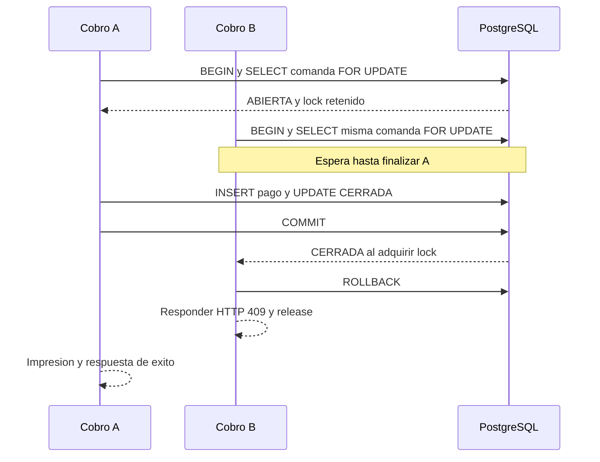

# SDD-001: Estabilizacion de comandas y cobro

Estado: Implementado
Actualizacion parte A (2026-11-09): declaracion local backend-borboto/src/multer.d.ts; el comando TypeScript backend --noEmit termina ahora con cero errores. Sin cambios de dependencias de produccion. Los errores Multer mencionados abajo son evidencia historica anterior a esta limpieza.
Responsable: GitHub Copilot, arquitectura e implementacion solicitadas por el usuario.
Fecha / revision: 2026-11-09 / 1.
Fuentes As-Built relacionadas: [03](03-contratos-y-datos.md), [04](04-flujos-y-funcionalidad.md), [plantilla SDD](05-reglas-sdd-y-convenciones.md).

## Problema y alcance

Estabilizar cancelacion, cobro y lecturas de items sin cambiar las reglas financieras del POS.

Incluido: cambios locales en [backend-borboto/index.ts](../../backend-borboto/index.ts), verificacion de consumidores, regeneracion de [server.js](../../server.js) con el script existente y actualizacion de 03/04. Angular solo se modificara si el contrato corregido requiere otro mapeo.

Excluido: migraciones, autorizacion HTTP, recalculo autoritativo del pago, cobros parciales, cambios de descuentos/puntos, concurrencia de otros endpoints, cola de impresion, refactorizacion general y ejecucion sobre datos reales. No editar el bundle manualmente.

Actores y dispositivos: operadores de Electron y clientes LAN que usan los contratos existentes; no cambia presentacion, accesibilidad ni permisos de UI.

## Evidencia inicial (antes de SDD-001)

- POST cancelar inicia BEGIN y retorna 404/400 sin ROLLBACK; finally libera el client.
- POST cobrar inserta pagos sin consultar/bloquear el estado de la comanda. Un segundo POST puede repetir el efecto.
- GET comanda activa y GET comanda por ID usan precio_unitario AS subtotal. La columna SQL ci.subtotal ya genera cantidad*precio_unitario.
- GET caja/mesa y GET caja/comanda solo proyectan cabecera, sin items; [CajaService](../../src/app/core/services/caja-service.ts) lee los items mediante los dos GET de comandas.
- [ComandaService](../../src/app/core/services/comanda.ts) transforma subtotal y producto.precio con Number y suma subtotal sin volver a multiplicarlo. Los borradores calculan cantidad*precio.
- [orden-resumen.html](../../src/app/features/comanda/components/orden-resumen/orden-resumen.html) usa producto.precio*cantidad. [desglose-cuenta.html](../../src/app/features/caja/components/desglose-cuenta/desglose-cuenta.html) y [desglose-mesa-dialog.html](../../src/app/features/mesas/components/desglose-mesa-dialog/desglose-mesa-dialog.html) muestran subtotal directamente.

Hipotesis comprobable: corregir las dos proyecciones y agregar control transaccional en los dos POST resuelve los tres requisitos sin cambiar Angular. Prueba discriminante: ejecutar los handlers extraidos de la fuente con clientes controlados; comprobar secuencia SQL/respuestas, dos cobros concurrentes y cantidad 3 con precio 12.50 -> subtotal 37.50.

## Reglas y criterios de aceptacion

### REQ-01: Cancelacion con transaccion limpia

- AC-01: Dada comanda inexistente, cancelar devuelve 404 solo despues de ROLLBACK y libera el client una vez.
- AC-02: Dada comanda no ABIERTA, devuelve 400 despues de ROLLBACK, sin UPDATE ni eventos.
- AC-03: Dada ABIERTA, mantiene la cancelacion, libera mesa/items, COMMIT y eventos existentes.
- AC-04: Ante error SQL previo a COMMIT, intenta ROLLBACK antes de devolver 500 y liberar. Si falla ROLLBACK, libera con Error para descartar la conexion, nunca devolverla reutilizable al pool.

### REQ-02: Cobro con bloqueo e idempotencia de estado

- AC-05: Despues de BEGIN y antes de configuracion fiscal, INSERT o efectos externos ejecuta SELECT id, mesa_id, estado, total FROM comandas WHERE id = $1 FOR UPDATE con comandaId parametrizado.
- AC-06: Sin comanda: ROLLBACK y 404 {error:'Comanda no encontrada'}, sin pago/factura/impresion/eventos.
- AC-07: Estado distinto de ABIERTA: ROLLBACK y 409 {error:'La comanda ya fue cobrada o cancelada'}, sin efectos posteriores.
- AC-08: Dos cobros de la misma comanda abierta se serializan; primero confirma y segundo observa CERRADA y devuelve 409; solo un INSERT pagos.
- AC-09: Error antes de COMMIT revierte y libera limpio o descarta conexion si rollback falla. No se intenta deshacer una transaccion ya confirmada por un error posterior.

### REQ-03: Subtotal real y precio unitario

- AC-10: Ambos GET de comandas proyectan ci.subtotal y ci.precio_unitario, conservando producto.precio como unitario historico de la linea.
- AC-11: Cantidad 3 y precio 12.50 entregan subtotal 37.50 y precio unitario 12.50; cantidad 1 y precio cero tambien conservan valores correctos.
- AC-12: Total visual suma subtotales de guardados y borrador, sin multiplicar el subtotal nuevamente; desgloses muestran la linea completa. Se mantienen cabeceras de caja y carga de items separada.

## Contratos

HTTP: POST /api/comandas/:comandaId/cancelar conserva cuerpo notas y respuestas actuales 200/400/404/500; 400/404 cierran transaccion antes de responder.

POST /api/caja/cobrar mantiene cuerpo y respuesta exitosa; agrega 404 y 409 exactos de AC-06/07. Repetir no devuelve el recibo previo: es rechazo por estado, no replay por idempotency key. La UI mantiene su manejo generico de errores HTTP.

GET /api/comandas/activa/:mesaId y GET /api/comandas/:comandaId mantienen identidad/origen/items/producto; subtotal pasa a significar importe real de linea y precio_unitario es campo adicional. producto.precio permanece unitario. NUMERIC puede ser string por pg; el mapeo Number existente de ComandaService y number pipe en desgloses son compatibles.

GET /api/caja/mesa/:mesaId y GET /api/caja/comanda/:comandaId no cambian: son cabeceras. No agregar items duplicados ni romper su contrato.

IPC sin cambios. Socket mantiene actualizar_mesas/actualizar_cocina en exito; rechazos y errores precommit no emiten esos eventos. Se conserva el riesgo existente de otros endpoints no serializados.

## Datos y estados

Sin cambios de esquema ni backfill: se utiliza subtotal generado existente. Cancelacion ABIERTA -> CANCELADA; cobro ABIERTA -> CERRADA. FOR UPDATE mantiene lock de fila hasta COMMIT/ROLLBACK. Un segundo cobro bajo aislamiento habitual READ COMMITTED relee el estado confirmado antes de continuar.

Seguimiento local de transaccion: se marca potencialmente abierta antes de intentar BEGIN, para cubrir tambien fallos de inicio; COMMIT/ROLLBACK exitoso cierra. Catch revierte solo si sigue potencialmente abierta. Ante fallo de rollback, release(Error) descarta el client; si el rollback confirma limpieza, release permite reutilizarlo incluso tras un BEGIN fallido.

No cambia la aceptacion de importes enviados por cliente ni la llamada fiscal dentro de transaccion; los efectos externos no tienen compensacion distribuida. Cancelacion y adiciones concurrentes siguen fuera de la garantia entre dos cobros; no afirmar exclusividad global del ciclo de comanda.

## Diseno propuesto

index.ts controla el lock y las salidas HTTP usando el client retenido actual; dos flags locales de transaccion/error de liberacion evitan reutilizacion de una conexion incierta. Se agregan ROLLBACK explicitos en salidas tempranas. Las dos consultas de items usan columna generada y campo unitario. Consumidores Angular permanecen sin cambios si AC-12 se confirma.

## Seguridad, operacion y accesibilidad

Se mejora integridad de transacciones y duplicados por cobro, no autenticacion ni autorizacion. Sin nuevos logs de datos personales/credenciales. No llamar Facturapi, impresoras o Sheets durante pruebas controladas. FOR UPDATE puede esperar por transacciones largas (incluida llamada fiscal); timeout/retry no se modifica. Sin cambios de UI: no se atribuye nueva auditoria AXE.

## Plan de verificacion

| Prueba | REQ / AC | Evidencia esperada |
| --- | --- | --- |
| TEST-01 | REQ-01 / AC-01..04 | Handler cancelacion con doble pg: 404, 400, exito, fallo SQL y fallo rollback; rollback antes de respuesta/release, conexion descartada si falla |
| TEST-02 | REQ-02 / AC-05..09 | Handler cobro con doble pg y lock controlado: inexistente/no ABIERTA, error SQL, dos requests concurrentes; un pago y respuestas 200/409 |
| TEST-03 | REQ-03 / AC-10..12 | Handler de cada GET con fixture de cantidad/precio; validar SELECT real, respuesta y formulas de consumidores; 37.50 no 12.50 ni 112.50 |
| TEST-04 | Transversal | Diagnosticos editor y TypeScript local; separar errores previos del cambio |
| TEST-05 | Produccion | bun run build:server genera server.js; comprobar contenido propio actualizado y ausencia de edicion manual |

Pruebas locales mediante Node/TypeScript y dobles en memoria, sin nuevos archivos de test fuera del alcance. No iniciar initDB ni ejecutar 000_init.sql. Las pruebas de dobles no sustituyen una prueba concurrente con PostgreSQL real: registrar expresamente ese limite. Comprobar git diff para limitar cambios al index, bundle y documentos autorizados. No ejecutar dist ni build Angular sin necesidad.

## Entrega y decisiones

Orden: especificacion primero, validacion documental, cambios fuente, pruebas enfocadas inmediatas, tipado/bundle y cierre As-Built. La solicitud del usuario aprueba estos requisitos; no hace falta una segunda aprobacion para implementarlos.

No se crea un helper transaccional global ni se refactorizan handlers vecinos. No se crea UNIQUE pagos(comanda_id), pues requeriria migracion y reglas historicas fuera de alcance. La columna subtotal generada evita duplicar el calculo SQL. Campos de precio del producto conservan significado actual.

### Evidencia de ejecucion (2026-11-09)

- TEST-01/02: 16 escenarios de handlers extraidos mediante AST TypeScript y ejecutados con Node/VM y dobles pg. Pasan inexistente, CERRADA, CANCELADA, exito y fallos de SELECT, BEGIN, COMMIT y ROLLBACK en ambos POST; se verifica orden rollback/respuesta/release y descarte con Error.
- TEST-02/03: 8 escenarios adicionales pasan: dos requests con lock simulado producen 200/409 y un INSERT; seis fixtures de ambos GET (cantidad 3/1, precio 12.50/0); formula real totalComanda con 37.50 guardado + 10 de borrador = 47.50. Sin dobles efectos externos reales.
- Consumidores y templates inspeccionados: no requieren cambios Angular; precio unitario anidado permanece separado del subtotal de linea. Caja continua leyendo items desde comandas.
- TEST-04: `node node_modules/typescript/bin/tsc -p backend-borboto/tsconfig.json --noEmit --pretty false` termina con cuatro errores previos: falta declaracion Multer y tres parametros implicitos de su fileFilter. Editor coincide. Comparacion semantica de programas actual/HEAD en memoria no detecta nuevos errores (ignora offsets distintos por CRLF); no se instalan tipos fuera del alcance.
- TEST-05: `bun run build:server` exitoso. `node --check server.js` y comprobacion de lock, conflicto y proyeccion corregida en bundle pasan. server.js fue generado, no editado manualmente.
- No se ejecutaron initDB, migraciones ni cobros sobre PostgreSQL real; tampoco impresion fisica o Facturapi. Las pruebas transitorias se ejecutaron en terminal sin crear archivos de tests. La garantia PostgreSQL de FOR UPDATE queda pendiente de prueba de integracion en una BD desechable bajo aislamiento configurado.

REQ-01, REQ-02 y REQ-03 implementados y cubiertos por pruebas controladas; documentos 03/04 actualizados. No se declara compilacion strict global limpia ni estado Verificado en instalacion real. No se extiende esta garantia a cancelacion/adiciones concurrentes u otros caminos que no toman el lock antes de leer estado.