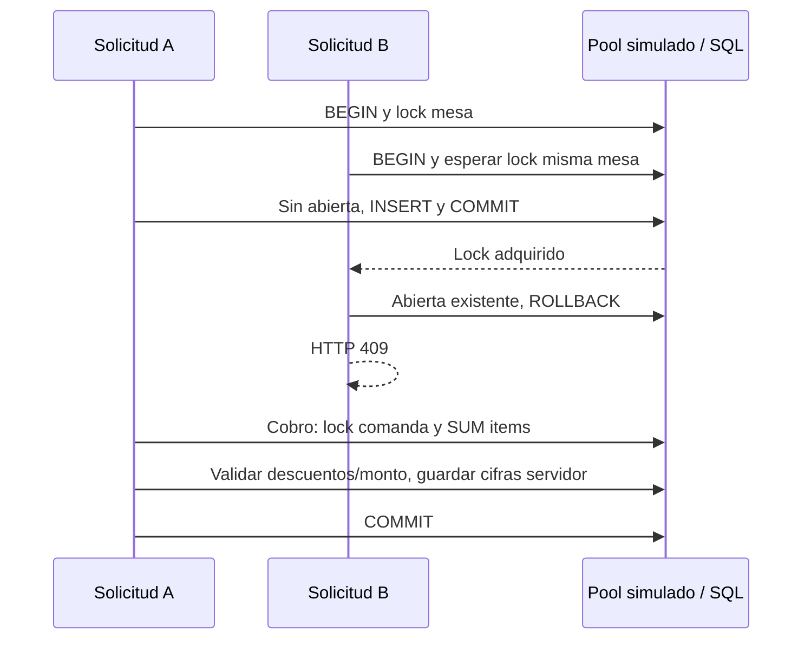

# SDD-002: Integridad de mesa, cobro y sockets

Estado: Implementado
Responsable: GitHub Copilot por solicitud del usuario.
Fecha / revision: 2026-11-09 / 1.
Fuentes As-Built: [02](02-especificacion-componentes.md), [03](03-contratos-y-datos.md), [04](04-flujos-y-funcionalidad.md), [plantilla](05-reglas-sdd-y-convenciones.md).

## Problema y alcance

Incluido: indice unico parcial y migracion 004, apertura/movimiento fisico protegidos, conflicto 23505 en adiciones, cobro autoritativo y teardown SocketService; bundle y documentos relacionados. Actores: Electron y clientes LAN existentes.

Excluido: iniciar PostgreSQL/pg_ctl/initdb/Electron, conexion al puerto 58432, cierre automatico de duplicados historicos, cambios de permisos, cobros parciales persistentes y refactorizacion de otros handlers.

## Evidencia actual

index.ts abre/mueve sin lock de mesa. SQL usa idx_comandas_mesa no unico (el nombre real difiere del mencionado en la solicitud). Cobro ya bloquea comanda desde SDD-001 pero confia en cifras cliente. SocketService registra callbacks sin teardown. Parte A ya declara Multer localmente y verifica backend limpio.

Hipotesis: locks de mesa serializan operaciones, el indice protege tambien creaciones por otros caminos; sumar subtotal persistido evita total manipulado; off con callback retenido evita acumulacion. Prueba discriminante: handlers extraidos por AST con mocks pg/lock y Observable real con socket doble; sin importar el backend completo ni iniciar servicios.

## Reglas y criterios de aceptacion

- REQ-01 / AC-01: indice UNIQUE solo para ABIERTA y mesa_id no NULL, en esquema inicial y 004. La migracion toma lock de tabla, detecta duplicados y aborta explicitamente, sin cerrar pedidos ni alterar datos; IF NOT EXISTS permite repetirla. Requiere reconciliacion manual antes de reintentar si detecta duplicados.
- REQ-01 / AC-02: abrir bloquea SELECT id, estado FROM mesas WHERE id=$1 FOR UPDATE y comprueba ABIERTA existente; conflicto 409 La mesa ya tiene una comanda abierta despues de rollback. Mesa inexistente 404.
- REQ-01 / AC-03: mover bloquea origen/destino en orden numerico estable, comprueba destino y devuelve 409 por ocupacion; 23505 en abrir/mover/agregar tambien hace rollback y 409. El indice es la ultima defensa de todos los escritores.
- REQ-02 / AC-04: despues del lock de comanda, suma COALESCE(SUM(subtotal),0), sincroniza comandas.total; ignora totalCuenta/cambio cliente y calcula importes monetarios redondeados a centavos.
- REQ-02 / AC-05: descuento manual finito/no negativo y no mayor al subtotal; promocion activa se calcula desde BD; puntos enteros/no negativos se verifican contra saldo del cliente bloqueado. No combinar promocion con puntos. Total minimo cero; rechazar valores invalidos con 400/rollback, sin pago.
- REQ-02 / AC-06: EFECTIVO requiere monto suficiente para total o parte proporcional; 400 Monto recibido insuficiente para cubrir el total de la cuenta. Cambio calculado en servidor; otros metodos cambio cero. Partes entero positivo. Mantener respuesta previa y agregar cifras autoritativas.
- REQ-03 / AC-07: Observable conserva handler y unsubscribe llama socket.off(eventName,handler) con la misma referencia; otras suscripciones no se eliminan.

## Contratos

Apertura/movimiento/adiciones: 409 {error:'La mesa ya tiene una comanda abierta'} ante conflicto. Cobro mantiene identidad/autofactura/ticketTexto/impresionesPendientes, agrega totalCuenta, descuento y cambio autoritativos. Errores de validacion 400 con error; no cambia IPC ni nombres Socket. Consumidores actuales toleran campos adicionales. NUMERIC de pg se normaliza localmente; subtotal no multiplica cantidad nuevamente.

## Datos y estados

004 bloquea comandas y aborta si GROUP BY mesa_id HAVING COUNT(*)>1 entre ABIERTA no NULL. No backfill destructivo. Instalar indice antes de operar para garantizar unicidad por caminos no bloqueados. Los locks de apertura/movimiento duran hasta commit/rollback. Se preservan transacciones y estados ABIERTA/CERRADA; division sigue cerrando toda comanda.

## Diseno propuesto

Cambios locales en index.ts, SQL inicial/004 y socket.service.ts. Sin ORM ni nuevo servicio de dominio. Descuentos promocionales se calculan desde tipo/valor activo, puntos equivalen a pesos como UI actual; descuento manual sigue permitido, pero acotado. No se cambia la construccion fiscal por producto; su conciliacion con descuentos desglosados queda fuera de esta fase.

## Seguridad, operacion y accesibilidad

Prohibidos servicios reales durante validacion. No autoriza importes negativos/NaN ni promociones inexistentes. Sin nuevos logs de secretos. No modifica UI ni declara auditoria AXE. Indice protege integridad, no sustituye autorizacion ni serializa adiciones contra cobro: esa concurrencia es riesgo residual.

## Plan de verificacion

TEST-01 -> AC-01..03: AST SQL verifica indice/predicado y guard de duplicados; mocks ejercitan locks y conflictos 23505, rollback antes de respuesta; pares concurrentes 200/409.
TEST-02 -> AC-04..06: fixtures SUM real distinto de total cliente; verificar INSERT y UPDATE, descuentos invalidados y monto insuficiente con 400/rollback; no invocar Facturapi real.
TEST-03 -> AC-07: extraer metodo SocketService y ejecutar Observable RxJS con socket on/off controlado; unsubscribe retira mismo handler.
TEST-04: tsc backend y raiz --noEmit, cero errores; build:server y node --check. No emitir build Angular ni ejecutar migraciones.
TEST-05: actualizar 02/03/04 y estado Implementado; evidencia explicita de mocks, sin certificar comportamiento contra PostgreSQL instalado.

## Entrega y decisiones

Solicitud aprueba requisitos. Crear especificacion antes del cambio productivo; validar inmediatamente cada slice. Se elige abortar migracion ante duplicados, no cerrar ventas arbitrariamente. Preservar cambios existentes SDD-001. Evidencia final se agregara tras pruebas; sin instancia PostgreSQL activa.

### Evidencia final (2026-11-09)

- TEST-01/02: seis escenarios Node/VM con handlers extraidos de AST pasan: apertura concurrente 200/409, movimiento concurrente 200/409, intento de unique_violation con rollback y cobro con total manipulado/efectivo insuficiente. Nueve casos complementarios verifican 409 y rollback exitoso en abrir/mover/agregar ante 23505, descuentos negativos/excesivos, descuento manual valido, promocion activa, saldo de puntos insuficiente y division proporcional. No se importa index.ts completo ni se contactan servicios reales.
- TEST-03: Observable RxJS real con metodo extraido de SocketService y socket doble: subscribe/unsubscribe invoca off con exactamente el eventName y handler registrados por on.
- SQL: comprobaciones estaticas de guard GROUP BY/HAVING, lock de tabla, cierre PL/pgSQL END; e indice/predicado en ambos SQL pasan. No se ejecuto 004; no se certifica sintaxis mediante un servidor PostgreSQL. Aplicar migracion en despliegue antes de depender de la garantia unica; duplicados requieren reconciliacion manual.
- TEST-04: `node node_modules/typescript/bin/tsc -p backend-borboto/tsconfig.json --noEmit --pretty false`, `-p tsconfig.app.json --noEmit --pretty false` y `-p tsconfig.json --noEmit --pretty false`: cero errores. `bun run build:server` y `node --check server.js`: exito. Declaracion Multer local, sin cambios de dependencias.
- TEST-05: 02/03/04 actualizados. Estado Implementado; no Verificado contra BD o dispositivos. No se iniciaron pg_ctl, initdb, Electron ni se intento conexion a 58432.

Riesgos conservados: el runner de migraciones usa Pool.query (no client retenido); operacion SQL real pendiente. Otros escritores pueden devolver error SQL generico aun cuando el indice impida duplicados. Adiciones simultaneas con cobro no toman el mismo lock de comanda; la suma es autoridad del cobro pero no garantiza exclusividad de ese otro flujo. Descuentos manuales siguen permitidos y acotados, no autorizados por rol. Facturapi desglosado por producto no reconcilia descuentos; consumo agrupado usa totalCuenta autoritativo. Division mantiene cierre completo con metadatos, no pagos parciales acumulados.