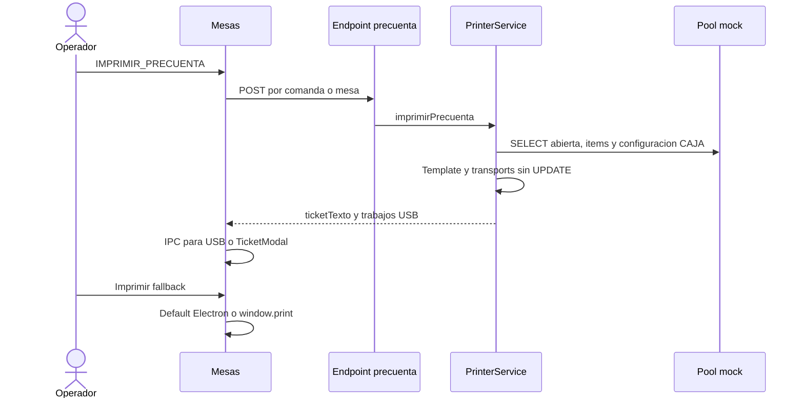

# SDD-003: Precuenta, SERVIDO y fallback de TicketModal

Estado: Implementado
Responsable: GitHub Copilot por solicitud del usuario.
Fecha / revision: 2026-11-09 / 1.
Fuentes As-Built: [02](02-especificacion-componentes.md), [03](03-contratos-y-datos.md), [04](04-flujos-y-funcionalidad.md), [plantilla SDD](05-reglas-sdd-y-convenciones.md).

## Problema y alcance

Incluido: template/metodo de precuenta, rutas HTTP por comanda o mesa, accion de Mesas y servicio consumidor; transaccion SERVIDO; fallback TicketModal; bundle y As-Built. Actores: Electron y navegador LAN actuales.

Excluido: iniciar PostgreSQL, pg_ctl, initdb, Electron o conectar puerto 58432; pagos, flags de cocina, migraciones, autorizacion y cola durable. No imprimir fisicamente en pruebas.

## Evidencia actual

Mesas IMPRIMIR_PRECUENTA solo notifica. PrinterService maneja destinos CAJA, RED/USB/SIMULACION y templates 58/80 mm. Servir solo cambia mesas.estado. TicketModal exige printerName y no ofrece salida util a textos fallback.

Hipotesis: lectura de comanda/items y reutilizacion de transports permiten precuenta sin mutaciones; una transaccion con lock sincroniza SERVIDO; default Electron o window.print resuelve el fallback. Comprobacion barata: AST extrae metodos/handlers y mocks capturan SQL, trabajos, eventos y print sin cargar modulos que conecten a DB.

## Reglas y criterios de aceptacion

- REQ-01 / AC-01: precuenta se identifica como PRECUENTA / NO ES COMPROBANTE DE PAGO, incluye negocio, origen/folio/mesa, mesero, fecha, cantidades, unitarios, subtotales y total desde items; ambas anchuras.
- REQ-01 / AC-02: solo ABIERTA; 404 si no existe abierta y 400 si no tiene items. Todas las consultas de precuenta son SELECT: sin pagos, UPDATE estados ni flags impreso/impreso_en.
- REQ-01 / AC-03: CAJA activa: RED envia, USB retorna trabajos, simulacion/error retorna texto; sin impresoras genera fallback 80mm. UI procesa trabajos y abre TicketModal para texto; error USB tambien permite vista de ese trabajo.
- REQ-02 / AC-04: servir BEGIN, SELECT mesa FOR UPDATE, UPDATE mesa y comandas ABIERTA a SERVIDO, COMMIT y ambos eventos. Inexistente: ROLLBACK/404. Error precommit: rollback; si falla, descartar client con release(Error); sin rollback tras commit confirmado.
- REQ-03 / AC-05: printerName conserva envio local; sin nombre busca default del sistema. Si no hay default o falla envio/listado, window.print disponible abre dialogo de impresion; no informar que el papel ya se imprimio. Sin alternativa, mostrar error claro.

## Contratos

POST /api/comandas/:comandaId/precuenta, cuerpo opcional vacio -> {ok:true,comandaId,ticketTexto:string|null,impresionesPendientes:ElectronPendingPrintJob[]}. POST /api/mesas/:mesaId/precuenta resuelve comanda ABIERTA y usa mismo servicio. IDs enteros positivos; 400 invalido/sin items, 404 sin abierta, 500 fallo operativo. No cambia contratos de cobro.

POST servir mantiene {ok,mensaje}; agrega transaccion, 404 mesa inexistente y actualizar_cocina ademas de actualizar_mesas. IPC existente, sin canales nuevos. Tipos de trabajos y ancho reutilizados.

## Datos y estados

Precuenta no escribe ninguna tabla ni requiere flags de impresion; recalcula total de lineas leidas sin guardar comandas.total. Lecturas separadas no garantizan snapshot ante adiciones/cobro simultaneos. SERVIDO cambia mesa y estado operativo de comandas ABIERTA, no cierre ni estado_kds. Mesa sin abierta se marca SERVIDO segun contrato pedido.

## Diseno propuesto

generarTemplatePrecuenta independiente evita etiquetas/metodos/pago/autofactura de cobro. imprimirPrecuenta usa queries de lectura y helpers actuales de empresa/destino/transporte. Dos endpoints concretos resuelven identidad sin sobrecargar un ID de comanda con un ID sintetico de mesa. MesaService ofrece llamada por Mesa; Mesas invoca, procesa USB y visualiza fallback. TicketModal prueba nombre/default y finalmente window.print; este imprime la ventana actual, no promete seleccion de dispositivo ni impresion silenciosa.

## Seguridad, operacion y accesibilidad

Texto sin HTML construido desde datos externos; TicketModal conserva interpolacion Angular. No logs nuevos de secretos. Sin pruebas de impresoras reales; limite de ventana de navegador explicitado. No modificar permisos ni afirmar auditoria AXE nueva. Evitar confirmaciones falsas de impresion completada.

## Plan de verificacion

TEST-01 -> AC-01..03: template real, servicio real extraido con mocks pg/transports, ambos anchos y destinos; errores 404/400 y ninguna query INSERT/UPDATE/DELETE. Handler real por ambas identidades; mesero/folio y suma correctos.
TEST-02 -> AC-04: handler real con mocks client; secuencia lock/updates/commit, dos eventos; 404/error SQL/rollback fallido, release una vez.
TEST-03 -> AC-05: metodo modal extraido con servicio y window mock; nombre, default, sin default, listado/envio fallido y print no disponible.
TEST-04: --noEmit backend, tsconfig.app y raiz: cero errores; build:server oficial y node --check (sin ejecutar bundle).
TEST-05: enlaces/documentos 02/03/04, estado Implementado; registrar limitacion sin DB ni DOM real.

## Entrega y decisiones

Especificar primero, validar cada slice y conservar cambios del usuario. No introducir pagos ficticios ni reusar imprimirComandaProduccion (escribe impreso). Estado final solicitado Implementado, no Verificado en hardware. Evidencia de ejecucion se agregara al cierre.

### Evidencia final (2026-11-09)

- TEST-01: seis escenarios con template y metodo imprimirPrecuenta reales extraidos/transpilados en Node/VM, pool/transports mocks: inexistente 404, vacia 400, USB, RED, SIMULACION y sin impresoras. Queries capturadas exclusivamente SELECT, texto sin etiqueta de pago y total 37.50 para tres items unitarios 12.50; trabajos USB y fallback 58/80 mm.
- TEST-02: diez casos de handlers reales en VM: precuenta por ambas identidades con exito/400/404; SERVIDO con lock, ambos UPDATE, COMMIT y dos eventos, 404 con rollback, fallo SQL y fallo rollback con release(Error). Sin importacion ejecutable del backend completo.
- TEST-03: diez casos frontend reales extraidos con mocks de window, dialogs y servicios, Observable RxJS real: nombre, default, sin default, envio/listado fallido y sin window.print; Mesas con USB, texto, error USB y error HTTP. No se realizo impresion fisica ni DOM real.
- TEST-04: tsc --noEmit backend-borboto/tsconfig.json, tsconfig.app.json y tsconfig.json, cero errores. bun run build:server y node --check server.js exitosos; bundle generado, no editado manualmente.
- TEST-05: As-Built 02/03/04 actualizado. Validaciones de enlaces y fences al cierre. No se iniciaron PostgreSQL, pg_ctl, initdb o Electron, ni se conecto a 58432.

Limites: precuenta lee cabecera e items por separado, no garantiza snapshot ante cambios concurrentes. RED/USB/sistema real y renderizado de impresion pendientes de validacion en dispositivo. Fallback window.print imprime ventana actual y puede incluir contenido ajeno al ticket segun estilos del navegador; no garantiza papel entregado. No hay nuevas restricciones de permisos ni cola persistente. SQL de precuenta no modifica total almacenado, estado, pagos o flags de cocina.