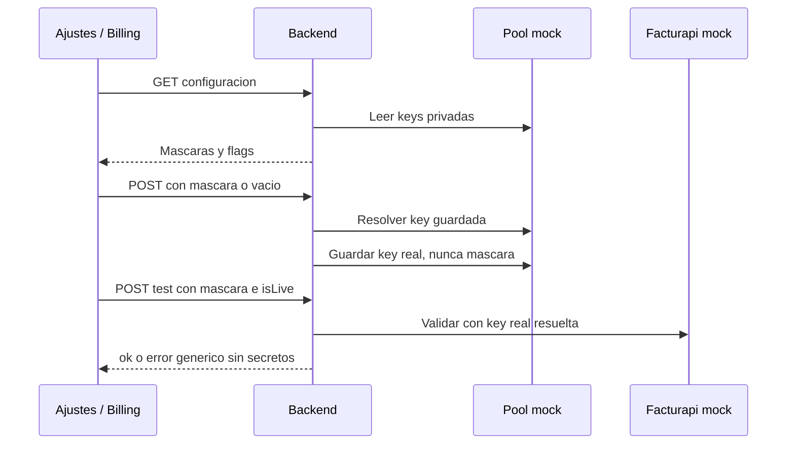

# SDD-004: Proteccion de secretos y contratos administrativos

Estado: Implementado
Responsable: GitHub Copilot por solicitud del usuario.
Fecha / revision: 2026-11-09 / 1.
Fuentes As-Built: [02](02-especificacion-componentes.md), [03](03-contratos-y-datos.md), [04](04-flujos-y-funcionalidad.md), [plantilla](05-reglas-sdd-y-convenciones.md).

## Problema y alcance

Incluido: handlers usuarios/facturacion/categorias/productos en index.ts, formularios Ajustes/Billing y tipos de servicio, bundle y As-Built. Actores: administracion Electron y consumidores HTTP existentes.

Excluido: migraciones, hashing de PIN, autorizacion HTTP, cifrado en reposo, rotacion/borrado explicito de keys, modificaciones de licencia y operacion de PostgreSQL. Prohibido iniciar pg_ctl/initdb/Electron o conectar puerto 58432; no contactar Facturapi real en pruebas.

## Evidencia actual

GET usuarios expone pin; POST/PUT usan RETURNING *. Ajustes copia el empleado y bloquea guardar si falta PIN. GET fiscal devuelve keys completas y Billing las carga/reenvia. POST fiscal guarda campos tal cual y test usa el valor recibido. Categoria POST ignora destino; CRUD producto omite clave_sat; el tipo categoria no incluye CAJA y no hay campo SAT editable.

Hipotesis: proyecciones seguras, preservacion SQL del PIN y resolucion server-side de keys permiten mantener UI sin fuga. Una prueba con mocks de pool/Facturapi que capture respuestas y parametros distingue secreto conservado de mascara persistida. Probar catalogos con parametros SQL y formularios sin servicios reales.

## Reglas y criterios de aceptacion

- REQ-01 / AC-01: GET usuarios devuelve id/nombre/rol/activo, pin vacio y tienePin:true; nunca PIN real. POST/PUT tampoco retornan PIN.
- REQ-01 / AC-02: alta exige PIN string de 4..6 digitos; PUT omitido/vacio conserva actual mediante COALESCE; nuevo valido sustituye, invalido 400; 23505 -> 409 PIN ya utilizado por otro usuario. UI limpia PIN al comenzar edicion y no lo exige para guardar nombre/rol/activo; alta si lo exige.
- REQ-02 / AC-03: GET fiscal devuelve ******** y ultimos cuatro caracteres solo si longitud>4, o vacio si no hay key; tieneApiKeyTest/tieneApiKeyLive indican existencia. Nunca retornar secreto completo, incluso keys cortas.
- REQ-02 / AC-04: POST fiscal omitido/vacio/enmascarado conserva key almacenada; valor nuevo reemplaza. Nunca almacenar mascara. Sin test key existente/nueva devuelve 400 para cumplir NOT NULL. CSD utiliza la key resuelta del modo activo. Respuesta solo ok/mensaje.
- REQ-02 / AC-05: POST test recibe apiKey e isLive; vacio/enmascarado usa key almacenada del modo elegido, o modo guardado si isLive omitido. Sin key 400; proveedor mock recibe secreto real, respuesta no lo incluye. Errores fiscales HTTP genericos, no mensajes externos potencialmente sensibles.
- REQ-03 / AC-06: POST categoria persiste destino_impresion o COCINA por default, tipo admite CAJA. Producto POST/PUT/GET admin incluye clave_sat; PUT omitido preserva valor, vacio/null permite limpiar. UI permite editar en alta/edicion.

## Contratos

GET usuarios conserva pin:'' para compatibilidad y agrega tienePin. PIN nuevo solo entra por request, no retorna ni se precarga en UI. Estado/roles existentes sin cambio.

FacturacionConfig agrega flags opcionales; apiKeyTest/Live son mascara de visualizacion, nunca credenciales para el SDK. POST test isLive opcional mantiene compatibilidad. Formulario permite campos vacios al guardar configuracion existente con flags; alta requiere test key. Servidor sigue siendo autoridad de preservacion. Las mascaras empiezan por asterisco o bullet y son valores reservados.

ProductoAdmin agrega clave_sat?:string|null; CategoriaAdmin agrega CAJA. Los campos restantes y eventos se conservan. Sin nuevos IPC/socket.

## Datos y estados

Sin cambios de esquema. PIN sigue almacenado como texto; COALESCE conserva cuando no se solicita cambio. Keys permanecen privadas en SQL; guardar mascara/vacio significa conservar, no borrar. Lectura/guardado fiscal mantiene patron actual sin transaccion de configuracion; concurrencia de ediciones es riesgo residual. No se cambia estado de comandas/pagos ni migraciones.

## Diseno propuesto

Helpers locales de mascara/resolucion en index.ts; proyecciones explicitas para usuarios. PIN y clave_sat omitidos conservan mediante SQL. POST fiscal lee configuracion privada para resolver keys y CSD. UI solo utiliza mascara/flags; formulario de empleado inicia pin vacio. Campo SAT usa controles Material existentes.

## Seguridad, operacion y accesibilidad

Eliminar secretos de respuestas, incluidos errores del proveedor y RETURNING de usuarios. No agregar logs de PIN/keys. Sin afirmar autorizacion o cifrado no implementados. Campos Material con label, misma navegacion; pruebas UI en memoria, no auditoria AXE nueva. Ultimos cuatro caracteres son informacion parcial intencional.

## Plan de verificacion

TEST-01 -> AC-01/02: handlers extraidos de AST con mocks pool; PIN nunca en JSON, alta requerida, PUT conserva/reemplaza, conflicto 23505. Metodo UI limpia PIN; template no bloquea edicion vacia.
TEST-02 -> AC-03..05: masks largas/cortas/ausentes, guardar vacio/mascara conserva y nuevo reemplaza; SDK mock recibe key resuelta en test/CSD y errores no filtran valores.
TEST-03 -> AC-06: SQL/params categoria/producto, preservacion/limpieza SAT; tipos y campos UI.
TEST-04: --noEmit backend, tsconfig.app y raiz, cero errores; build:server y node --check sin ejecutar bundle.
TEST-05: actualizar 02/03/04 y estado Implementado; documentar validacion en memoria, sin PostgreSQL activo.

## Entrega y decisiones

Solicitud aprueba alcance; crear especificacion antes del codigo. No introducir hashing incompatible con login existente. Reservar mascara para preservacion y no permitir borrado accidental de keys. Mantener distincion entre proteccion de respuestas y autorizacion pendiente. Evidencia final se agregara al cierre.

### Evidencia final (2026-11-09)

- TEST-01/03: 13 escenarios de handlers reales extraidos de AST en Node/VM con mocks pool: GET sin PIN incluso con fixture que lo contiene, PUT omitido/vacio/nuevo/invalido, 23505 POST/PUT, alta sin PIN, destino CAJA/default y SAT POST/PUT/preservacion.
- TEST-02: 13 escenarios fiscales con mocks pool/Facturapi: mascara larga/corta/ausente, conservar omitido/vacio/asteriscos/bullets, reemplazo nuevo, CSD con key guardada, modo test/live/guardado y error externo sin revelar key.
- TEST-01/03 UI: seis casos de metodos Ajustes/Billing y bindings con servicios/RxJS en memoria: limpiar PIN al editar, guardar sin PIN, alta exige PIN, pruebas con flags por modo y campos SAT/CAJA en ambos formularios.
- Cuatro escenarios adicionales: sin key inicial/guardada devuelve 400 sin escritura ni SDK; carga de flags mantiene required para alta y lo retira con test key almacenada. Total: 36 casos controlados pasan.
- TEST-04: `node node_modules/typescript/bin/tsc -p backend-borboto/tsconfig.json --noEmit --pretty false`, `-p tsconfig.app.json --noEmit --pretty false` y `-p tsconfig.json --noEmit --pretty false`: cero errores. `bun run build:server` y `node --check server.js`: exito.
- TEST-05: documentos 02/03/04 actualizados. Estado Implementado; no validacion de PostgreSQL, impresoras ni proveedor real. No se iniciaron pg_ctl/initdb/Electron ni se conecto al puerto 58432.

Limites: PIN almacenado en texto, sin autorizacion HTTP nueva; CORS abierto y otros secretos/token fuera de estas rutas siguen pendientes. Ultimos cuatro caracteres son revelacion parcial intencional de keys largas. Preservar key vacia/enmascarada no es mecanismo de borrado/rotacion; ediciones fiscales concurrentes conservan riesgo de sobrescritura entre lectura y UPSERT. Formularios mantienen convenciones existentes; no se declara auditoria AXE ni prueba visual real.