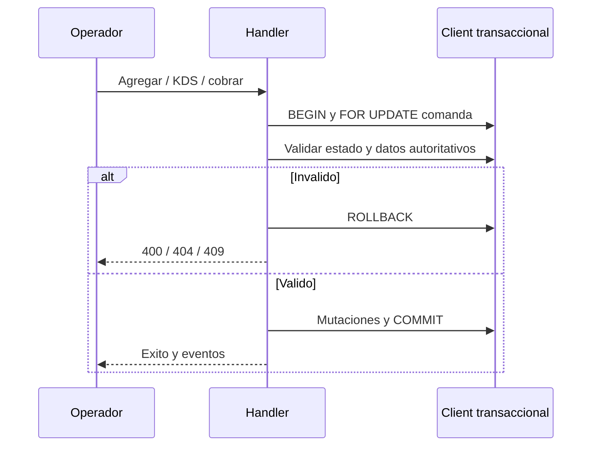

# SDD-008: Ciclo atomico de comanda y precios

Estado: Verificado
Responsable: Equipo Borboto
Fecha / revision: 2026-11-09 / 1
Fuentes As-Built relacionadas: [05](05-reglas-sdd-y-convenciones.md), [06](06-auditoria-y-refactorizacion-por-modulo.md), [backend](../../backend-borboto/index.ts).

## Problema y alcance
Incluido: CO-01, CO-02, KD-04 y CJ-04; agregar productos, KDS, cobro y lock vecino de cancelacion.
Excluido: cambios de UX, division de cuenta, autorizacion, fiscalidad y esquema.
Actores y dispositivos: operadores Electron y navegador LAN; contrato HTTP compartido.

## Evidencia actual
POST comandas acepta precios cliente y no bloquea ni valida estado. KDS escribe sin validar existencia/estado. Cobro permite mesa del body como fallback.
Hipotesis comprobable: validar bajo lock de comanda antes de mutar y usar catalogo/mesa persistidos elimina estas escrituras indebidas. Un handler real con client simulado que registre INSERT/UPDATE antes del rechazo refuta la hipotesis.

## Reglas y criterios de aceptacion
REQ-01 / AC-01: comanda existente bloqueada FOR UPDATE; ausente devuelve 404 Comanda no encontrada; CERRADA/CANCELADA devuelve 409 No se pueden agregar productos a una comanda cerrada o cancelada, con ROLLBACK sin insertar.
REQ-02 / AC-02: ID entero positivo y cantidad entera positiva; catalogo consultado en transaccion; ausente 400, no disponible 409 identificando producto. Precio NUMERIC de BD, incluido cero, es autoridad; precio cliente ignorado.
REQ-03 / AC-03: toggle bloquea comanda e item; despachar bloquea comanda. Ausente 404, no ABIERTA 409 con ROLLBACK. Eventos solo despues de COMMIT; cobro emite mesas y cocina.
REQ-04 / AC-04: mesa liberada exclusivamente desde mesa_id bloqueado; NULL conserva mesas ajenas incluso con mesaId cliente.
AC-05: sin cambios visuales ni de accesibilidad; contratos existentes de clientes LAN/Electron conservados salvo rechazos intencionales.

## Contratos
HTTP: POST /api/comandas conserva comandaId/mesaId/items/usuarioId y respuesta ok,totalAdicional,comandaId,ticketTexto,impresionesPendientes. Items acepta productoId o producto.id, cantidad y notas; precio no autoritativo. Validacion 400, conflicto 409, ausencia 404, fallo inesperado 500.
PATCH /api/cocina/items/:itemId/toggle y POST /api/cocina/tickets/:comandaId/despachar conservan respuesta {ok:true}; agregan 404/409.
POST /api/caja/cobrar conserva contrato; mesaId no determina mesa liberada.
Socket: actualizar_mesas y actualizar_cocina, broadcast sin payload, consumidores recargan HTTP; no emision en rechazo.
IPC: sin cambios. Importes NUMERIC se convierten a number; mesa_id nullable; fechas sin cambios.

## Datos y estados
Tablas: comandas, comanda_items, productos, mesas y pagos. Sin migracion ni backfill.
BEGIN -> lock comanda -> validar -> mutar -> COMMIT -> eventos/impresion. Cancelacion comparte lock; toggle adquiere primero comanda y despues item para evitar inversion respecto a despacho.
ABIERTA puede recibir items o transiciones KDS; CERRADA/CANCELADA no. No se introduce idempotencia de adicion ni se cambia el efecto fiscal externo existente.

## Diseno propuesto
Handlers existentes en index.ts, sin nuevas capas de produccion.

## Seguridad, operacion y accesibilidad
SQL parametrizado y validacion servidor. Sin secretos nuevos ni cambios de autorizacion. Errores liberan client; fallos de infraestructura conservan 500. Offline/timeouts e impresion conservan comportamiento existente. Sin cambios de foco, teclado, ARIA o contraste.
Prohibido iniciar PostgreSQL, pg_ctl, initdb, Electron o conectar al puerto 58432 en esta entrega.

## Plan de verificacion
TEST-01 (REQ-01/02): handlers aislados con mocks de Pool/client, estados terminales, producto ausente/no disponible, cantidades invalidas y precios manipulados/cero.
TEST-02 (REQ-03): KDS inexistente/terminal, ROLLBACK/release y eventos post-COMMIT.
TEST-03 (REQ-04): cobro externo con mesaId 5 no libera mesas y emite ambos eventos.
Gates: node --test backend-borboto/tests/sdd-008.test.cjs; tsc --noEmit -p backend-borboto/tsconfig.json, tsconfig.app.json y tsconfig.json; bun run build:server; node --check server.js.
Mocks verifican SQL/orden, no prueban el scheduler ni locks de PostgreSQL real.

## Entrega y decisiones
Orden: especificacion, handlers, arnes, gates, contratos/flujos y evidencia.
Trazabilidad: REQ-01 -> AC-01 -> POST comandas/cancelar -> TEST-01; REQ-02 -> AC-02 -> POST comandas -> TEST-01; REQ-03 -> AC-03 -> KDS/cobrar -> TEST-02/03; REQ-04 -> AC-04 -> cobrar -> TEST-03.
Bundle server.js solo regenerado mediante build. Evidencia: node --test backend-borboto/tests/sdd-008.test.cjs: 6 grupos aprobados, 0 fallos. bun x tsc --noEmit -p backend-borboto/tsconfig.json, tsconfig.app.json y tsconfig.json: 0 errores. bun run build:server y node --check server.js: exito. Contratos 03 y flujos 04 actualizados. PostgreSQL real y hardware excluidos expresamente; no se inicio ningun servicio ni se importo el arranque del backend en pruebas.