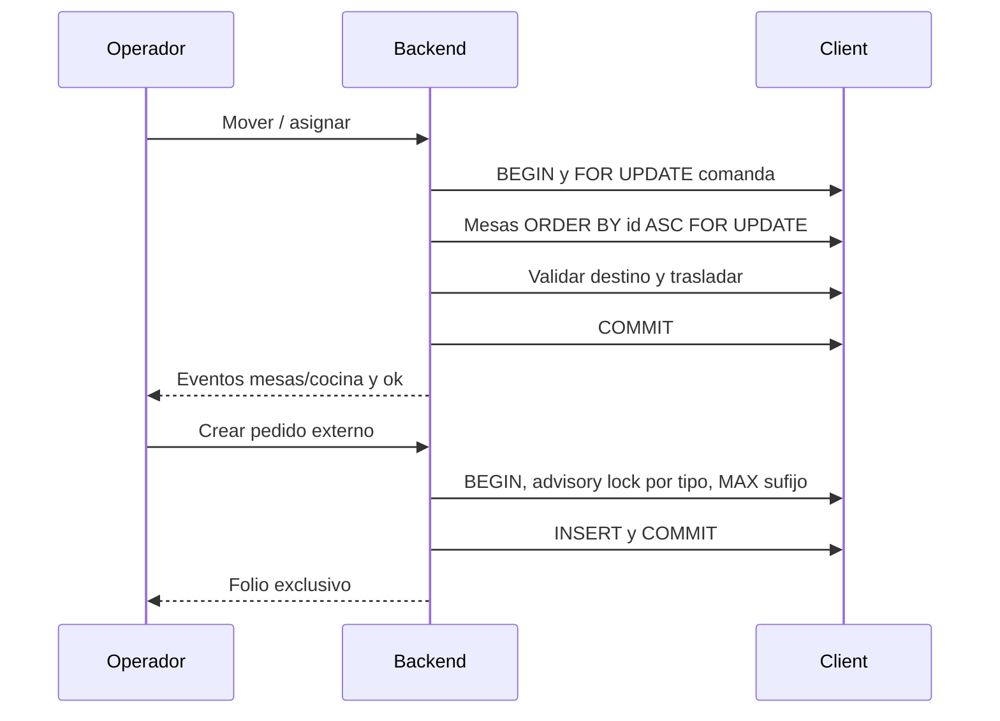

# SDD-009: Transferencias, folios y direccion de envio

Estado: Implementado
Responsable: Equipo Borboto
Fecha / revision: 2026-11-09 / 1
Fuentes As-Built relacionadas: [05](05-reglas-sdd-y-convenciones.md), [06](06-auditoria-y-refactorizacion-por-modulo.md), [backend](../../backend-borboto/index.ts).

## Problema y alcance
Incluido: ME-02/ME-04; politica unica de traslado/asignacion, folios diarios exclusivos para MOSTRADOR/ENVIO y persistencia de contacto de cliente existente antes de confirmar envio.
Excluido: fusion de cuentas, historial/snapshot de direccion por pedido, migraciones y cambios de autorizacion. Actores: operadores Electron/LAN.

## Evidencia actual
Tres handlers de traslado tienen locks/errores distintos y pueden limpiar destino=origen o mover estado sin comanda abierta. generarFolioOrigen usa COUNT+1; creaciones ya usan transaccion pero no lock exclusivo. Dialog envio cierra para cliente existente sin guardar direccion/telefono/notas editados.
Hipotesis comprobable: helper unico con comanda bloqueada antes de mesas ordenadas, y lock de folios retenido hasta insertar/commit, evita escrituras invalidas y duplicados. Mocks que registren UPDATE ante origen sin ABIERTA, o que ejecuten MAX antes del advisory lock, refutan la hipotesis.

## Reglas y criterios de aceptacion
REQ-01 / AC-01: tres endpoints validan IDs enteros positivos; origen=destino devuelve 400 La mesa de destino debe ser distinta a la mesa de origen. Comanda primero FOR UPDATE, luego mesas involucradas ORDER BY id ASC FOR UPDATE; alguna mesa ausente 404. Mover exige ABIERTA en origen (404 ausente); asignar exige existencia 404 y ABIERTA 409. Destino con otra ABIERTA o 23505 devuelve 409 La mesa ya tiene una comanda abierta. Rechazos de validacion hacen rollback antes de UPDATE; errores SQL (incluido 23505) revierten escrituras intentadas. Sin eventos de rechazo.
AC-02 (REQ-01): actualiza solo comanda bloqueada y destino con estado_operativo/comensales; libera origen anterior distinto con DISPONIBLE,0,0. Conserva tipo/folio de origen. Externa NULL solo actualiza destino. Ambos eventos mesas/cocina despues de COMMIT; rollback fallido descarta client.
REQ-02 / AC-03: generarFolioOrigen exige client transaccional, pg_advisory_xact_lock exclusivo por tipo antes de leer consecutivo; calcula maximo sufijo numerico valido del dia +1, fallback COUNT+1 si no hay sufijos. Lock retenido hasta COMMIT/ROLLBACK de crear; MOSTRADOR y ENVIO independientes. No se reutiliza COUNT cuando existe un maximo mayor.
REQ-03 / AC-04: confirmar cliente existente compara direccion/telefono/notas; si cambiaron guarda actualizarCliente antes de close confirmado, conservando otros datos del cliente. Fallo notifica y mantiene dialog abierto. Direccion/nombre no vacios; bloqueo local de confirmaciones repetidas durante guardado. Alta nueva conserva flujo.
AC-05: sin PostgreSQL, pg_ctl, initdb, Electron ni puerto 58432; validaciones en memoria/TypeScript, sin declarar concurrencia real verificada.

## Contratos
POST /api/mesas/:origenId/mover y POST /api/mesas/mover: origenId (path/body), destinoId body; {ok:true,mensaje,comandaId,mesaId,tipoOrigen,folioOrigen}, campos nuevos aditivos. POST /api/comandas/:comandaId/asignar-mesa: comandaId path,destinoId body; misma identidad de respuesta. 400 IDs/igualdad, 404 comanda/mesa ausente, 409 terminal/conflicto, 500 inesperado.
POST /api/mostrador/crear y /api/envios/crear conservan usuarioId/clienteId y respuesta 201 con numero/folioOrigen M-n/E-n; asignacion dentro de transaccion.
Dialog envio sigue devolviendo {confirmado:true,clienteId}; PUT /api/clientes/:id previo si contacto cambia. Fallo no devuelve falso exito.
Socket: actualizar_mesas y actualizar_cocina sin payload tras traslado confirmado; creacion conserva actualizar_mesas. IPC/fechas/importes sin cambios; mesa_id nullable.

## Datos y estados
Sin migracion ni backfill; no repara folios historicos duplicados. Locks de comanda antes de mesas mantienen orden comanda->mesa de cobro/KDS; mesas siempre ascendentes. Validacion destino bajo lock de mesa sin adquirir lock de otra comanda (evita ciclo con cobro de destino). Indice parcial 004 sigue requerido y error 23505 normalizado.
Advisory lock de dos claves: namespace propio y tipo MOSTRADOR/ENVIO. MAX de sufijo de prefijo correcto para CURRENT_DATE; no elimina historial. Lock por tipo serializa tambien cambios de dia; fecha_apertura y CURRENT_DATE usan reloj de transaccion. Concurrencia garantizada entre escritores que usan esta politica, no SQL externo/manual.
Direccion se guarda en clientes (directorio compartido), no snapshot inmutable de pedido. Reintento guardado es asignacion idempotente; no crea envio antes de completar persistencia.

## Diseno propuesto
Helper unico trasladarComanda en index.ts owns BEGIN/locks/validacion/mutacion/COMMIT; error tipado compartido por handlers. generarFolioOrigen recibe PoolClient. Dialog usa signal de guardado y conserva datos originales al actualizar.

## Seguridad, operacion y accesibilidad
SQL parametrizado, IDs positivos, sin secretos ni nueva autorizacion. Rollback/release en fallos; eventos solo post-COMMIT. No iniciar servicios reales. Dialog conserva controles y foco; confirmacion deshabilitada mientras guarda, error visible via NotificationService. Sin auditoria AXE/navegador ni garantia de hardware.

## Plan de verificacion
TEST-01 REQ-01: tres handlers/helper reales aislados, igualdad, origen huerfano, mesas ausentes, terminal, destino ocupado/23505, externos, orden de locks, rollback/release/eventos.
TEST-02 REQ-02: mocks client con mutex advisory en memoria; creaciones simultaneas por tipo generan folios distintos; maximo con huecos, fallback, COMMIT y ROLLBACK liberan lock. SQL/orden comprobados sin motor PostgreSQL.
TEST-03 REQ-03: dialog real aislado, PUT antes de close, cambios de contacto, preservacion de email/nombre, error sin close y doble confirmacion bloqueada.
Gates: node --test backend-borboto/tests/sdd-008.test.cjs backend-borboto/tests/sdd-010.test.cjs backend-borboto/tests/sdd-014.test.cjs backend-borboto/tests/sdd-009.test.cjs; bun x tsc --noEmit -p backend-borboto/tsconfig.json, tsconfig.app.json, tsconfig.json; bun run build:server; node --check server.js.

## Entrega y decisiones
Orden: especificacion -> helper/folios -> dialog -> arnes -> gates -> As-Built 02/03/04/06 y cierre Implementado.
Trazabilidad: REQ-01 -> AC-01/02 -> helper/tres handlers -> TEST-01; REQ-02 -> AC-03 -> generarFolioOrigen/creaciones -> TEST-02; REQ-03 -> AC-04 -> confirmar dialog -> TEST-03.
Decisiones: lock de comanda primero y mesas ascendentes; no lock destino-comanda; conservar folio tras traslado; contacto persistido en cliente, no esquema nuevo. Limites: SQL/concurrencia real y AXE no ejecutados.

Evidencia de cierre (2026-11-09): node --test backend-borboto/tests/sdd-009.test.cjs: 7 grupos aprobados, 0 fallos. Ejecucion conjunta SDD-008/010/014/009: 28 aprobados, 0 fallos. bun x tsc --noEmit -p backend-borboto/tsconfig.json, tsconfig.app.json y tsconfig.json: 0 errores. bun run build:server y node --check server.js: exito. Documentos 02/03/04/06 actualizados; enlaces/bloques y git diff --check validos. Ningun servicio iniciado, sin importacion del arranque backend, sin conexiones PostgreSQL ni ejecucion Electron.