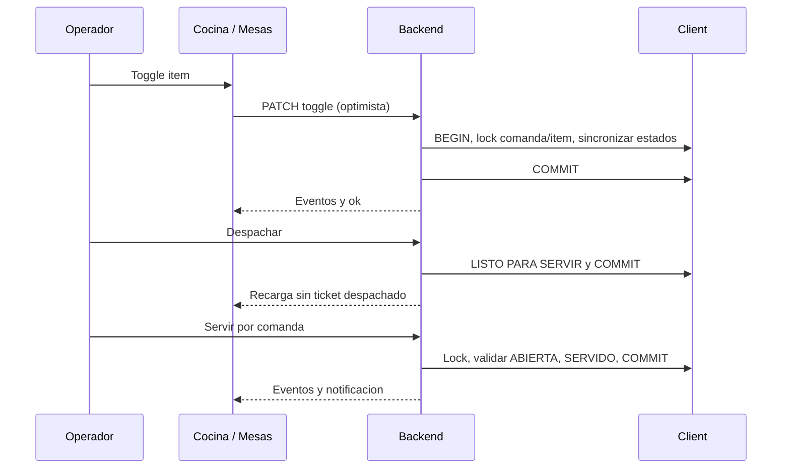

# SDD-010: KDS, entrega, tiempos y finalizados

Estado: Implementado
Responsable: Equipo Borboto
Fecha / revision: 2026-11-09 / 1
Fuentes As-Built relacionadas: [05](05-reglas-sdd-y-convenciones.md), [06](06-auditoria-y-refactorizacion-por-modulo.md), [backend](../../backend-borboto/index.ts).

## Problema y alcance
Incluido: KD-01/02/03, ME-03/01; preparacion por item, despacho, entrega de pedidos fisicos/externos y finalizados de hoy.
Excluido: migraciones, historial anterior a hoy, fiscalidad, cambios de permisos y reloj incremental cliente. Actores: cocina y operadores Electron/LAN.

## Evidencia actual
Toggle transaccional SDD-008 no sincroniza estado_kds ni estado operativo; UI no emite toggle ni revierte error. GET tickets devuelve despachados y alias duplicado; minutos fisicos son persistidos. Servir solo acepta mesa; externos cerrados desaparecen.
Hipotesis comprobable: separar estado agregado de preparacion y estado operativo de despacho, con botones conectados y DTO autoritativo, permite preparar parcialmente, despachar y entregar sin reaparicion. Un GET con items mixtos que no devuelva PREPARANDO o un mock PATCH fallido que conserve el flag optimista refuta la hipotesis.

## Reglas y criterios de aceptacion
REQ-01 / AC-01: item accionable por boton nativo (clic/Enter/Espacio), output numerico hasta servicio; PATCH sincroniza completado/estado_kds y estado operativo EN COCINA. PREPARANDO solo pertenece al agregado KDS, no al enum de mesas. Fallo revierte solo item afectado y su agregado; peticion duplicada local se bloquea mientras pendiente.
REQ-02 / AC-02: GET cocina excluye LISTO PARA SERVIR/SERVIDO; ningun item listo=PENDIENTE, mezcla=PREPARANDO, todos=LISTO. LISTO permite despacho; no equivale a despachado.
REQ-03 / AC-03: minutos calculados desde fecha_apertura, minimo 1 abiertos; mesas sin abierta y externos cerrados=0. Valores cambian al recargar HTTP, no contador persistido.
REQ-04 / AC-04: POST por comanda bloquea FOR UPDATE, ausente 404, no ABIERTA 409; SERVIDO y mesa asociada actualizados atomicos, externos sin mesa validos. Eventos solo post-COMMIT. UI accion visible LISTO PARA SERVIR; notifica exito/error. Ruta por mesa conservada.
REQ-05 / AC-05: GET mesas incluye externas abiertas y cerradas cuya fecha_cierre pertenece al dia del servidor; cerradas proyectan DISPONIBLE y fecha de cierre para filtro. ACTIVOS no incluye finalizadas, DISPONIBLE si; TODOS incluye ambas explicitamente.
AC-06: no iniciar PostgreSQL, pg_ctl, initdb, Electron ni conectar puerto 58432. No alteraciones visuales generales ni promesa de auditoria AXE no ejecutada.

## Contratos
HTTP: PATCH /api/cocina/items/:itemId/toggle conserva {ok:true}, 404/409 y rollback; estado_kds LISTO/PENDIENTE segun completado. GET /api/cocina/tickets conserva DTO TicketCocina, estado exclusivamente PENDIENTE/PREPARANDO/LISTO, un mesaNumero y minutosTranscurridos entero.
POST /api/comandas/:comandaId/servir, cuerpo vacio, {ok:true,mensaje}; ID entero positivo, 400 invalido, 404 ausente, 409 no ABIERTA, 500 inesperado. POST /api/mesas/:mesaId/servir compatible.
GET /api/mesas agrega cerradas externas de hoy sin cambiar forma Mesa; estado DISPONIBLE, estadoOperativo DISPONIBLE y creadoEn=fecha_cierre en finalizadas.
Socket: actualizar_mesas/actualizar_cocina broadcast sin payload post-COMMIT; vistas recargan HTTP y desmontan suscripciones existentes. IPC sin cambios. Importes/fechas conservados, mesa_id NULL soportado.

## Datos y estados
Sin migracion/backfill. comandas, comanda_items y mesas existentes. Lock comun de comanda antes de item/mesa; BEGIN/validar/mutar/COMMIT. Rollback errores y release de client. Canceladas nunca en historico solicitado.
Preparacion parcial -> PREPARANDO en DTO; ninguna/parcial/todas listas sin despachar mantienen EN COCINA operativo (enum existente no admite PREPARANDO); despacho -> LISTO PARA SERVIR; entrega -> SERVIDO; cobro -> CERRADA/DISPONIBLE. No idempotencia nueva para toggle; entrega repite asignacion sin efectos externos.

## Diseno propuesto
Handlers y componentes/servicios existentes, sin nueva capa de produccion. Agregacion DTO por items; filtros frontend por estado normalizado. Botones nativos con aria-pressed por item y estilo/foco Material para entrega.

## Seguridad, operacion y accesibilidad
SQL parametrizado, no secretos nuevos. Permisos UI existentes conservados; autorizacion servidor no ampliada. Foco/Enter/Espacio nativos y estado aria-pressed; no acciones de abrir/cobrar en tarjetas externas finalizadas. Offline PATCH revierte estado, errores entrega visibles. Tiempo del dia segun zona horaria del servidor; no historial multidia en este paquete.

## Plan de verificacion
TEST-01 REQ-01: handler real aislado y servicio Angular transpilado con doubles de signals/http, exito/error/duplicado, estados por item y agregado; wiring de templates estatico.
TEST-02 REQ-02/03: GET handlers aislados, estados ninguno/mezcla/todos, predicado SQL exclusion y formula minutos. Mocks comprueban SQL, no ejecutan motor PostgreSQL.
TEST-03 REQ-04: servir externa/fisica, ausente/cerrada/cancelada, rollback, release, eventos post-COMMIT.
TEST-04 REQ-05: SQL cerradas del dia y proyeccion DISPONIBLE, filtros de MesaService con datos simulados.
Gates: node --test backend-borboto/tests/sdd-010.test.cjs y regresion SDD-008; bun x tsc --noEmit -p backend-borboto/tsconfig.json, tsconfig.app.json y tsconfig.json; bun run build:server; node --check server.js.

## Entrega y decisiones
Orden: especificacion -> backend/UI -> arnes -> gates -> As-Built 02/03/04/06 y evidencia.
Trazabilidad: REQ-01 -> AC-01 -> toggle/KdsCard/CocinaService -> TEST-01; REQ-02/03 -> AC-02/03 -> GET tickets/mesas -> TEST-02; REQ-04 -> AC-04 -> servir/MesaCard/Mesas/MesaService -> TEST-03; REQ-05 -> AC-05 -> GET mesas/filtros -> TEST-04.
Decisiones: historico solo cerradas de hoy; preparacion completa no despacha implicitamente; no editar bundle manualmente. Limites: SQL real, concurrencia real, navegador/AXE y hardware no validados por mocks.

Evidencia de cierre (2026-11-09): node --test backend-borboto/tests/sdd-010.test.cjs: 7 grupos aprobados; ejecucion conjunta con sdd-008.test.cjs: 13 aprobados, 0 fallos. bun x tsc --noEmit -p backend-borboto/tsconfig.json, tsconfig.app.json y tsconfig.json: 0 errores. bun run build:server y node --check server.js: exito. Documentos 02/03/04/06 actualizados; enlaces/bloques y git diff --check validos. No se inicio ningun servicio ni se importo el arranque del backend; no hubo conexiones a PostgreSQL ni ejecucion de Electron.