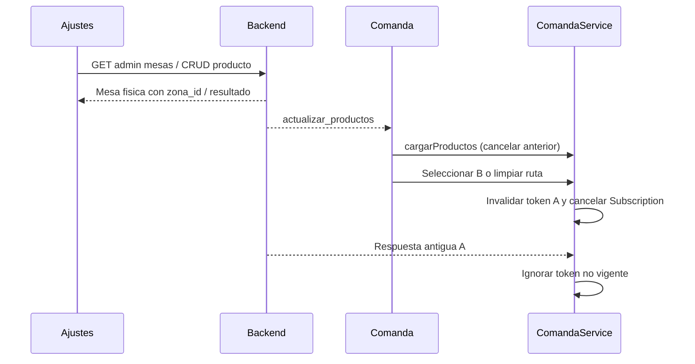

# SDD-014: Catalogos, mesas admin y seleccion de comanda

Estado: Implementado
Responsable: Equipo Borboto
Fecha / revision: 2026-11-09 / 1
Fuentes As-Built relacionadas: [05](05-reglas-sdd-y-convenciones.md), [06](06-auditoria-y-refactorizacion-por-modulo.md), [backend](../../backend-borboto/index.ts), [ComandaService](../../src/app/core/services/comanda.ts).

## Problema y alcance
Incluido: AD-01, AD-04 y CO-03; mesas fisicas administrativas con zona_id, eventos uniformes de catalogo, 404/FK de productos, seleccion limpia y cargas cancelables.
Excluido: auth servidor, migraciones, validacion completa de importacion, sincronizacion de promociones indirectas y cambios visuales. Actores: administradores y operadores Electron/LAN.

## Evidencia actual
Ajustes.getAdminMesas consume GET mesas operacional con externos negativos y sin zona_id. Copia de edicion ya conserva los campos recibidos. PUT producto no valida rows vacio; DELETE desactiva ante cualquier error SQL. Comanda no escucha catalogo ni limpia ruta vacia; cargas internas duplican mapeo y no cancelan peticiones anteriores.
Hipotesis comprobable: endpoint fisico propio, evento uniforme y token/cancelacion compartidos evitan contaminacion y respuestas antiguas. Prueba barata: mock entrega carga B y despues A (incluso tras unsubscribe); identidad/items deben seguir siendo B. Una zona perdida al editar solo numero refuta el contrato administrativo.

## Reglas y criterios de aceptacion
REQ-01 / AC-01: GET admin mesas solo tabla mesas con id,numero,zona_id,capacidad,estado,zona. Ajustes usa este endpoint, rechaza filas externas sin identidad fisica/zone valida y conserva zona_id al editar. PUT mesa exige numero no vacio y zona_id entero positivo (400 invalido); 404 ausente. Numero admite nombres textuales existentes; capacidad conserva contrato previo.
REQ-02 / AC-02: POST/PUT/DELETE/importar-lote producto exitosos emiten actualizar_productos; PUT conserva PRODUCTO_ACTUALIZADO. PUT/DELETE ausente 404 Producto no encontrado. DELETE solo ante 23503 intenta desactivar con RETURNING y verifica existencia; otros errores 500 sin mutacion alternativa/evento.
AC-03 (REQ-02): Comanda escucha actualizar_productos y recarga catalogo, retira listener al destruirse. Recargas de menu tambien cancelan/ignoran respuestas antiguas; no reescriben items guardados ni borrador historico (servidor SDD-008 valida precio/disponibilidad al enviar).
REQ-03 / AC-04: ruta sin IDs enteros positivos limpia identidad, items y origen. Cargas por mesa/ID comparten cancelacion y token incremental; respuesta/error anterior no altera nueva seleccion. Al iniciar carga se limpia lo anterior; un helper mapea NUMERIC a number y conserva subtotal de linea.
AC-05: reset invalida cualquier carga pendiente; destroy retira ruta/socket y cancela cargas de pantalla. Sin cambios de accesibilidad visual ni de contratos IPC.

## Contratos
GET /api/admin/mesas, sin cuerpo: MesaAdmin[] fisicas con zona_id real y nombre de zona. GET /api/mesas operacional conservado.
PUT /api/mesas/:id: numero,zona_id,capacidad; 400 Numero y zona validos son requeridos, 404 Mesa no encontrada, fila actualizada y evento mesas en exito.
PUT/DELETE /api/productos/:id: 404 {error:'Producto no encontrado'}; DELETE exito fisico o desactivacion FK; errores inesperados 500. POST/importacion conservan respuestas 201.
Socket: actualizar_productos broadcast sin payload en exito; PRODUCTO_ACTUALIZADO con fila en PUT para compatibilidad; consumidores recargan GET productos y desmontan listeners. Importacion emite tras COMMIT; CRUD individual tras SQL exitoso.
Tipos TS: DTO carga comanda con mesaId nullable, origen nullable y items tipados; precios/subtotales number|string recibidos y number internos. Fechas/IPC sin cambios.

## Datos y estados
Sin migracion/backfill. Lectura mesas LEFT JOIN zonas sin union externa. DELETE RETURNING y fallback UPDATE RETURNING evitan exito para ID ausente; sin nueva transaccion para CRUD individual.
Token monotono y Subscription para comanda/menu; primero invalidar/cancelar, luego reset/iniciar. Reset no borra catalogo; menu no modifica consumos. No idempotencia nueva ni compensacion externa.

## Diseno propuesto
Backend y servicios/componentes existentes, sin capas nuevas. Comanda agrupa suscripciones ruta/socket y limpia en OnDestroy. ComandaService usa helper de carga y helper puro de mapeo; Ajustes obtiene DTO fisico.

## Seguridad, operacion y accesibilidad
Valores SQL parametrizados; errores no crean mutaciones alternativas salvo FK conocida. Endpoint admin no introduce autorizacion inexistente. Sin secretos ni nuevos logs sensibles. Offline/error carga vigente limpia seleccion; error catalogo conserva ultimo menu. Sin UI nueva, foco/ARIA/contraste conservados; no auditoria AXE en esta entrega.
Prohibido iniciar PostgreSQL, pg_ctl, initdb, Electron o conectar puerto 58432. Validacion solo mocks Node y TypeScript estatico; bundle generado por script existente.

## Plan de verificacion
TEST-01 REQ-01: handler GET admin SQL fisico/zone, PUT invalido/ausente, Ajustes conserva zona al editar numero/capacidad.
TEST-02 REQ-02: CRUD exitoso/eventos, 404, FK desactiva, fallo no FK no desactiva, importacion evento post-COMMIT; componente socket recarga y unsubscribe.
TEST-03 REQ-03: servicio real con HttpClient/signal doubles, cargas A/B en ambos sentidos y error tardio, reset pendiente, mapeo subtotal/precio, ruta vacia/invalida y teardown.
Gates: node --test backend-borboto/tests/sdd-008.test.cjs backend-borboto/tests/sdd-010.test.cjs backend-borboto/tests/sdd-014.test.cjs; bun x tsc --noEmit -p backend-borboto/tsconfig.json, tsconfig.app.json, tsconfig.json; bun run build:server; node --check server.js.

## Entrega y decisiones
Orden: especificacion -> handlers -> servicios/componentes -> arnes -> gates -> documentos 02/03/04/06 y cierre Implementado.
Trazabilidad: REQ-01 -> AC-01 -> GET admin/PUT mesa/Ajustes -> TEST-01; REQ-02 -> AC-02/03 -> CRUD/Comanda/menu -> TEST-02; REQ-03 -> AC-04/05 -> Comanda/ComandaService -> TEST-03.
Decisiones: endpoint administrativo separado en lugar de ampliar union operacional; nombre de mesa no se restringe a digitos; token ademas de unsubscribe cubre emisores tardios. Limites: PostgreSQL real/concurrencia real y navegador/AXE no ejecutados.

Evidencia de cierre (2026-11-09): node --test backend-borboto/tests/sdd-014.test.cjs: 8 grupos aprobados, 0 fallos. Ejecucion conjunta SDD-008/010/014: 21 aprobados, 0 fallos. bun x tsc --noEmit -p backend-borboto/tsconfig.json, tsconfig.app.json y tsconfig.json: 0 errores. bun run build:server y node --check server.js: exito. Documentos 02/03/04/06 actualizados; enlaces/bloques y git diff --check validos. No se inicio ningun servicio ni se importo el arranque del backend; sin conexiones PostgreSQL ni ejecucion Electron.