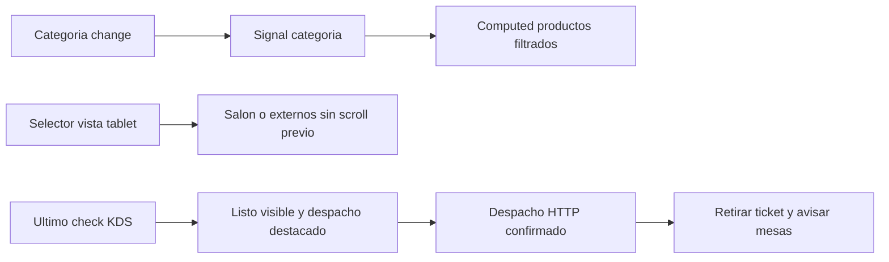

# SDD-023: Filtros de menu, mesas responsive y continuidad KDS

Estado: Implementado
Responsable: Equipo Borboto
Fecha / revision: 2026-11-09 / 1
Fuentes: [05](05-reglas-sdd-y-convenciones.md), [ComandaService](../../src/app/core/services/comanda.ts), [Mesas](../../src/app/features/mesas/mesas.ts), [CocinaService](../../src/app/core/services/cocina.ts).

## Problema y alcance
Corregir filtro de categorias importadas, desbordamiento de acciones y navegacion tablet, y tickets que desaparecen antes de despachar. Sin cambios en cobro, persistencia de estados ni protocolos de impresion/fiscalidad.

## Evidencia actual
Menu escucha selectionChange en MatChipListbox, cuyo output instalado es change. El template ya usa productosFiltrados. Servicio deduplica categorias sin normalizar mayusculas; importador hace trim pero no compara BTRIM en categorias existentes. Mesas apila externos bajo salon en 1024px, con cards 220px y acciones sin wrap. KDS PREPARANDO exige mezcla de checks y excluye LISTO.
Hipotesis y check: cambiar a change debe actualizar signal y computed; mock del evento con categoria importada debe filtrar. KDS debe conservar el mismo ticket al marcar ultimo item hasta respuesta de despacho exitosa.

## Reglas y criterios de aceptacion
REQ-01: categorias dinamicas deduplicadas por trim/lowercase, TODOS por defecto, evento change tipado y lista computed filtrada. Importacion busca/guarda nombre trim y fallback General si vacio.
REQ-02: desktop >=1200px conserva dos paneles con externo mas ancho y grid minimo 300px; bajo 1200px selector superior Mesas Fisicas/Mostrador/Domicilio con contadores activos independientes del filtro. Vista seleccionada no exige recorrer salon. Cards/acciones se ajustan sin scroll horizontal, botones visibles y textos envueltos, sin altura fija que recorte acciones.
REQ-03: PREPARANDO incluye LISTO no despachados. PENDIENTE conserva tickets durante preparacion/listos para no desaparecer tras primer/ultimo check; etiquetas y contadores reflejan ese alcance. LISTO explicito se llama Listos por Despachar y cuenta tickets. Ultimo check destaca despacho en tarjeta; no cambia estado operativo a LISTO PARA SERVIR hasta despacho confirmado. Fallo HTTP conserva rollback existente.
AC: controles nativos/Material accesibles, seleccion anunciada con aria-pressed, foco visible y texto contenido; no se presume auditoria AXE sin ejecutarla.

## Contratos
HTTP/Socket existentes sin nuevas rutas ni cuerpos. POST importar-lote normaliza categoria antes de SELECT/INSERT. Estados KDS PENDIENTE/PREPARANDO/LISTO preservados; solo cambia pertenencia a filtros UI. Vista tablet usa signal; desktop sigue mostrando salon y panel externo con selector propio. Contadores activos excluyen DISPONIBLE/LIBRE, no dependen de filtros de listado.

## Datos y estados
Sin migraciones. Normalizacion de comparacion no renombra categorias existentes ni modifica productos guardados. Completar checks no despacha automaticamente. Seleccion de vista no limpia filtros ni pedidos.

## Diseno propuesto
Correcciones en componentes/servicios actuales; sin nuevas dependencias. Grid con minmax/min-width:0, acciones wrapping y altura adaptable. Navegacion responsive usa botones segmentados con iconos existentes y etiquetas.

## Seguridad, operacion y accesibilidad
Sin nuevos permisos/secretos. SQL parametrizado. No iniciar PostgreSQL ni Electron; tests Node con mocks y typechecks. Cambios UI conservan Material y tema existente; comprobar breakpoints y layouts con contenido largo cuando navegador disponible.

## Plan de verificacion
Pruebas persistentes en sdd-099-cierre.test.cjs: categorias importadas/case/espacios, evento Material correcto y lista filtrada; importacion normalizada; contadores/vistas; ultimo check visible con filtro PREPARANDO/PENDIENTE, rollback y despacho; guards estructurales de layout. Suites previas, tsc backend/app y root, bun run build:server/node --check, bun run build. Revision visual desktop/tablet/mobile con mocks si herramientas disponibles, sin backend real.

## Entrega y decisiones
Ampliacion autorizada explicitamente: CSS responsive de la cabecera global. El navegador detecto cards contenidas a 390px pero navbar de 946px; se permite wrap de enlaces y limite del nombre de usuario sin cambiar permisos/rutas. La correccion debe eliminar ese overflow previo para completar la validacion movil.
Orden: especificacion, filtro local, validacion, layout/KDS con validacion enfocada, suites/builds y evidencia. Contadores computados desde MesaService.mesas; no desde listas filtradas. Se conserva confirmacion explicita de despacho. Pendientes: verificacion hardware/instalador no incluida; no generar instalador Electron en este entorno.

Evidencia (2026-11-09): 62 pruebas Node aprobadas, 0 fallos (sdd-008/010/014/009/099). Los tres typechecks backend/app/root terminaron sin errores. bun run build:server y node --check server.js PASS; bun run build PASS, salida dist/borboto. git diff --check y enlaces documentales PASS.

Navegador de desarrollo con fixtures inyectados en signals y HTTP/Socket interceptados: 40 mesas a 1440/1024/390px sin overflow horizontal; tablet/movil muestran externos arriba sin recorrer salon. Validacion adicional de las tres vistas a 390px con texto/importe largo sin overflow en cards. Capturas desktop/KDS revisadas. Clic real de categorias: Bebidas -> Agua/Cafe, Panaderia -> Pan, Todas -> 3 productos. Ultimo check real conserva ticket en PREPARANDO con despacho destacado; respuesta exitosa simulada habilita boton. Contratos HTTP/rollback/despacho cubiertos con mocks Node, no con backend real. No se inicio PostgreSQL ni Electron; AXE automatizado y hardware/instalador no ejecutados. Frontend de desarrollo en puerto 4307.