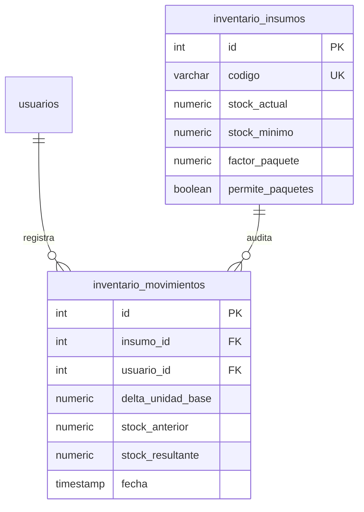
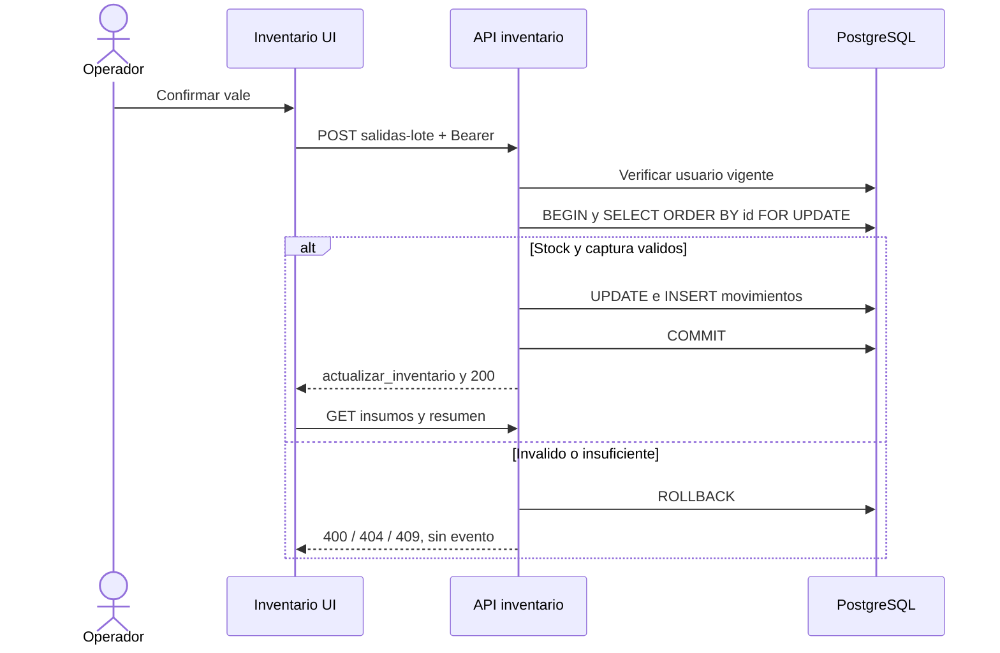

# SDD-024: Inventario de almacen, cocina y guardia

Estado: Implementado
Responsable: Equipo Borboto
Fecha / revision: 2026-11-09 / 6
Fuentes As-Built relacionadas: [01](01-arquitectura-general.md), [02](02-especificacion-componentes.md), [03](03-contratos-y-datos.md), [04](04-flujos-y-funcionalidad.md).

## Problema y alcance
Controlar existencias independientes del catalogo de venta, por unidades o paquetes, con guardia y trazabilidad.
Incluido: salidas atomicas, configuracion, compras, conteo fisico, alertas y Kardex.
Excluido: recetas, descuento por venta, proveedores, costos promedio, reservas e idempotencia distribuida.
Actores: ADMIN configura; ADMIN/CAJERO/COCINERO operan; MESERO consulta API. Electron y navegador LAN respetan las restricciones existentes de dispositivo.

## Evidencia actual
`backend-borboto/index.ts` controla HTTP, sesiones y broadcast; `src/session.ts` verifica tokens. `src/db.ts` descubre automaticamente migraciones SQL ordenadas. `role-access.service.ts` decide permisos por dispositivo. El navbar real esta en `shared/components/navbar-component`.
Hipotesis comprobable: un modulo registrado desde index con pool y emisor inyectados permite probar transacciones sin arrancar la aplicacion. Prueba barata: lote con segundo insumo insuficiente conserva ambos saldos y no emite evento.

## Reglas y criterios de aceptacion
| Requisito | Criterio observable | Implementacion | Prueba |
| --- | --- | --- | --- |
| REQ-01 | AC-01: esquema idempotente, FK restrictiva, stock no negativo | 000_init.sql, 007_inventario_almacen.sql | TEST-01 inspeccion estatica |
| REQ-02 | AC-02: lote bloqueado por id, rollback integral, 409 sin stock | modulo inventario registrado en index.ts | TEST-02 arnes transaccional |
| REQ-03 | AC-03: cocina captura unidades/paquetes y confirma un vale | InventarioComponent, InventarioService, rutas/navbar | TEST-03 compilacion Angular |
| REQ-04 | AC-04: solo ADMIN configura, compra y cuenta; conserva auditoria | InventarioAdminComponent embebido en Ajustes | TEST-04 permisos y ajustes |
| REQ-05 | AC-05: suites y builds pasan sin infraestructura activa | tests/sdd-024-inventario.test.cjs | TEST-05 comandos de cierre |
AC-06: formularios etiquetados, foco visible, teclado y estados de carga/error; no prometer AXE sin ejecutarlo.
AC-07: una desconexion no confirma exito; no reintentar escrituras automaticamente, recargar antes de decidir un nuevo envio.
AC-08 (extension REQ-01): alta, edicion y reset sincronizan nombre_paquete/factor_paquete con permite_paquetes. False normaliza CAJA/1 y deshabilita FormControls sin emitir eventos; true habilita ambos. Guardado usa getRawValue. TEST-06 con formularios reales en memoria.
AC-09 (extension REQ-02): mantener microfono con puntero o Espacio/Enter inicia SpeechRecognition/webkitSpeechRecognition es-MX, interimResults y continuous. Transcripcion acumulada reemplaza provisionales sin duplicarlos y conserva el prefijo escrito, hasta 255 caracteres. Soltar/salir/cancelar detiene, destroy aborta y retira callbacks. Sin soporte/permisos se enfoca la nota y muestra guia discreta sin snackbar. TEST-12 con reconocedor simulado.

## Contratos
Todas las rutas bajo `/api/inventario` usan requireAuth (Bearer firmado y usuario activo vigente) y requireRoles.
| Metodo/ruta | Roles | Entrada / salida |
| --- | --- | --- |
| GET /insumos | ADMIN, CAJERO, COCINERO, MESERO | activos; incluirInactivos=true solo ADMIN; array enriquecido |
| GET /resumen-alertas | los cuatro roles | totalInsumos, sinStock, bajoGuardia, enPrecaucion, itemsCriticos |
| POST /salidas-lote | ADMIN, CAJERO, COCINERO | origen, notas?, items[{insumoId,modoCaptura,cantidad}]; ok |
| POST /insumos | ADMIN | configuracion y stock_inicial opcional; 201 insumo |
| PUT /insumos/:id | ADMIN | configuracion sin modificacion directa de stock; insumo |
| POST /insumos/:id/ajuste | ADMIN | tipoMovimiento ENTRADA_COMPRA con cantidad/modoCaptura o REINVENTARIO_AJUSTE con nuevoStockFisico o paquetesContados/unidadesSueltasContadas; ok |
| GET /movimientos | ADMIN | insumoId?, tipoMovimiento?, limite 1..500 (100 por defecto); filas con insumo_nombre |
Errores: 400 entrada invalida, 401 sesion ausente/expirada, 403 rol, 404 insumo ausente/inactivo, 409 codigo duplicado o stock insuficiente (error, disponible, solicitado), 500 fallo interno sin SQL expuesto.
Numeros JSON finitos, maximo dos decimales; NUMERIC se normaliza al leer. Fechas TIMESTAMP segun zona del servidor, serializadas por pg/Express. codigo y ubicacion admiten null. No IPC nuevo ni cambios en contratos anteriores.
Socket: `actualizar_inventario`, sin payload sensible; broadcast del servidor tras commit; receptores recargan HTTP autorizado, teardown con DestroyRef. Es invalidacion, no entrega garantizada.

## Datos y estados
007 crea inventario_insumos (codigo unico, nombre, categoria, unidad, paquete/factor, stock/minimo/costo, ubicacion, activo, actualizado_en) e inventario_movimientos (FK insumo RESTRICT, tipo/modo, cantidad/factor, delta, saldos, notas, FK usuario SET NULL, nombre y fecha). Checks positivos y no negativos; indices activo, categoria y (insumo_id, fecha DESC). 000_init refleja el mismo esquema; nunca ejecutarlo sobre datos reales. Migracion aditiva sin backfill y descubierta por el cargador existente.
Estado calculado con prioridad: stock=0 SIN_STOCK; stock<=minimo BAJO_GUARDIA; minimo>0 y stock<=minimo*1.25 PRECAUCION; resto OK. Faltante=max(minimo-stock,0) solo en guardia. Desglose=floor(stock/factor) y residuo a dos decimales cuando factor>1 y paquetes habilitados.
Transacciones: BEGIN, SELECT ordenado FOR UPDATE, validar, actualizar e insertar movimientos, COMMIT, evento. Fallos ROLLBACK y release. Items repetidos consumen saldo acumulado; escrituras concurrentes quedan serializadas por bloqueo. Aritmetica en centesimas; conversion que produzca fracciones menores se rechaza para no perder stock silenciosamente. Conteo sin cambio no crea movimiento de cantidad cero (cantidad_capturada debe ser positiva).
No hay clave idempotente: un reenvio confirmado es otra operacion. No existen efectos externos antes de commit.

## Diseno propuesto
Revision 6 vigente (Implementado): dictado exclusivamente nativo del navegador y backend solo de datos de inventario. No quedan modelos, librerias de voz, procesos auxiliares, workers, archivos de audio, endpoint de transcripcion ni canales IPC de dictado. SpeechRecognition/webkitSpeechRecognition usa es-MX, continuous/interim; getUserMedia solicita permiso y cierra tracks antes de iniciar. Soltar durante permiso no inicia grabacion tardia; destroy retira callbacks/aborta y cierra tracks tardios. Notas escritas se conservan, provisionales no se duplican y limite 255. Empaquetado directo sin preparacion de voz.
AC-14 / TEST-12: HTTP inseguro, API ausente, permisos denegados, microfono ausente y errores network/service-not-allowed restauran edicion/foco y guia discreta junto a nota, sin snackbar alarmante ni comandos de configuracion. Electron permite solo media/audio para la ventana principal y su origen propio mediante handlers estandar de sesion, no canales personalizados ni permisos globales. Prueba con mock de permiso y reconocimiento, incluido corto/destroy/errores; prueba interactiva de campos de paquete y foco con API/microfono simulados.
Limite explicito: el teclado virtual y su microfono dependen del SO, configuracion y proveedor; focus no garantiza teclado visible en escritorio ni dictado offline. SpeechRecognition puede necesitar Internet y no estar implementado en Electron. Esta revision sustituye el requisito previo de inferencia offline propia; solo el teclado manual es alternativa siempre disponible en la app.

Extension revision 2: InventarioAdminComponent (compuesto por Ajustes, sin formulario propio en ajustes.ts) observa permite_paquetes con teardown y normaliza tambien despues de reset/editar y antes de guardar. InventarioComponent posee una instancia de reconocimiento por pulsacion, conserva texto base y reconstruye resultados completos, bloquea nuevo dictado/envio mientras termina y evita callbacks despues de destroy. Textarea de solo lectura durante reconocimiento para no sobrescribir ediciones concurrentes; teclado vuelve disponible al finalizar. Sin cambios HTTP, IPC, SQL ni permisos. Hipotesis: disable/enable reactivo y reconstruccion de resultados evitan valores residuales/duplicados; pruebas baratas de reset y dos eventos interim/final pueden refutarla.
Voz depende del soporte del navegador, permisos, contexto seguro (HTTPS o localhost) y posiblemente del servicio remoto del navegador; no se garantiza offline ni soporte Electron/LAN HTTP. No se guarda audio ni se solicita permiso antes de la pulsacion. El boton incluye estado accesible, teclado, cancelacion por blur y animacion respetando reduced-motion. Estado de esta extension: Implementado. Un inicio tardio tras soltar el boton solicita stop de nuevo; durante finalizacion se conservan resultados finales y se bloquean nuevos inicios/envio.

Modulo backend separado por necesidad de pruebas sin efectos de arranque; registrado en index.ts con pool/emisor. InventarioService mantiene catalogo y alertas con signals y recarga por socket. InventarioComponent gestiona filtros y vale local. InventarioAdminComponent mantiene formularios reactivos de configuracion/entrada/conteo e historial y se integra como pestaña de Ajustes, sin ampliar su servicio generalista.

## Seguridad, operacion y accesibilidad
Autoridad exclusivamente servidor: nunca aceptar stock resultante, factor ni usuario del cliente. Consultas parametrizadas, limites de lote/campos/numeros e historial acotado. Usuario responsable obtenido de sesion y tabla usuarios. Desactivacion logica conserva historial. Sin secretos ni SQL en respuestas. Error visible y botones bloqueados durante escritura; sin reintentos automaticos. Etiquetas, semantica de tablas/formularios, indicadores textuales ademas de color, controles tactiles y layout adaptable.

## Plan de verificacion
TEST-01: comparar SQL inicial/migracion, checks e indices sin ejecutar PostgreSQL.
TEST-02/04: node --test backend-borboto/tests/sdd-024-inventario.test.cjs con mocks de pool, sesiones y emision: limites de guardia, paquetes, bloqueo, rollback, compra, conteo, permisos y duplicados.
TEST-03/05: node --test para sdd-008,009,010,014,099-cierre,024; tsc --noEmit -p backend-borboto/tsconfig.json, tsconfig.app.json y tsconfig.json; bun run build; bun run build:server; node --check server.js.
TEST-06/12: el mismo arnes sdd-024 usa Angular Forms reales, RxJS y SpeechRecognition simulado; verifica disabled/enable, normalizacion y getRawValue en alta/editar/reset/guardar, teardown, prefijo escrito, interim/final, permiso con cierre de tracks, clic corto, rechazo de permiso, variante webkit, teclado, limite 255, cancelacion/destroy, foco/guia sin alertas y permiso Electron acotado a media/audio propio. Prueba interactiva con API y voz simuladas; hardware y servicio remoto no quedan certificados.
Prohibido arrancar PostgreSQL, pg_ctl, initdb, Electron o conectar a 58432. Migracion real, navegador/AXE y hardware no quedan certificados por mocks o compilacion.

## Entrega y decisiones
Revision 6 (2026-11-09): 84/84 pruebas en seis suites, 22 del modulo (inventario/transacciones/AC-08 conservados y nueve pruebas nativas nuevas); tres tsc --noEmit sin errores, bun run build y bun run build:server correctos, node --check server.js correcto. Eliminados speech completo (incluidos modelos generados), adaptador WAV, rutas/helper de transcripcion y dependencia de voz mediante bun remove; lockfile actualizado. Dist vuelve a build + build:server + electron-builder sin gates/recursos de voz. sharp se conserva por ser dependencia previa ajena a voz; asarUnpack conserva solo pdf-to-printer.
Prueba interactiva en Angular localhost:4320 con HTTP/socket interceptados y SpeechRecognition/getUserMedia simulados. Alta/toggle CAJA-1/editar/nuevo de paquetes correctos. Nota conserva 'Para cocina' y agrega 'dos cajas de agua'; permiso una vez, track temporal cerrado una vez, error network enfoca textarea editable sin snackbar. Vista de 390x844 con contexto inseguro/API ausente simulados enfoca nota y permite escritura, cero errores de pagina y sin desbordamiento horizontal; captura del vale revisada. Socket se aborta intencionalmente al no existir backend. No se certifica microfono fisico, servicio de voz del navegador, teclado virtual real ni AXE/hardware. No se inicio Electron ni PostgreSQL. Frontend de demostracion queda activo; no se genero instalador nuevo.
Evidencia extension UX revision 2 (2026-11-09): `node --test backend-borboto/tests/sdd-024-inventario.test.cjs` 17/17 (12 anteriores y 5 nuevas); los tres `bunx tsc --noEmit -p` solicitados, backend/Angular/raiz, cero errores; `bun run build` correcto. No cambia backend ni bundle servidor. No se certifican transcripcion/microfono reales ni soporte de cada dispositivo mediante estos mocks. Los archivos ajustes.ts/html/scss conservan su composicion: el formulario y sus estilos viven realmente en inventario-admin.ts/html/scss.
Orden: especificacion, SQL/backend/arnes, validacion enfocada, UI/integracion, gates, As-Built. No editar server.js manualmente; build:server lo regenera.
Se prefiere modulo de dominio inyectable a ampliar handlers inseparables del arranque; componente administrativo enfocado a duplicar logica en Ajustes. Se conserva politica de acceso por dispositivo y no se cambia inventario de productos vendidos.
Evidencia de cierre (2026-11-09): `node --test` de sdd-008, sdd-009, sdd-010, sdd-014, sdd-099-cierre y sdd-024-inventario: 74/74 pruebas, 12 propias de inventario. `bunx tsc --noEmit -p` backend-borboto/tsconfig.json, tsconfig.app.json y tsconfig.json: cero errores. `bun run build`, `bun run build:server` y `node --check server.js`: correctos. As-Built 01/02/03/04 actualizados. La suite 099 sustituye execFileSync/fs en VM; no inicia binarios reales.
Riesgos y pendientes: migracion 007 no aplicada ni ejecutada con PostgreSQL real, concurrencia real no certificada, sin idempotencia y sin auditoria AXE/navegador. No se inicio PostgreSQL, Electron, pg_ctl o initdb ni se conecto al puerto 58432. Estado Implementado no significa Verificado en infraestructura real.