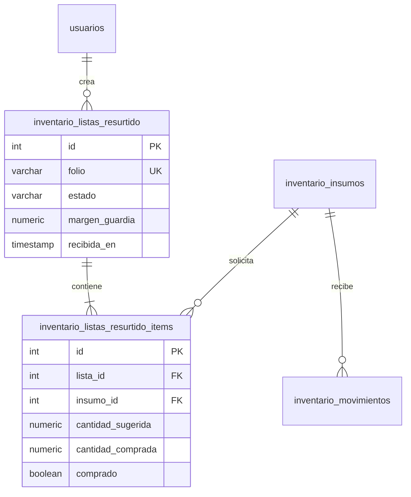
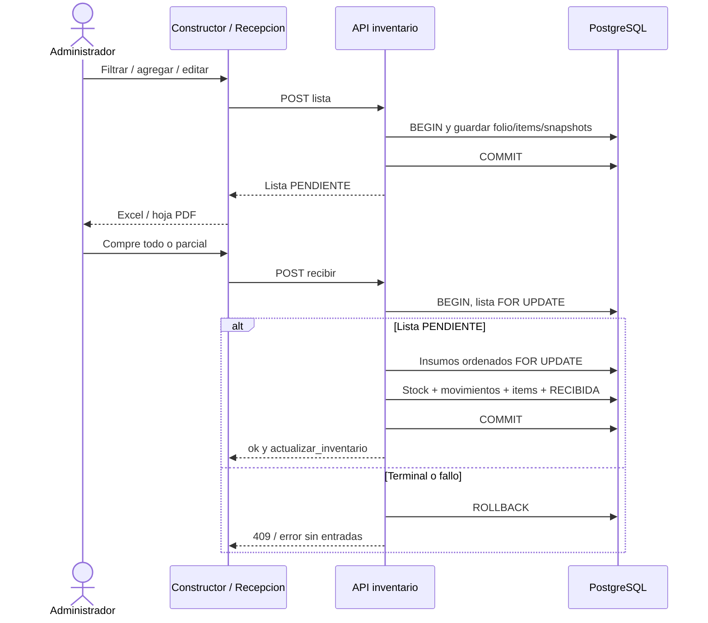

# SDD-025: Reportes de resurtido y recepcion de compras

Estado: Implementado
Responsable: Equipo Borboto
Fecha / revision: 2026-11-13 / 1
Fuentes As-Built: [01](01-arquitectura-general.md), [02](02-especificacion-componentes.md), [03](03-contratos-y-datos.md), [04](04-flujos-y-funcionalidad.md), [SDD-024](SDD-024-inventario-almacen-cocina-y-guardia.md).

## Problema y alcance
Preparar compras con guardia/margen y filas manuales, exportar una lista persistida y registrar el regreso sin duplicar entradas.
Incluido: constructor ADMIN, Excel, impresion/PDF de navegador, pendientes, recepcion total/parcial/extras, cancelacion, auditoria.
Excluido: proveedores, facturas de compra, impuestos, valorizacion promedio, importacion automatica de Excel o recepciones sucesivas de una misma lista.
Actores: ADMIN segun politica de dispositivo existente en Ajustes. Cocina/meseros no administran compras por API.

## Evidencia actual
InventarioAdminComponent real reside en features/inventario y es compuesto por Ajustes. InventarioService contiene contratos HTTP; registrarInventario mantiene requireAuth/requireRoles y helpers transaccionales, conversion en centesimas, bloqueos y movimiento auditado. db.ts descubre SQL numerado automaticamente; xlsx existe y TicketModal usa ventana de impresion aislada.
Hipotesis: bloquear lista antes de insumos y cambiar PENDIENTE a RECIBIDA en el mismo commit evita una segunda entrada. Prueba barata: recibir TODO dos veces con pool mock debe devolver 409 la segunda, sin movimientos extra.

## Reglas y criterios de aceptacion
| REQ | AC | Fuente | Test |
| --- | --- | --- | --- |
| REQ-01 | AC-01: migracion aditiva 008 y esquema inicial equivalentes, FK/estado/cantidades validos | Database | SQL estatico |
| REQ-02 | AC-02: stock<=minimo+margen, categoria opcional, filas manuales sin duplicar, cantidades editables | ResurtidoComponent/helper puro | filtros y sugerencias |
| REQ-03 | AC-03: guardar antes de exportar y folio real en archivo; Excel columnas completas; hoja imprimible sin UI de app | servicio/exportador | persistencia y estructura XLSX |
| REQ-04 | AC-04: TODO/PARCIAL suma unidades y paquetes de forma atomica con responsable/folio; 409 repetido; cancelar no suma | resurtido backend | transaccion y permisos |
| REQ-05 | AC-05: suites mock, tres tsc y builds limpios, As-Built actualizado | arnes sdd-025 | gates |
AC-06: errores conservan borrador, botones bloqueados durante escritura, teclado/etiquetas/foco y tema claro/oscuro; no certificar AXE sin ejecutarlo.
AC-07: si faltante calculado es cero o negativo, sugerir minimo una unidad; PAQUETE ceil(max(1, umbral-stock)/factor). Se alcanza el umbral segun formula solicitada; en igualdad se agrega una unidad para evitar cantidad cero.
AC-08: recepcion parcial cierra lista completa, guarda no-comprados/cero y admite extras comprados positivos; no deja saldo abierto para recibir luego. Segunda recepcion/cancelacion de estado terminal 409.

## Contratos
Todos bajo /api/inventario, requireAuth vigente y requireRoles ADMIN, SQL parametrizado.
| HTTP | Entrada | Salida/errores |
| --- | --- | --- |
| POST /listas-resurtido | nombre?, margenGuardia>=0, notas?, items[{insumoId,modoCaptura,cantidadSugerida>0}] | 201 lista con items y snapshots de servidor |
| GET /listas-resurtido | sin query | pendientes y recientes (30 dias), maximo 100, con items/datos actuales |
| GET /listas-resurtido/:id | id | lista/items, 404 ausente |
| POST /listas-resurtido/:id/recibir | modo TODO o PARCIAL, notas?, items parcial [{insumoId,comprado,modoCaptura,cantidadComprada>=0}] | ok, 404 ausente/insumo inactivo, 409 terminal, 400 captura/duplicados |
| POST /listas-resurtido/:id/cancelar | sin cuerpo requerido | ok; 404/409, no stock |
401 sin sesion, 403 rol, 500 fallo SQL sin exponer consulta. Cantidades finitas a dos decimales, lote 1..200, notas 255, nombre 120; sin IDs ni factor/stock/usuario autoritativos del cliente. NUMERIC normalizado en DTO, fechas TIMESTAMP servidor serializadas por pg. Sin IPC nuevo.
Socket actualizar_inventario solo tras commit, tambien para cambios de lista; receptor recarga pendientes/catalogo. Teardown de HTTP/socket con DestroyRef. Exportar una lista ya guardada no crea otra; editar el borrador despues de guardar exige una nueva lista.

## Datos y estados
008 inventario_listas_resurtido: id SERIAL, folio unico, nombre, margen_guardia no negativo, estado PENDIENTE/RECIBIDA/CANCELADA, notas, usuario FK SET NULL/nombre, creada_en y recibida_en. Items: lista FK CASCADE, insumo FK RESTRICT, modo, sugerida positiva, comprada nullable/no negativa, comprado default true, snapshots stock/minimo. UNIQUE(lista_id,insumo_id) e indices lista/estado-fecha. Folio RES- con id de secuencia rellenado minimo cuatro digitos, nunca MAX+1; puede haber huecos por rollback.
Creacion aditiva, sin backfill ni ejecucion de 000_init sobre datos reales. Cargador existente encuentra 008, sin cambios en db.ts.
Recepcion: BEGIN, lista FOR UPDATE, comprobar PENDIENTE, items, insumos ORDER BY id ASC FOR UPDATE, conversion autoritativa con factor actual, UPDATE stock y INSERT ENTRADA_COMPRA, actualizar items reales y lista, COMMIT, evento. Error ROLLBACK/release. Factor historico real aplicado queda en movimientos; TODO usa modo/cantidad sugerida y factor vigente, no factor enviado por cliente. Configuracion de paquetes cambiada puede requerir revision parcial. Snapshot representa existencias al guardar; exportacion incluye datos actuales del insumo junto a snapshot de stock/minimo. No hay idempotencia de creacion ante respuesta perdida: recargar listas antes de repetir.

## Diseno propuesto
Modulo resurtido registrado dentro del propietario de inventario, reutiliza helpers de auth/transaction/conversion/movimiento mediante dependencias, sin duplicar arranque DB. ResurtidoComponent pequeno embebido en InventarioAdminComponent; input de insumos, formulario reactivo, signals de borrador/pendientes/recepcion, helper puro para sugerencias y exportacion XLSX/ventana imprimible.

## Seguridad, operacion y accesibilidad
Solo ADMIN en servidor, responsable de sesion, no SQL ni secretos en errores. Folio incluido en nota auditada, recorte consciente a 255. Exportacion trata campos como texto/celdas no formulas; impresion construye DOM/textContent, nunca HTML de insumos sin escapar. Si popup bloqueado se avisa y no recibe compra; exportacion fallida conserva lista pendiente. Foco en panel abierto, labels, tablas con cabeceras, controles nativos y adaptacion mobile/temas. PDF via dialogo imprimir/guardar del navegador, no spooler/hardware ni libreria fiscal.

## Plan de verificacion
Arnes node:test/mocks sdd-025 reutiliza estilo esbuild/VM: filtros/margen, manuales, alta/snapshots, TODO/PARCIAL/extras, rollback integral, duplicados/estado terminal, cancelacion, roles, esquema, columnas XLSX y texto imprimible.
Gates: node --test backend-borboto/tests/*.test.cjs; bunx tsc --noEmit -p backend-borboto/tsconfig.json, tsconfig.app.json y tsconfig.json; bun run build; bun run build:server; node --check server.js. Sin PostgreSQL, Electron, pg_ctl/initdb ni conexion 58432. Migracion real, impresion/PDF real y AXE no se certifican con mocks.

## Entrega y decisiones
Prueba visual 2026-11-13: Angular localhost:4325 con API/socket simulados, sin backend real. Se conecto InventarioAdminComponent a una pestaña ADMIN de Ajustes, ausente en el estado inicial. Guardia+margen agrego dos filas; producto manual llevo lista a tres; guardado produjo RES-0001; revision mostro modo PAQUETE correcto y recepcion parcial cerro pendiente. Se corrigio seleccion explicita de opciones para evitar mostrar UNIDAD cuando el dato era PAQUETE. Vista 390x844 sin overflow horizontal de pagina ni errores de app; tablas usan scroll propio. No certifica PostgreSQL, impresion/PDF real ni AXE. Frontend de demo queda activo; no se genero instalador.
Evidencia (2026-11-13): node --test backend-borboto/tests/*.test.cjs 93/93 (9 nuevas SDD-025); tres bunx tsc --noEmit backend/Angular/raiz cero errores; bun run build/build:server y node --check server.js correctos. Fixtures SDD-024 adaptados al registro de modulo y sesion Electron actual sin restaurar funcion ausente. As-Built 01/02/03/04 actualizados. Migracion 008 no aplicada, concurrencia PostgreSQL real, PDF/impresora y AXE pendientes; mocks no los certifican.
Orden: especificacion, SQL/backend/prueba enfocada, UI/exportador, gates, As-Built. No editar bundle server.js manualmente. No alterar SDD-024 de voz ni otras pantallas. Riesgos: exportacion usa catalogo actual mas snapshots; factor de recepcion es vigente; creacion no tiene clave idempotente; parcial cierra incluso cuando no se compro nada.