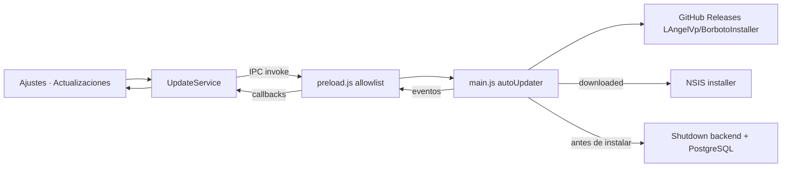

# SDD-026: Actualizacion automatica del sistema

Estado: Implementado
Responsable: Equipo Borboto
Fecha / revision: 2026-11-17 / 2 (diagnostico y robustez)
Fuentes As-Built relacionadas: [01](01-arquitectura-general.md), [02](02-especificacion-componentes.md), [04](04-flujos-y-funcionalidad.md), [SDD-099](SDD-099-cierre-integral-arquitectura-y-modulos.md).

## Problema y alcance

Entregar actualizaciones de la aplicacion de escritorio sin reinstalar manualmente ni pedir al operador que localice instaladores. El operador consulta desde **Ajustes → Actualizaciones del Sistema**, descarga la version publicada y decide cuando reiniciar para instalarla.

Incluido:

- `electron-updater` como dependencia de produccion y publicacion GitHub en `package.json`.
- Proceso principal: verificacion, descarga manual, progreso, instalacion y cierre ordenado de backend/PostgreSQL antes de reiniciar.
- IPC restringido por lista blanca en `preload.js`.
- Servicio Angular `UpdateService` y pestana de UI en Ajustes con version actual, version disponible, progreso, errores discretos y botones de accion.
- Documentacion del flujo y de los canales.

Excluido:

- Firma de codigo, canal beta, actualizaciones delta, rollback automatico, despliegue CI/CD de releases y actualizacion de clientes navegador/LAN.
- Verificacion end-to-end sobre una release real firmada o un repositorio privado con token.

Actores y dispositivos: solo la aplicacion Electron empaquetada. En desarrollo o en el cliente navegador la funcion se muestra como no disponible.

## Evidencia actual

- `electron-updater@6.8.11` instalado en `dependencies`.
- `build.publish` en `package.json` apunta al proveedor GitHub `LAngelVp/BorbotoInstaller`, repositorio publico con releases `1.0.0` y `1.0.1`.
- `main.js` importa `autoUpdater`, desactiva la descarga automatica, expone los handlers IPC, ejecuta una verificacion automatica al cargar la ventana y registra diagnostico `[UPDATER]`.
- `preload.js` mantiene `contextIsolation` y agrega unicamente los canales necesarios a sus conjuntos `invokes` y `events`.
- `src/app/core/services/update.service.ts` encapsula la comunicacion IPC con signals y `NgZone`, expone `canCheck`, `canDownload`, `canInstall` y registra logs `[UPDATER]`.
- La pestana vive en `src/app/features/ajustes/ajustes.html` y consume el servicio desde `ajustes.ts`. Las acciones permanecen visibles y el boton de busqueda se deshabilita con motivo cuando el puente IPC no esta disponible.
- Verificacion externa: el resolvedor `GitHubProvider` de `electron-updater` encuentra `1.0.1`, su `latest.yml` y el `.exe` desde una instalacion `1.0.0`; por tanto un fallo de deteccion no se atribuye al repositorio ni al formato de publicacion.

Hipotesis comprobable: con `autoDownload = false`, verificar nunca instala ni reinicia por si solo; solo `quit-and-install` dispara el instalador, y lo hace despues de detener el backend y PostgreSQL. Un reinicio sin descarga previa debe rechazarse.

## Reglas y criterios de aceptacion

| REQ | AC observable | Fuente | Verificacion |
| --- | --- | --- | --- |
| REQ-01 | Dependencia de produccion y proveedor GitHub configurados; electron-builder puede generar `latest.yml` al publicar | package.json | revision de manifiesto |
| REQ-02 | La disponibilidad se decide con `app.isPackaged`; en desarrollo el actualizador queda `unavailable` sin intentar red | main.js | inspeccion y arranque dev |
| REQ-03 | Verificar actualizaciones no descarga ni instala; conserva la app operable | main.js, UpdateService | prueba manual/estado |
| REQ-04 | Descargar solo procede con una version disponible y emite progreso porcentual | main.js, UI | evento `download-progress` |
| REQ-05 | Instalar exige estado `downloaded`; cierra backend/PostgreSQL y reinicia con el instalador | main.js | revision de flujo |
| REQ-06 | Fallos de red no abren dialogos ni notificaciones globales; actualizan el estado de la pestana con detalle tecnico | main.js, UI | inspeccion de `markUpdateError` |
| REQ-07 | El renderer solo accede a los canales explicitamente permitidos | preload.js | lista blanca |
| REQ-08 | La UI muestra version actual, estado, progreso y acciones coherentes; botones usan `canCheck`, `canDownload`, `canInstall` y ofrecen reintento | ajustes.html/ts | build Angular estricto |
| REQ-09 | `tsc --noEmit`, `tsc -p tsconfig.app.json` y build de Angular sin errores | repo | ejecucion local |
| REQ-10 | Al iniciar la app empaquetada se ejecuta una verificacion automatica unica tras cargar la ventana | main.js | log `[UPDATER]` y estado |
| REQ-11 | HTTP 401/403/404/429, `latest.yml` invalido y fallos de release feed producen mensaje amigable y detalle con codigo | main.js, UpdateService | revision y prueba sin red |

## Contratos IPC

Todos los canales se invocan a traves de `window.borbotoElectron`, expuesto por `preload.js` con `contextBridge`.

| Canal | Tipo | Entrada | Salida / efecto |
| --- | --- | --- | --- |
| `get-app-version` | invoke | sin payload | `string` con `app.getVersion()` |
| `get-update-state` | invoke | sin payload | snapshot del estado del actualizador |
| `check-for-updates` | invoke | sin payload | `{ok, isUpdateAvailable, version, state}` o `{ok:false, reason, message, detail, code, statusCode, state}` |
| `download-update` | invoke | sin payload | inicia descarga; `{ok, state}` o error controlado con `detail` |
| `quit-and-install` | invoke | sin payload | valida estado `downloaded`, detiene servicios y lanza `quitAndInstall(false, true)` |
| `update-available` | evento main→renderer | `{version, releaseNotes, releaseDate, state}` | actualiza version disponible |
| `update-not-available` | evento main→renderer | `{version, state}` | confirma que no hay novedades |
| `download-progress` | evento main→renderer | `{percent, bytesPerSecond, transferred, total, state}` | alimenta barra de progreso |
| `update-downloaded` | evento main→renderer | `{version, state}` | habilita reinicio |
| `update-error` | evento main→renderer | `{message, detail, code, statusCode, state}` | error discreto en la pestana con diagnostico |

El preload no acepta payloads en estos canales; cualquier canal fuera de la lista blanca se rechaza.

## Datos y estados

Estado autoritativo en el proceso principal (`updateState`):

`idle → checking → available → downloading → downloaded → (reinicio)`
`checking → not-available`
`checking | downloading → error`
`unavailable` cuando `app.isPackaged=false` o el puente IPC no existe.

El estado incluye `detail`, `errorCode` y `statusCode` para diagnostico. El renderer mantiene una copia reactiva en `UpdateService.state`, se sincroniza al abrir la pestana con `get-update-state` y calcula `canCheck`, `canDownload` y `canInstall` a partir del estado y del puente IPC. `electron-updater` persiste la descarga en el directorio de actualizaciones de Electron; la app informa el porcentaje, bytes transferidos, tamano total y notas de version.

## Diseno propuesto

Responsabilidades:

- **Proceso principal**: unica autoridad de `autoUpdater`; usa `app.isPackaged` como criterio de disponibilidad, configura `autoDownload=false`, `autoInstallOnAppQuit=true`, `allowPrerelease=false`; traduce eventos de red a eventos IPC y nunca abre dialogos por fallos de red. Emite logs `[UPDATER]` con version, `app.isPackaged`, `NODE_ENV`, existencia de `app-update.yml`, resultado de cada verificacion y detalle de codigos HTTP.
- **Preload**: puente con lista blanca de invokes y eventos; sin `nodeIntegration` ni acceso arbitrario a Electron.
- **Angular**: `UpdateService` centraliza estado y acciones; registra logs `[UPDATER]`, distingue entorno sin IPC y expone `canCheck`, `canDownload`, `canInstall`. `AjustesComponent` presenta la pestana, muestra detalle tecnico plegable y usa `NotificationService` solo para resultados solicitados por el usuario.
- **Cierre previo**: `detenerServiciosAplicacion()` es compartido por `before-quit` y `quit-and-install`, garantizando que PostgreSQL se detenga tambien al actualizar.

## Flujo operativo

1. Al cargar la ventana principal, la app empaquetada programa una verificacion automatica unica a los 8 segundos. La UI consulta `get-app-version` y `get-update-state`.
2. El operador tambien puede entrar a **Ajustes → Actualizaciones del Sistema** y pulsar **Buscar Actualizaciones** (o **Reintentar Busqueda** tras un error). El main llama `autoUpdater.checkForUpdates()` solo si `app.isPackaged`.
3. Si hay version nueva, se recibe `update-available` y aparece **Descargar Actualización**.
4. Al descargar, `download-progress` actualiza la barra; la UI no bloquea el resto de la aplicacion.
5. Al terminar, `update-downloaded` habilita **Reiniciar y Actualizar**.
6. Al confirmar, el main valida el estado, detiene el backend y PostgreSQL, marca el cierre como completado y ejecuta `autoUpdater.quitAndInstall(false, true)`.
7. El instalador NSIS aplica la version y reinicia Borboto POS.

Los fallos de red o de GitHub actualizan el estado `error` de la pestana con un mensaje amigable y un detalle tecnico plegable; no interrumpen la venta ni muestran dialogos modales. Codigos cubiertos: 401 (autenticacion), 403 (permisos/limite), 404 (release o `latest.yml` inexistente), 429 (limite temporal), `ERR_UPDATER_INVALID_UPDATE_INFO` (YAML invalido), `ERR_UPDATER_INVALID_RELEASE_FEED` y `ERR_UPDATER_LATEST_VERSION_NOT_FOUND`.

## Diagnostico y operacion

Los logs se emiten con prefijo `[UPDATER]` en la consola del proceso principal y en la consola del renderer. El puente de consola de `main.js` excluye `[UPDATER]` de las notificaciones globales, por lo que estos mensajes no interrumpen al usuario.

Secuencia esperada al verificar:

1. `[UPDATER] Inicializando actualizador automatico` con `version`, `packaged`, `nodeEnv`, `configPath` y `configExists`.
2. `[UPDATER] Verificacion automatica programada en 8000 ms` o `Solicitud manual de busqueda`.
3. `[UPDATER] Resultado de checkForUpdates` con `available`, `latestVersion` y `currentVersion`.
4. `[UPDATER] Evento update-available` o `update-not-available`.

Si se lee `app.isPackaged=false`, la app se esta ejecutando con `electron .` o desde el arbol de desarrollo; las actualizaciones solo se prueban con la version instalada. Si aparece 404, revisar que el tag publicado contenga `latest.yml` y el `.exe` referencia; si aparece 401/403, revisar visibilidad del repositorio o limites de GitHub. Si `configExists=false`, el paquete no incluyo `app-update.yml` y debe regenerarse con electron-builder.

## Seguridad, operacion y accesibilidad

- `contextIsolation: true` y `nodeIntegration: false` se conservan; el renderer solo usa canales declarados.
- No se aceptan ni ejecutan comandos, rutas o URLs enviados por el renderer.
- La instalacion exige descarga completa y confirmacion explicita del usuario; no hay reinicio silencioso.
- El cierre previo evita corromper la base de datos portable al actualizar.
- La pestana usa etiquetas, iconos y textos de estado; los botones se deshabilitan durante operaciones. No se certifica AXE en este cambio.

## Plan de verificacion

1. `bun x tsc --noEmit` y `bun x tsc --noEmit -p tsconfig.app.json`: sin errores.
2. `bun run build`: compilacion Angular estricta y generacion de plantillas sin errores.
3. Revision estatica de `main.js` y `preload.js` (sintaxis y lista blanca).
4. Prueba manual sobre una release publicada: verificar deteccion automatica y manual, descargar, reiniciar, confirmar version y que PostgreSQL vuelva a iniciar.
5. Prueba manual sin red: la UI debe mostrar el estado de error, el detalle tecnico y habilitar **Reintentar Busqueda** sin dialogos ni interrupciones.
6. Revision de consola: confirmar trazas `[UPDATER]` con `packaged=true`, `configExists=true`, version detectada y ausencia de errores silenciosos.

## Entrega y decisiones

Implementado en codigo y verificado con TypeScript/build local. La revision 2 corrige el diagnostico: el repositorio remoto y el `latest.yml` de `1.0.1` son correctos; la verificacion ahora se dispara automaticamente al iniciar la app empaquetada y los fallos de red dejan trazabilidad `[UPDATER]` sin interrumpir al usuario. La prueba real de actualizacion requiere publicar una version mayor y un artefacto NSIS con `latest.yml` en GitHub Releases; para publicar se debe incrementar `version` en `package.json`, generar el instalador y subir el bloque de artefactos que produce electron-builder.
