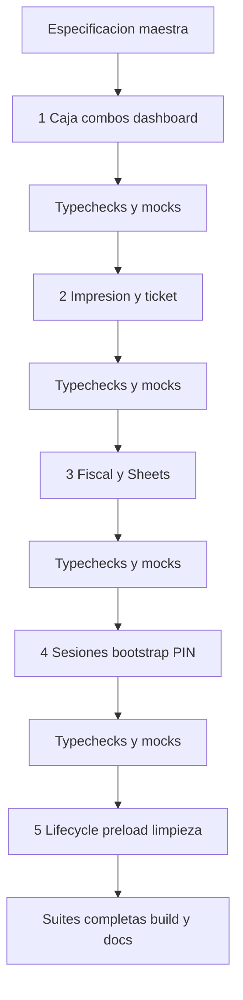

# SDD-099: Cierre integral de arquitectura y modulos

Estado: Implementacion parcial; cierre integral pendiente
Responsable: Equipo Borboto
Fecha / revision: 2026-11-09 / 1
Fuentes As-Built relacionadas: [05](05-reglas-sdd-y-convenciones.md), [06](06-auditoria-y-refactorizacion-por-modulo.md).

## Problema y alcance
Consolidar los 14 paquetes pendientes en cinco bloques ordenados. Incluido: contratos financieros, impresion, fiscalidad, sesiones, migraciones y aislamiento Electron. Excluido: ejecucion de PostgreSQL/Electron, conexiones al puerto 58432, integracion hardware y auditoria AXE real. No marcar hallazgos cerrados sin evidencia de implementacion y pruebas.

## Evidencia actual
Cobro exige solo cuota aunque cierra venta completa; corte toma sumas cliente; dashboard usa UTC y mezcla historial con estadisticas. Impresion, sincronizacion fiscal y lifecycle requieren cambios contractuales. Ver fuentes y hallazgos de 06.
Hipotesis comprobable del bloque 1: exigir total neto completo y calcular corte desde pagos elimina discrepancias. Un mock que acepte $50 para cerrar $100 o inserte sumas cliente refuta la hipotesis.

## Reglas y criterios de aceptacion
| Bloque / paquete | REQ / AC observable | Contrato / propietario | Prueba requerida | Estado |
| --- | --- | --- | --- | --- |
| 1 / SDD-011 | CJ-01/02: division informativa, efectivo cubre total neto, cero tras descuento valido, puntos configurados; ticket subtotal/descuento/neto/cuota | cobrar, CajaService, templates | Cuenta 100/50 rechazada, cero permitido, centavos y puntos | Pendiente |
| 1 / SDD-012 | CJ-03: corte SQL autoritativo serializado e idempotente; error carga bloquea UI | corte, CorteCajaDialog | Mock pagos/sumas falsas, doble corte, fallo GET | Pendiente |
| 1 / SDD-015 | AD-02/03: combos/promociones atomicos, borrado desactiva, error propagado, UI alcance real | db sync, CRUD promos, Ajustes | Rollback sync/borrado y evento postcommit | Pendiente |
| 1 / SDD-016 | DV-01/02/03: fechas locales, historial global por folio, estadisticas no pisan busqueda | Dashboard y HTTP | Dia local, HOY acotado, busqueda antigua | Pendiente |
| 2 / SDD-013 | IM-01/02: no marcar impresion fallida/ausente, reintento seguro, pago ausente 404, RAW ok=false falla | printer service/routes, reprint | Mocks RED/USB/fallback/ausente | Pendiente |
| 2 y 5 / SDD-022 | IM-03/AD-05: ticket aislado/contextual; importacion validada, referencias/deprecaciones y docs | TicketModal, importar, archivos legacy | DOM/RAW/mocks lote y busqueda imports | Pendiente |
| 3 / SDD-017 | FA-01: receipt neto conciliado sin locks durante HTTP; vigencia configurada; recuperacion externa definida | cobrar/Facturapi | Descuento, centavos, fallo externo postcommit | Pendiente |
| 3 / SDD-018 | FA-02: identidad invoice/receipt, sin match por monto, draft->UUID atomico | sincronizarFacturas | FK existente, UUID nuevo, rollback | Pendiente |
| 3 / SDD-019 | FA-03/04: token nunca expuesto, timer limpiado, conteo falla cerrado, secretos preservados por SQL atomico | Sheets y configuracion | URL/log sin token, fallo SQL, mascara concurrente | Pendiente |
| 4 / SDD-005 | AU-01: sesion HMAC con exp/rol y autorizacion backend; interceptor API | auth/backend/app.config | 401/403 sin mutacion, token valido | Pendiente |
| 4 / SDD-006 | AU-02/03: fallo red no bootstrap, registro Electron previo, bootstrap exclusivo, PIN scrypt compatible y rate limit | auth/Login/usuarios | Bootstrap doble, PIN legado/hash, red | Pendiente |
| 5 / SDD-007 | EP-01: migration client retenido, init no destructivo sobre tablas existentes, cluster propio | db/main | SQL/orden y comandos sin taskkill global | Pendiente |
| 5 / SDD-020 | EP-02: preload allowlist, renderer aislado, bridge tipado sin require arbitrario | preload/main/Angular/license | IPC/payloads autorizados y rechazo | Pendiente |
| 5 / SDD-021 | EP-03/04: licencia fecha real, timeout dev y cierre/URLs coherentes | main/licencia/runtime | Fechas invalidas, reloj/timeout/puerto mocks | Pendiente |

## Contratos
HTTP conserva rutas y aliases; cambios deliberados: corte/cobro autoritativos, 404 reprint, 401/403 endpoints sensibles. Division no es pago parcial. Sesion contiene id,rol,exp y firma HMAC; cliente transmite Bearer solo API propia. IPC solo API allowlist expuesta por preload. Errores de infraestructura no equivalen a resultados de negocio vacios. Socket invalidaciones solo despues de confirmacion local. NUMERIC convertido y redondeado a centavos; fechas de filtros locales.

## Datos y estados
Migracion aditiva prevista 005_pin_hash.sql: ampliar usuarios.pin de VARCHAR(6) a TEXT, sin borrar ni transformar PINs existentes; migracion transparente al autenticar. Sesiones HMAC en memoria caducan a las 12 horas y al reiniciar servidor.
BEGIN/COMMIT/ROLLBACK siempre en client retenido. Locks por usuario para corte/bootstrap, comanda para ciclo, transaccion para combos/migraciones. Efectos fiscales externos despues de pago confirmado no se revierten con SQL: registrar fallo recuperable sin falsificar cierre. PIN legado migra a hash al login. Clusters ajenos no se terminan. Especificar migraciones adicionales antes de cambios destructivos.

## Diseno propuesto
Cinco bloques estrictamente secuenciales; usar servicios actuales y helpers pequenos donde reducen contratos duplicados. Cada bloque requiere typechecks antes del siguiente.

## Seguridad, operacion y accesibilidad
Sin secretos en URLs/logs/respuestas. Autorizacion por rol backend, bootstrap exclusivo y PIN seguro. Bridge IPC valida canales/payloads; contextIsolation habilitado y nodeIntegration deshabilitado al entregar aislamiento. UI deshabilita confirmaciones repetidas/fallidas. No prometer AXE/hardware real mediante mocks.

## Plan de verificacion
Suite persistente backend-borboto/tests/sdd-099-cierre.test.cjs junto con sdd-008/010/014/009, usando handlers/clases aislados y mocks pg/HTTP/clock/DOM/IPC. Nunca importar arranque real del backend/main en pruebas.
Tras cada bloque: bun x tsc --noEmit -p backend-borboto/tsconfig.json, tsconfig.app.json y tsconfig.json. Cierre: bun run build:server, node --check server.js, enlaces Markdown y git diff --check. Matriz anterior vincula requisitos a pruebas; resultados y pendientes deben registrarse explicitamente.

## Entrega y decisiones
Orden y alcance aprobados por solicitud del usuario. Documentos 01..06 solo pueden declarar implementados los paquetes cuya evidencia exista. El objetivo de cierre 100% no autoriza sustituir pruebas faltantes por declaraciones. Estado inicial: ningun bloque de este paquete cerrado; evidencia se actualizara tras gates.

## Estado de entrega
Los cinco bloques tienen cambios de codigo y typechecks ejecutados en orden. La tabla inicial de criterios conserva los gates requeridos; esta tabla registra el avance vigente.

| Paquetes | Estado actual | Evidencia / pendiente |
| --- | --- | --- |
| SDD-005/006 | Implementado con mocks | HMAC/rol, bootstrap exclusivo, PIN scrypt/legado, interceptor y error red/reintento; migracion 005 solo escrita, no aplicada en PostgreSQL |
| SDD-007 | Implementado; integracion real no ejecutada | Client retenido y marcador init protegido; cluster propio sin taskkill global/postmaster.pid; prueba de client/rollback |
| SDD-011/012 | Implementado con mocks | Pago completo/neto cero/puntos/ticket; corte SQL serializado, diferencias servidor y duplicado rechazado |
| SDD-013 | Parcial | Claim SKIP LOCKED, marcado por destino, RAW negativo y reprint 404; falta confirmacion durable por impresora y recuperacion si envio externo ocurre antes de fallo COMMIT |
| SDD-015/016 | Implementado con mocks | Transaccion promo/combo, desactivacion previa, alcance real; fechas locales y busqueda independiente |
| SDD-017 | Parcial | Receipt postcommit, neto exacto desglosado y vigencia local; falta outbox/conciliacion durable de receipt remoto si INSERT local falla, sin asumir idempotencia del proveedor |
| SDD-018/019 | Implementado con mocks | Draft->UUID e identidad verificada transaccional; no monto/FK inexistente; Sheets redaccion/timer/conteo; preservacion SQL atomica de keys |
| SDD-020/021 | Implementado con mocks; integracion real no ejecutada | Preload allowlist, Node deshabilitado, aislamiento, puerto efectivo, licencia fecha real y shutdown compartido/limite 30 s; timeout informa cierre incompleto |
| SDD-022 | Implementado; verificacion UI/hardware limitada | Ticket contextual/ventana aislada, lote por fila, uploads escribibles/JSON, legacy deprecado tras buscar imports, docs corregidos |

Decisiones necesarias para cierre integral: contrato durable de trabajos/confirmacion de impresion y protocolo de idempotencia/conciliacion de Facturapi para no duplicar efectos remotos. No se simula que esas garantias ya existen. AXE, impresora, instalador y motor SQL reales excluidos por entorno.

Evidencia local: suite maestra 21 pruebas aprobadas; conjunto sdd-008/010/014/009/099: 49 aprobadas, 0 fallos. Los tres typechecks pasan con 0 errores; bundle regenerado mediante bun run build:server; node --check server.js, main.js y preload.js validos. Enlaces documentales y git diff --check validos. No se inicio PostgreSQL ni Electron ni se conecto puerto 58432. GOOGLE_SHEET_TOKEN debe configurarse por entorno, sin fallback secreto embebido. Estos gates no cierran los contratos durables pendientes de SDD-013/017.