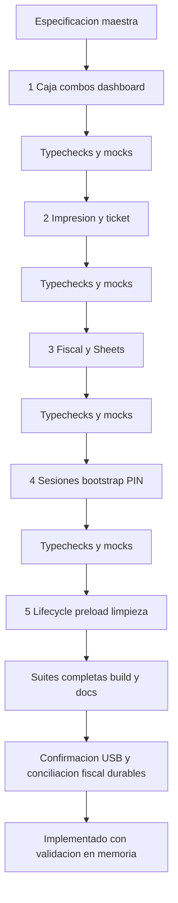

# SDD-099: Cierre integral de arquitectura y modulos

Estado: Implementado
Responsable: Equipo Borboto
Fecha / revision: 2026-11-09 / 2 (cierre durable)
Fuentes As-Built relacionadas: [05](05-reglas-sdd-y-convenciones.md), [06](06-auditoria-y-refactorizacion-por-modulo.md).

## Problema y alcance
Consolidar los 14 paquetes pendientes en cinco bloques ordenados. Incluido: contratos financieros, impresion, fiscalidad, sesiones, migraciones y aislamiento Electron. Excluido: ejecucion de PostgreSQL/Electron, conexiones al puerto 58432, integracion hardware y auditoria AXE real. No marcar hallazgos cerrados sin evidencia de implementacion y pruebas.

## Evidencia actual
Evidencia inicial: cobro exigia solo cuota aunque cerraba venta completa; corte tomaba sumas cliente; dashboard usaba UTC y mezclaba historial con estadisticas. Los cinco bloques y los dos contratos durables finales estan implementados; ver estado de entrega y pruebas. Ver fuentes y hallazgos historicos de 06.
Hipotesis comprobable del bloque 1: exigir total neto completo y calcular corte desde pagos elimina discrepancias. Un mock que acepte $50 para cerrar $100 o inserte sumas cliente refuta la hipotesis.

## Reglas y criterios de aceptacion
| Bloque / paquete | REQ / AC observable | Contrato / propietario | Prueba requerida | Estado |
| --- | --- | --- | --- | --- |
| 1 / SDD-011 | CJ-01/02: division informativa, efectivo cubre total neto, cero tras descuento valido, puntos configurados; ticket subtotal/descuento/neto/cuota | cobrar, CajaService, templates | Cuenta 100/50 rechazada, cero permitido, centavos y puntos | Implementado |
| 1 / SDD-012 | CJ-03: corte SQL autoritativo serializado e idempotente; error carga bloquea UI | corte, CorteCajaDialog | Mock pagos/sumas falsas, doble corte, fallo GET | Implementado |
| 1 / SDD-015 | AD-02/03: combos/promociones atomicos, borrado desactiva, error propagado, UI alcance real | db sync, CRUD promos, Ajustes | Rollback sync/borrado y evento postcommit | Implementado |
| 1 / SDD-016 | DV-01/02/03: fechas locales, historial global por folio, estadisticas no pisan busqueda | Dashboard y HTTP | Dia local, HOY acotado, busqueda antigua | Implementado |
| 2 / SDD-013 | IM-01/02: RED confirma solo null, USB itemIds/ack explicito, fallo conserva pendientes, RAW/reprint | printer service/routes, Comanda y PrinterService UI | USB exito/fallo/ack perdido, destinos separados, endpoint y ack idempotente | Implementado |
| 2 y 5 / SDD-022 | IM-03/AD-05: ticket aislado/contextual; importacion validada, referencias/deprecaciones y docs | TicketModal, importar, archivos legacy | DOM/RAW/mocks lote y busqueda imports | Implementado |
| 3 / SDD-017 | FA-01: receipt neto postcommit, vigencia e intento durable por pago, external_id y conciliacion sin duplicar | cobrar, fiscal-receipts.service, endpoint y sync | Fallo INSERT/reinicio/respuesta perdida/concurrencia/visibilidad tardia con un create | Implementado |
| 3 / SDD-018 | FA-02: identidad invoice/receipt, sin match por monto, draft->UUID atomico | sincronizarFacturas | FK existente, UUID nuevo, rollback | Implementado |
| 3 / SDD-019 | FA-03/04: token nunca expuesto, timer limpiado, conteo falla cerrado, secretos preservados por SQL atomico | Sheets y configuracion | URL/log sin token, fallo SQL, mascara concurrente | Implementado |
| 4 / SDD-005 | AU-01: sesion HMAC con exp/rol y autorizacion backend; interceptor API | auth/backend/app.config | 401/403 sin mutacion, token valido | Implementado |
| 4 / SDD-006 | AU-02/03: fallo red no bootstrap, registro Electron previo, bootstrap exclusivo, PIN scrypt compatible y rate limit | auth/Login/usuarios | Bootstrap doble, PIN legado/hash, red | Implementado |
| 5 / SDD-007 | EP-01: migration client retenido, init no destructivo sobre tablas existentes, cluster propio | db/main | SQL/orden y comandos sin taskkill global | Implementado |
| 5 / SDD-020 | EP-02: preload allowlist, renderer aislado, bridge tipado sin require arbitrario | preload/main/Angular/license | IPC/payloads autorizados y rechazo | Implementado |
| 5 / SDD-021 | EP-03/04: licencia fecha real, timeout dev y cierre/URLs coherentes | main/licencia/runtime | Fechas invalidas, reloj/timeout/puerto mocks | Implementado |

## Contratos
Revision de cierre durable implementada: produccion USB devuelve itemIds por destino y no marca impreso al generar; POST /api/impresoras/confirmar-impresion valida entre 1 y 2000 IDs enteros positivos y confirma solo tras exito RAW/IPC (400 datos invalidos, 500 fallo SQL). Repetir confirmacion es idempotente y conserva impreso_en original. RED confirma solo retorno null. Sin ack, items pendientes son recuperables desde la consulta de produccion existente. Un ack perdido puede implicar reimpresion; no se promete entrega fisica exactamente una vez con dispositivos sin protocolo de idempotencia. Confirmacion autorizada para operadores con sesion, igual que RAW.

Revision fiscal durable: migracion 006 crea intentos_autofactura por pago_id, con solicitud JSON, estado, fechas y evidencia de error generica. Helper compartido por cobro, POST /api/caja/pagos/:pagoId/autofactura y reconciliacion serializa por pago mediante advisory lock de sesion (sin locks de filas de comanda/mesa durante HTTP). Primero reutiliza ticket local, despues busca receipt remoto por external_id exacto String(pagoId); solo un intento nuevo puede ejecutar receipts.create. Persiste estado EMITIENDO antes del efecto remoto. Un intento EMITIENDO/RECONCILIAR sin receipt visible devuelve conflicto recuperable, nunca crea otro ciegamente. Reconciliacion posterior recupera por external_id y hace upsert por facturapi_receipt_id; no duplica pagos ni extiende vigencia configurada. La garantia de no duplicar no asume consistencia inmediata de la busqueda del proveedor.

POST /api/caja/pagos/:pagoId/autofactura devuelve {ok:true,pagoId,autofactura:{codigo,url,expiracion}}; 400 ID invalido, 404 Pago no encontrado, 409 emision ambigua/incompatibilidad/configuracion ausente, 503 proveedor/persistencia pendientes. Requiere ADMIN/CAJERO via middleware de caja. La sincronizacion procesa hasta 50 intentos por invocacion y refleja pendientes en su resultado. Si una emision ambigua nunca aparece en el proveedor, se mantiene bloqueada para conciliacion en lugar de emitir otro recibo automaticamente. El cliente de cobro se libera tras COMMIT antes de usar el helper para evitar agotamiento del pool.

Pruebas de cierre adicionales: USB generado conserva false; exito RAW/IPC confirma itemIds, fallo no confirma; fallo de INSERT local tras receipts.create deja intento durable y reintento/sync recupera receipt existente con una sola creacion; concurrencia por pago y busqueda fallida/ambigua no crean recibos adicionales. Sin PostgreSQL/Electron reales.
HTTP conserva rutas y aliases; cambios deliberados: corte/cobro autoritativos, 404 reprint, 401/403 endpoints sensibles. Division no es pago parcial. Sesion contiene id,rol,exp y firma HMAC; cliente transmite Bearer solo API propia. IPC solo API allowlist expuesta por preload. Errores de infraestructura no equivalen a resultados de negocio vacios. Socket invalidaciones solo despues de confirmacion local. NUMERIC convertido y redondeado a centavos; fechas de filtros locales.

## Datos y estados
Migracion [006_intentos_autofactura.sql](../../Database/migrations/006_intentos_autofactura.sql): intento por pago con FK, solicitud JSONB y estados PENDIENTE/EMITIENDO/RECONCILIAR/CONFIRMADO. Creada pero no aplicada en este entorno. Implementacion en [fiscal-receipts.service.ts](../../backend-borboto/src/services/fiscal-receipts.service.ts); no guarda secretos del proveedor ni reescribe el pago. No es una transaccion distribuida: conserva evidencia previa al efecto HTTP y resuelve ambiguedad mediante identidad remota.
Migracion aditiva prevista 005_pin_hash.sql: ampliar usuarios.pin de VARCHAR(6) a TEXT, sin borrar ni transformar PINs existentes; migracion transparente al autenticar. Sesiones HMAC en memoria caducan a las 12 horas y al reiniciar servidor.
BEGIN/COMMIT/ROLLBACK siempre en client retenido. Locks por usuario para corte/bootstrap, comanda para ciclo, transaccion para combos/migraciones. Efectos fiscales externos despues de pago confirmado no se revierten con SQL: registrar fallo recuperable sin falsificar cierre. PIN legado migra a hash al login. Clusters ajenos no se terminan. Especificar migraciones adicionales antes de cambios destructivos.

## Diseno propuesto
Cinco bloques estrictamente secuenciales; usar servicios actuales y helpers pequenos donde reducen contratos duplicados. Cada bloque requiere typechecks antes del siguiente.

## Seguridad, operacion y accesibilidad
Sin secretos en URLs/logs/respuestas. Autorizacion por rol backend, bootstrap exclusivo y PIN seguro. Bridge IPC valida canales/payloads; contextIsolation habilitado y nodeIntegration deshabilitado al entregar aislamiento. UI deshabilita confirmaciones repetidas/fallidas. No prometer AXE/hardware real mediante mocks.

## Plan de verificacion
Suite persistente backend-borboto/tests/sdd-099-cierre.test.cjs junto con sdd-008/010/014/009, usando handlers/clases aislados y mocks pg/HTTP/clock/DOM/IPC. Nunca importar arranque real del backend/main en pruebas.
Tras cada bloque: bun x tsc --noEmit -p backend-borboto/tsconfig.json, tsconfig.app.json y tsconfig.json. Cierre: bun run build:server, node --check server.js, enlaces Markdown y git diff --check. Matriz anterior vincula requisitos a pruebas; resultados y pendientes deben registrarse explicitamente.

## Entrega y decisiones
Orden y alcance aprobados por solicitud del usuario. Cierre global Implementado para los contratos SDD-001..SDD-022, incluidos SDD-013/017 finales. La evidencia es de arneses en memoria y verificacion estatica; no una certificacion SQL/hardware/proveedor en produccion.

## Estado de entrega
Los cinco bloques tienen cambios de codigo y typechecks ejecutados en orden. La tabla inicial de criterios conserva los gates requeridos; esta tabla registra el avance vigente.

| Paquetes | Estado actual | Evidencia / pendiente |
| --- | --- | --- |
| SDD-005/006 | Implementado con mocks | HMAC/rol, bootstrap exclusivo, PIN scrypt/legado, interceptor y error red/reintento; migracion 005 solo escrita, no aplicada en PostgreSQL |
| SDD-007 | Implementado; integracion real no ejecutada | Client retenido y marcador init protegido; cluster propio sin taskkill global/postmaster.pid; prueba de client/rollback |
| SDD-011/012 | Implementado con mocks | Pago completo/neto cero/puntos/ticket; corte SQL serializado, diferencias servidor y duplicado rechazado |
| SDD-013 | Implementado | RED solo tras null; USB conserva false y devuelve itemIds; ack validado/idempotente tras exito RAW/IPC; fallo deja items pendientes, sin reimpresion automatica ante ack fallido |
| SDD-015/016 | Implementado con mocks | Transaccion promo/combo, desactivacion previa, alcance real; fechas locales y busqueda independiente |
| SDD-017 | Implementado | Intento durable previo, external_id por pago, lock de sesion y busqueda remota antes de crear; upsert local y recuperacion por endpoint/sync tras fallo INSERT o respuesta perdida; concurrencia crea una vez |
| SDD-018/019 | Implementado con mocks | Draft->UUID e identidad verificada transaccional; no monto/FK inexistente; Sheets redaccion/timer/conteo; preservacion SQL atomica de keys |
| SDD-020/021 | Implementado con mocks; integracion real no ejecutada | Preload allowlist, Node deshabilitado, aislamiento, puerto efectivo, licencia fecha real y shutdown compartido/limite 30 s; timeout informa cierre incompleto |
| SDD-022 | Implementado; verificacion UI/hardware limitada | Ticket contextual/ventana aislada, lote por fila, uploads escribibles/JSON, legacy deprecado tras buscar imports, docs corregidos |

Decisiones de cierre: ack explicito USB con estado persistido de items; intento fiscal durable y bloqueo de reemision ambigua. Cerrados los dos pendientes dentro de esos contratos. AXE, impresora, instalador, PostgreSQL, Electron y Facturapi reales no ejecutados; no se promete exactamente-una-vez de hardware ni disponibilidad inmediata del proveedor.

Evidencia final (2026-11-09): suite maestra 28 pruebas aprobadas; conjunto sdd-008/010/014/009/099: 56 aprobadas, 0 fallos. bun x tsc --noEmit en backend-borboto/tsconfig.json, tsconfig.app.json y tsconfig.json: 0 errores. bun run build:server y node --check server.js: PASS. Script de build usa --minify-whitespace para evitar whitespace heredado de comentarios de dependencias, sin renombrar simbolos ni editar bundle manualmente. git diff --check: PASS. Enlaces, anchors y fences Markdown verificados. Migracion 006 creada, no aplicada aqui. No se inicio PostgreSQL ni Electron ni se conecto puerto 58432; Facturapi/HTTP/pg/IPC simulados. GOOGLE_SHEET_TOKEN debe configurarse por entorno, sin fallback secreto embebido.